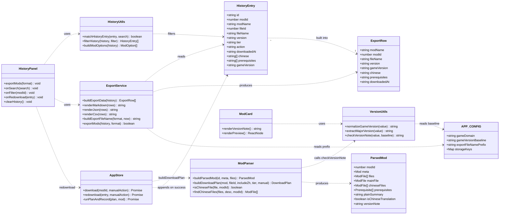
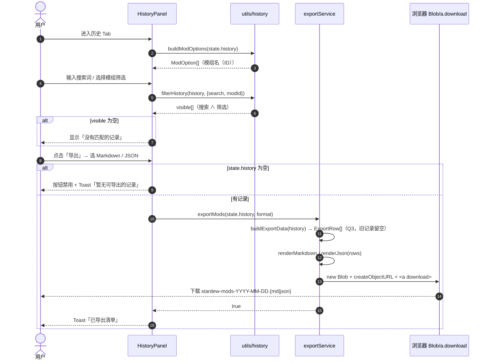
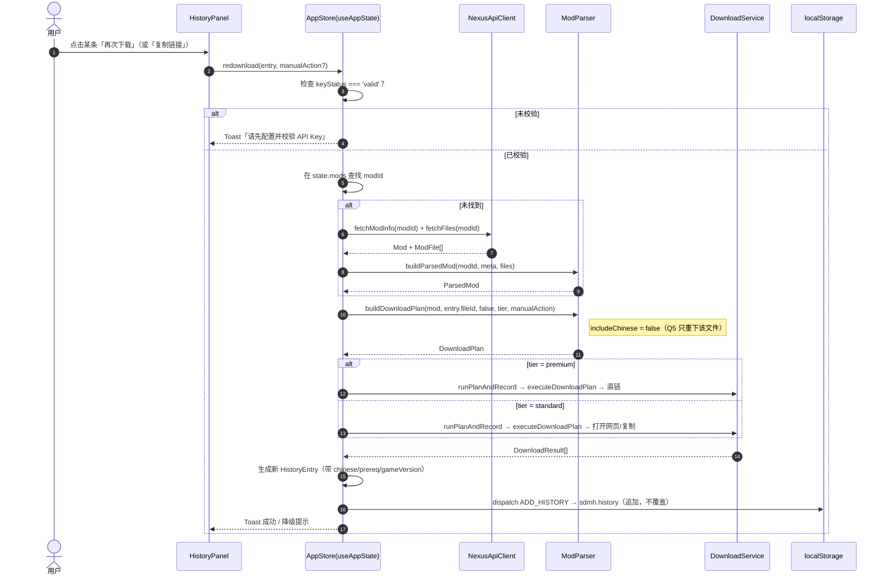
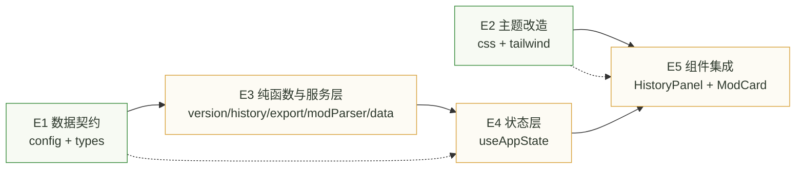

# 星露谷模组下载助手 — 增量架构设计与任务分解（v2）

> 文档版本：v2.0（增量文档）　|　架构师：高见远（Gao）　|　需求来源：`docs/PRD-v2.md`（许清楚 v2.0，唯一需求来源）
> 基线：`docs/DESIGN.md`（v1.0，R01–R22 已交付）　|　形态：纯静态 PWA，无后端
> 阅读约定：本文**只描述本次增量**，不重复 v1 全文。变更标记：**【修改】**＝在 v1 已有文件上最小改动；**【新增】**＝新文件。任务编号用 `E1…E5`，与 v1 的 `T01…T05` 区分。
> 核心纪律：**最小变更**——能改配置就不重写组件，能加可选字段就不改核心结构，能复用纯函数就不复制逻辑。

---

## 0. 增量概述（本次变更范围与受影响文件总览）

### 0.1 已拍板决策的落地方式（严格遵守，不再讨论）

| # | 主理人决策 | 本设计落地位置 |
| --- | --- | --- |
| Q1 | 导出做 Markdown + JSON（两种必做），共用一份组装数据；CSV 可选 | §3.1 `buildExportData()` 统一产出 `ExportRow[]`，三种 render 共用；UI 至少 MD/JSON |
| Q2 | 版本兼容提醒内置可配置基线，默认 `1.6`，放 `APP_CONFIG`；不加用户输入 | `APP_CONFIG.gameVersionBaseline = '1.6'`，`checkVersionNote()` 默认读它 |
| Q3 | 导出以下载历史 `history` 为准 | `exportMods(state.history, format)`，不读 `state.mods` |
| Q4 | 保留 v1 深色配色不变，仅默认主题改浅色，深色不重做 | `:root.dark` 变量原样保留；语义 chip 类在 `:root.dark` 下映射回 v1 观感 |
| Q5 | 再次下载默认只重下该记录文件，不自动附带汉化/前置 | `redownload()` 调用 `buildDownloadPlan(mod, entry.fileId, false, …)`，`includeChinese=false` |
| Q6 | 清空历史始终清空全部，二次确认文案写明"将清空全部记录" | `HistoryPanel` 清空按钮文案 + `aria-label` 改写，`clearHistory()` 逻辑不变 |
| Q7 | `HistoryEntry` 新字段不回溯旧记录，旧记录导出时新列留空 | 新字段全为可选 `?`；`buildExportData()` 用 `?? []` / `?? ''` 兜底 |

### 0.2 受影响文件总览

| 文件 | 类型 | 变更摘要 | 对应需求 |
| --- | --- | --- | --- |
| `src/config/index.ts` | 【修改】 | 增加 `gameVersionBaseline`、`exportFileNamePrefix` | R24 / R28 |
| `src/types/domain.ts` | 【修改】 | `HistoryEntry` 加 3 个可选字段；`ParsedMod` 加 `versionNote?` | R24 / R28 |
| `src/index.css` | 【修改】 | `:root` 改田园浅色变量；新增语义 chip 变量与类；focus 环改绿；`.app-card` 用 `shadow-card`；渐变变量 | R23 / R29 |
| `tailwind.config.js` | 【修改】 | `brand`/`accent`/`surface` 色阶、boxShadow.card | R23 |
| `src/data/prerequisites.ts` | 【修改】 | 加 SVE(3758)、名称型条目、补 aliases | R30 |
| `src/data/chineseKeywords.ts` | 【修改】 | 补关键词；`KNOWN_TRANSLATIONS` 填 TranslateAll(36170) | R31 |
| `src/services/modParser.ts` | 【修改】 | `buildParsedMod()` 派生 `versionNote`；修正汉化映射按 modId 查表 | R28 / R31 |
| `src/utils/version.ts` | 【新增】 | 版本提取/基线比对纯函数 | R28 |
| `src/utils/history.ts` | 【新增】 | 历史搜索 + 模组筛选 + 筛选项生成纯函数 | R25 / R26 |
| `src/services/exportService.ts` | 【新增】 | 导出数据组装 + MD/JSON(/CSV) 渲染 + 前端下载 | R24 |
| `src/hooks/useAppState.tsx` | 【修改】 | 默认主题改 light；新字段写入时机；新增 `redownload` | R23 / R24 / R27 |
| `src/components/HistoryPanel.tsx` | 【修改】 | 导出按钮、搜索框、模组筛选、再次下载、清空文案 | R24–R27 / R23 |
| `src/components/ModCard.tsx` | 【修改】 | 预览放大、作者独立行、摘要浅底块、田园占位、chip 换语义类、版本提醒 chip | R23 / R28 / R29 |

**明确【不变】的文件（本次不动，回归时只需确认未受影响）**：
`package.json`、`index.html`、`vite.config.ts`、`tsconfig*.json`、`postcss.config.js`、`public/*`、`src/main.tsx`、`src/vite-env.d.ts`、`src/types/nexus.ts`、`src/services/nexusApi.ts`、`src/services/downloadService.ts`、`src/utils/bbcode.ts`、`src/utils/format.ts`、`src/utils/download.ts`、`src/utils/errors.ts`、`src/hooks/useLocalStorage.ts`、`src/hooks/useToast.tsx`、`src/components/ui/*`（含 `EmptyState.tsx`，田园装饰用 CSS/局部 SVG 解决，不改它）、`StatusBar.tsx`、`ApiKeyPanel.tsx`、`ModIdInput.tsx`、`FileList.tsx`、`PrerequisiteList.tsx`、`DownloadActions.tsx`、`TabBar.tsx`、`App.tsx`。

> 变更面集中在 **13 个文件（11 改 + 3 新增，其中 modParser 兼两项）**，v1 的网络层、下载执行层、状态基础结构完全不动，回归风险可控。

---

## 1. 数据与类型变更（仅列变更类型）

### 1.1 `src/types/domain.ts`

```ts
/** 【修改】单个模组聚合后的领域对象（UI 直接消费） */
export interface ParsedMod {
  modId: number;
  meta: Mod;
  files: ModFile[];
  mainFile: ModFile | null;
  chineseFiles: ModFile[];
  prerequisites: Prerequisite[];
  plainSummary: string;
  isChineseTranslation: boolean;
  /** 【新增】版本兼容提醒文案：由 buildParsedMod 基于主文件派生；无风险/无版本时不写此字段 */
  versionNote?: string;
}

/** 【修改】下载历史条目 */
export interface HistoryEntry {
  id: string;
  modId: number;
  modName: string;
  fileId: number;
  fileName: string;
  version: string;
  tier: PremiumTier;
  action: DownloadAction;
  downloadedAt: string;
  /** 【新增】下载时一并带入的汉化文件名；旧记录无此字段，导出留空（Q7） */
  chinese?: string[];
  /** 【新增】下载时识别到的前置名称；旧记录无此字段，导出留空（Q7） */
  prerequisites?: string[];
  /** 【新增】所选文件的游戏兼容版本（归一化字符串）；旧记录无此字段，导出留空（Q7） */
  gameVersion?: string;
}
```

> 其余领域类型（`Prerequisite` / `DownloadItem` / `DownloadPlan` / `DownloadResult` / `KeyValidationResult` / `AppState` / 各联合类型）**完全不变**。`AppState.history` 元素类型自动扩展，无需改 reducer 结构。

### 1.2 `src/config/index.ts`

```ts
export const APP_CONFIG = {
  appName: '星露谷模组下载助手',
  applicationName: 'stardew-mod-helper',
  applicationVersion: '1.0.0',
  gameDomain: 'stardewvalley',
  apiBaseUrl: 'https://api.nexusmods.com/v1/',
  webBaseUrl: 'https://www.nexusmods.com',
  /** 【新增 Q2】SMAPI 版本兼容基线，内置可配置，不引入用户输入 */
  gameVersionBaseline: '1.6',
  /** 【新增 Q1】导出文件名前缀，最终形如 stardew-mods-2026-06-01.md */
  exportFileNamePrefix: 'stardew-mods',
  storageKeys: {
    apiKey: 'sdmh.apiKey',
    history: 'sdmh.history',
    theme: 'sdmh.theme',
    lastIds: 'sdmh.lastIds',
  },
} as const;
```

> `apiPath` 完全不变。

### 1.3 `src/hooks/useAppState.tsx` 中的 `AppActions`

```ts
export interface AppActions {
  setKey(apiKey: string): void;
  clearKey(): void;
  validate(): Promise<void>;
  setIdsInput(value: string): void;
  resolveMods(input?: string): Promise<void>;
  selectFile(modId: number, fileId: number): void;
  toggleChinese(modId: number): void;
  download(modId: number, manualAction?: 'open' | 'copy'): Promise<void>;
  /** 【新增 R27】按历史记录再次下载；默认仅重下该记录文件，不带汉化/前置（Q5） */
  redownload(entry: HistoryEntry, manualAction?: 'open' | 'copy'): Promise<void>;
  setTheme(theme: ThemeMode): void;
  setTab(tab: TabKey): void;
  clearHistory(): void;
}
```

> `ReducerAction` 无需新增分支：`redownload` 成功后复用现有 `ADD_HISTORY` 即可。

### 1.4 字段写入时机（关键共享约定）

新字段**只在下载成功的那一刻**从 `ParsedMod` 带出，写入位置是 `useAppState.tsx` 中 `download()` / `redownload()` 生成 `HistoryEntry` 的 `.map()`（见 §3.5 的 `runPlanAndRecord`）：

```ts
chinese: mod.chineseFiles.map((f) => f.file_name),      // 汉化文件名
prerequisites: mod.prerequisites.map((p) => p.name),    // 前置名称（含名称型）
gameVersion: normalizeGameVersion(result.item.file.game_version),
```

**绝不**回溯改写 `localStorage` 里的旧记录（Q7），导出时用 `?? []` / `?? ''` 兜底。

---

## 2. 主题改造方案（R23）

### 2.1 `src/index.css`：CSS 变量（浅色田园）

把 `:root`（现为冷灰蓝）替换为下表；`:root.dark` 原有 6 个变量**原样保留**（Q4），仅追加 chip 变量的深色映射。

| 变量 | 浅色值（`:root`） | 深色值（`:root.dark`，新增覆盖） |
| --- | --- | --- |
| `--app-bg` | `#F7FAF3` | `#0f172a`（不变） |
| `--app-surface` | `#FFFFFF` | `#1e293b`（不变） |
| `--app-surface-raised` | `#FDFBF4` | `rgba(30,41,59,0.8)`（不变） |
| `--app-text` | `#2F3A2E` | `#e2e8f0`（不变） |
| `--app-muted` | `#6B7A66` | `#94a3b8`（不变） |
| `--app-border` | `rgba(95,174,87,0.16)` | `rgba(148,163,184,0.14)`（不变） |
| `--app-bg-image` | `linear-gradient(180deg,#F7FAF3,#EFF5E6)` | `none` |
| `--chip-main-bg/fg` | `#E7F4E4` / `#3F8F42` | `rgba(56,189,248,0.15)` / `#38bdf8` |
| `--chip-chinese-bg/fg` | `#FBF1D6` / `#9A6B12` | `rgba(251,191,36,0.15)` / `#fbbf24` |
| `--chip-prereq-bg/fg` | `#E4F1EC` / `#2F7A5A` | `rgba(167,139,250,0.15)` / `#a78bfa` |
| `--chip-version-bg/fg` | `#FFF4E2` / `#A8631A` | `rgba(251,191,36,0.15)` / `#fbbf24` |
| `--chip-error-bg/fg` | `#FDECEC` / `#A94848` | `rgba(244,63,94,0.15)` / `#fb7185` |

关键代码改动（工程师按此落地）：

```css
:root {
  color-scheme: light;
  --app-bg: #F7FAF3;
  --app-bg-image: linear-gradient(180deg, #F7FAF3, #EFF5E6);
  --app-surface: #FFFFFF;
  --app-surface-raised: #FDFBF4;
  --app-text: #2F3A2E;
  --app-muted: #6B7A66;
  --app-border: rgba(95, 174, 87, 0.16);
  --chip-main-bg: #E7F4E4;     --chip-main-fg: #3F8F42;
  --chip-chinese-bg: #FBF1D6;  --chip-chinese-fg: #9A6B12;
  --chip-prereq-bg: #E4F1EC;   --chip-prereq-fg: #2F7A5A;
  --chip-version-bg: #FFF4E2;  --chip-version-fg: #A8631A;
  --chip-error-bg: #FDECEC;    --chip-error-fg: #A94848;
}

:root.dark {
  color-scheme: dark;
  /* 以下 6 行 = v1 原值，禁止改动 */
  --app-bg: #0f172a;
  --app-surface: #1e293b;
  --app-surface-raised: rgba(30, 41, 59, 0.8);
  --app-text: #e2e8f0;
  --app-muted: #94a3b8;
  --app-border: rgba(148, 163, 184, 0.14);
  --app-bg-image: none;
  /* 语义 chip 在深色下映射回 v1 观感（低透明底 + 亮字） */
  --chip-main-bg: rgba(56, 189, 248, 0.15);    --chip-main-fg: #38bdf8;
  --chip-chinese-bg: rgba(251, 191, 36, 0.15); --chip-chinese-fg: #fbbf24;
  --chip-prereq-bg: rgba(167, 139, 250, 0.15); --chip-prereq-fg: #a78bfa;
  --chip-version-bg: rgba(251, 191, 36, 0.15); --chip-version-fg: #fbbf24;
  --chip-error-bg: rgba(244, 63, 94, 0.15);    --chip-error-fg: #fb7185;
}

/* body：加柔和渐变，深色下自动关闭 */
body {
  background-color: var(--app-bg);
  background-image: var(--app-bg-image);
  background-attachment: fixed;
  /* 其余 v1 属性保留 */
}

/* 焦点环：#22c55e → #5FAE57 */
:focus-visible { outline: 2px solid #5FAE57; outline-offset: 2px; }

@layer components {
  /* .app-card 的 shadow-lg 改为 shadow-card（配合 tailwind 柔和绿影） */
  .app-card { @apply rounded-2xl shadow-card border; /* 其余不变 */ }

  /* 【新增】语义 chip：浅底深字 / 深色下由变量映射回 v1 */
  .chip--main     { background: var(--chip-main-bg);    color: var(--chip-main-fg); }
  .chip--chinese  { background: var(--chip-chinese-bg); color: var(--chip-chinese-fg); }
  .chip--prereq   { background: var(--chip-prereq-bg);  color: var(--chip-prereq-fg); }
  .chip--version  { background: var(--chip-version-bg); color: var(--chip-version-fg); }
  .chip--error    { background: var(--chip-error-bg);   color: var(--chip-error-fg); }
}
```

> 使用方式：把组件里的 `chip bg-sky-500/15 text-sky-400` 换成 `chip chip--main`（其余 chip 同理，见 §5 E5）。这样组件零配色逻辑，深浅主题自动切换。

### 2.2 `tailwind.config.js`

```js
colors: {
  brand:   { 400: '#86C96B', 500: '#5FAE57', 600: '#3F8F42' },
  accent:  { 400: '#E8C46A', 500: '#D9A441' },
  surface: { DEFAULT: '#FFFFFF', raised: '#FDFBF4' },
},
boxShadow: {
  card: '0 8px 24px -12px rgba(63, 143, 66, 0.18)', // 柔和绿影，避免深色重阴影
},
```

> `darkMode: 'class'`、字体栈、content 均不变。**注意**：当前源码未使用 Tailwind 的 `bg-surface*` 工具类（卡片走 `var(--app-surface-*)`），故改 `surface` 浅色值不会破坏深色；工程师若发现新增代码需要 surface 底色，统一用 `var(--app-surface-*)` 而非 Tailwind 类。

### 2.3 默认主题切换（两个点，缺一不可）

| 位置 | v1 | v2 | 说明 |
| --- | --- | --- | --- |
| `useAppState.tsx` L195 `useLocalStorage<ThemeMode>(key, 'dark')` | `'dark'` | **`'light'`** | 新用户无存储时的初始值 |
| `useAppState.tsx` L83 `createInitialState` 回退 | `theme === 'light' ? 'light' : 'dark'` | **`theme === 'dark' ? 'dark' : 'light'`** | 防御异常值，默认落 light |

**老用户 `dark` 偏好不被覆盖的论证**：`useLocalStorage` 仅在 `localStorage.getItem(key) === null` 时返回 `initial`（见 `useLocalStorage.ts` L13–16）。老用户已存 `sdmh.theme = "dark"` → 读出 `'dark'` → `createInitialState('dark')` → 命中 `theme === 'dark'` → 返回 `'dark'` ✅。新用户无存储 → initial `'light'` → 返回 `'light'` ✅。`useEffect` 的 `classList.toggle('dark', …)` 逻辑不变。主题切换按钮（StatusBar）不动。

### 2.4 标签 chip 浅底深字方案

用 §2.1 的 `.chip--*` 语义类统一处理，避免在每个组件写 `dark:` 前缀。映射表：

| 语义 | 组件 | 旧 class | 新 class | 浅底/深字 |
| --- | --- | --- | --- | --- |
| 主文件 | ModCard | `bg-sky-500/15 text-sky-400` | `chip--main` | `#E7F4E4`/`#3F8F42` |
| 汉化可用 | ModCard / HistoryPanel | `bg-accent-400/15 text-accent-400` | `chip--chinese` | `#FBF1D6`/`#9A6B12` |
| 需前置 | ModCard | `bg-violet-500/15 text-violet-400` | `chip--prereq` | `#E4F1EC`/`#2F7A5A`（由紫调改田园青绿） |
| 版本提醒 | ModCard（新增） | — | `chip--version` | `#FFF4E2`/`#A8631A`（暖橙，不用刺眼红） |
| 错误/失败 | ModCard（可选） | `text-rose-400` | `chip--error` | `#FDECEC`/`#A94848` |

> HistoryPanel 的下载动作 chip（一键直下/打开 N 网/复制链接）与 Premium chip 保持现状 `brand`/`accent` 透明类即可——它们在新 brand/accent 色阶下自动变绿/金，浅底对比度足够；如需统一也可换 `chip--main` / `chip--chinese`。

### 2.5 田园装饰（轻量，不过度）

- 页面渐变已由 `--app-bg-image` 落地（§2.1）。
- 预览失败占位：在 `ModCard.tsx` 内联一段叶片/幼苗 SVG（`currentColor` 取 `brand-500`，`opacity` 低），配文字"暂无预览图"，替换 v1 的像素游戏机 SVG（见 §5 E5）。
- 空状态 `EmptyState.tsx` **不改**：其插画在浅色下仍可见，`app-card` 已变浅底，无需重做。

---

## 3. 新模块与函数设计（全部给出函数签名）

### 3.1 `src/services/exportService.ts`【新增】

```ts
import { APP_CONFIG } from '../config';
import type { HistoryEntry } from '../types/domain';

export type ExportFormat = 'md' | 'json' | 'csv';

/** 导出中间结构：三种格式共用这一份组装数据（Q1） */
export interface ExportRow {
  modName: string;
  modId: number;
  fileName: string;
  version: string;
  gameVersion: string;     // 旧记录为 ''
  chinese: string;         // 顿号连接；旧记录为 ''
  prerequisites: string;   // 顿号连接；旧记录为 ''
  downloadedAt: string;    // ISO 8601 UTC
}

/** 从 history 组装导出数据（Q3：数据源唯一为 history） */
export function buildExportData(history: HistoryEntry[]): ExportRow[];

/** 渲染为 Markdown 表格（含标题、导出时间、条数） */
export function renderMarkdown(rows: ExportRow[]): string;

/** 渲染为稳定结构 JSON（JSON.stringify(rows, null, 2)） */
export function renderJson(rows: ExportRow[]): string;

/** 渲染为 CSV（UTF-8 BOM 前置，Excel 中文不乱码） */
export function renderCsv(rows: ExportRow[]): string;

/** 文件名：stardew-mods-YYYY-MM-DD.{md|json|csv}，日期取 new Date().toISOString().slice(0,10) */
export function buildExportFileName(format: ExportFormat, now?: Date): string;

/** 触发导出：组装 → 渲染 → Blob → <a download> → revokeObjectURL；空历史返回 false（不产生文件） */
export function exportMods(history: HistoryEntry[], format: ExportFormat): boolean;
```

实现要点：

- `buildExportData`：`chinese: (h.chinese ?? []).join('、')`，`prerequisites: (h.prerequisites ?? []).join('、')`，`gameVersion: h.gameVersion ?? ''`，`version: h.version || '—'`——这就是 Q7 的"旧记录留空"。
- 列顺序（三种格式一致）：`模组名 / ID / 文件 / 版本 / 游戏版本 / 汉化 / 前置 / 下载时间`。
- Markdown 单元格转义：`replace(/\|/g,'\\|').replace(/\r?\n/g,' ')`；CSV 单元格转义：`/"|,"|\r|\n/.test(v)` 时用双引号包裹并把 `"` 替成 `""`。
- Blob MIME：`md → text/markdown;charset=utf-8`、`json → application/json;charset=utf-8`、`csv → text/csv;charset=utf-8`。
- 纯前端：`URL.createObjectURL` + 临时 `<a>.click()` + `setTimeout(() => URL.revokeObjectURL(url), 1000)`；**不经任何网络**。
- UI 层（`HistoryPanel`）负责：空历史时禁用按钮并 Toast"暂无可导出的记录"；`exportMods()` 返回 `false` 时同样提示，返回 `true` 时 Toast"已导出 Markdown/JSON 清单"。

### 3.2 `src/utils/history.ts`【新增】——历史搜索与筛选纯函数

```ts
import type { HistoryEntry } from '../types/domain';

export interface HistoryFilter {
  search: string;             // 模糊词，大小写不敏感
  modId: number | 'all';      // 'all' = 全部模组
}

/** 大小写不敏感模糊匹配：modName / fileName / String(modId) 三选一命中即可；空词恒 true */
export function matchHistoryEntry(entry: HistoryEntry, search: string): boolean;

/** 组合筛选：模组筛选 ∧ 搜索，均满足才保留；不改变入参顺序（原 history 已按时间倒序） */
export function filterHistory(history: HistoryEntry[], filter: HistoryFilter): HistoryEntry[];

export interface ModOption {
  modId: number;
  label: string;              // "模组名（ID）"
}

/** 从 history 按 modId 去重生成筛选项，按 label 用 localeCompare('zh-CN') 排序 */
export function buildModOptions(history: HistoryEntry[]): ModOption[];
```

实现要点：

- `matchHistoryEntry`：`const q = search.trim().toLowerCase(); if (!q) return true;` 然后对三个字段 `.toLowerCase().includes(q)`（`modId` 用 `String(entry.modId)`）。
- `buildModOptions` 用 `Map<number, string>`（同 modId 保留首次出现的名称），再 `Array.from(map, ([modId, name]) => ({ modId, label: `${name}（${modId}）` }))`。
- 组件内用 `useMemo` 包裹两次调用，`history`/`search`/`modId` 变化时重算。

### 3.3 `src/utils/version.ts`【新增】——版本提醒纯函数（Q2）

```ts
import { APP_CONFIG } from '../config';

/** 归一化 game_version（string[] | string | null | undefined）为可读字符串：数组用顿号连接 */
export function normalizeGameVersion(
  value: string[] | string | null | undefined,
): string;

/** 提取主版本 x.y，如 ["1.6.8"] → "1.6"、"1.7" → "1.7"；无法解析返回 null */
export function extractMajorVersion(
  value: string[] | string | null | undefined,
): string | null;

/** 版本兼容提醒：与基线主版本不一致返回温和文案（"可能失效/建议核对"），一致或无信息返回 null */
export function checkVersionNote(
  gameVersion: string[] | string | null | undefined,
  baseline: string = APP_CONFIG.gameVersionBaseline,
): string | null;
```

实现要点：

- `extractMajorVersion`：`const raw = Array.isArray(value) ? value[0] : value; const m = typeof raw === 'string' ? raw.match(/\d+\.\d+/) : null; return m ? m[0] : null;`
- `checkVersionNote`：`major` 或 `baselineMajor` 为空 → `null`；两者相等 → `null`；否则返回：
  `"此模组标注游戏版本 ${major}，与当前推荐版本 ${baselineMajor} 不一致，可能存在失效风险，建议核对后再下载。"`
- **绝不返回阻断性措辞**（禁止"禁止下载/不兼容/错误"等），不参与 `buildDownloadPlan` 的任何分支。

### 3.4 `src/services/modParser.ts`【修改】——两处增量

**(a) `buildParsedMod()` 派生版本提醒**（在现有返回对象里加一行，不改签名）：

```ts
export function buildParsedMod(modId: number, meta: Mod, files: ModFile[]): ParsedMod {
  // …v1 逻辑不变
  const versionFile = pickMainFile(safeFiles);          // 主文件作为默认基准
  return {
    // …v1 字段不变
    versionNote: checkVersionNote(versionFile?.game_version) ?? undefined,
  };
}
```

> 用户在卡片里切换文件后，`ModCard` 用选中文件的 `game_version` 再调用一次 `checkVersionNote()` 覆盖展示（§5 E5），ParsedMod 的 `versionNote` 作为默认基准。这样既不改解析签名，又能对选中文件实时准确。

**(b) 修正汉化映射查表键（R31 的必要配套）**：

v1 现状：`isChineseFile()` L80 用 `KNOWN_TRANSLATIONS[file.file_id]` 查表，但 `KNOWN_TRANSLATIONS` 的注释语义是 `modId → 关键词`。R31 要填入的 TranslateAll `36170` 是 **modId**，按 file_id 查会永远不命中。最小修正：

```ts
export function isChineseFile(file: ModFile, modId?: number): boolean;             // 加可选第二参
export function findChineseFiles(files: ModFile[], metaDescription = '', modId?: number): ModFile[]; // 加可选第三参
// buildParsedMod 调用：findChineseFiles(safeFiles, meta.description ?? '', modId)
```

查表逻辑改为：`KNOWN_TRANSLATIONS[file.file_id] ?? KNOWN_TRANSLATIONS[modId ?? -1] ?? []`——兼容旧 file_id 键，同时支持 modId 键。三个函数均为可选参数，v1 调用点不受影响（向后兼容）。

### 3.5 再次下载：复用 `buildDownloadPlan` 的完整调用链（R27 / Q5）

在 `useAppState.tsx` 内抽取一个内部 helper，让 `download()` 与 `redownload()` 共用"执行计划 → 写历史 → Toast"逻辑（这是本次唯一涉及的状态层重构，且是纯抽取，不改变 v1 行为）：

```ts
// 内部函数（不导出）
async function runPlanAndRecord(plan: DownloadPlan, mod: ParsedMod): Promise<void>;
```

它包含 v1 `download()` 中从 `executeDownloadPlan()` 到 `dispatch(ADD_HISTORY)` 与 Toast 分支的**原样代码**，唯一增量是在 `.map()` 生成 `HistoryEntry` 时补三行新字段（§1.4）。`id` 生成改为 `${modId}:${fileId}:${now + index}` 以避免同毫秒多条撞号。

```ts
// 新 action
const redownload = useCallback(
  async (entry: HistoryEntry, manualAction?: 'open' | 'copy'): Promise<void> => {
    if (state.keyStatus !== 'valid') {
      pushToast('请先配置并校验 API Key 后再下载', 'error');   // Q5：不静默失败
      return;
    }
    let mod = state.mods.find((m) => m.modId === entry.modId);
    if (!mod) {
      // 该模组不在当前解析列表（如切换过 ID）：临时重新拉取，不污染 state.mods
      const [meta, files] = await Promise.all([
        fetchModInfo(entry.modId, state.apiKey),
        fetchFiles(entry.modId, state.apiKey),
      ]);
      mod = buildParsedMod(entry.modId, meta, files);
    }
    // Q5：includeChinese=false → 只重下该文件，不附带汉化/前置
    const plan = buildDownloadPlan(mod, entry.fileId, false, state.tier, manualAction);
    await runPlanAndRecord(plan, mod);
  },
  [state.keyStatus, state.mods, state.apiKey, state.tier, runPlanAndRecord, pushToast],
);
```

- Premium：`buildDownloadPlan` 固定 `action:'direct'` → `executeDownloadPlan` 走直链。
- 非 Premium：`manualAction` 默认 `'open'` → 打开 N 网文件页；历史卡片另给"复制链接"次级按钮传 `'copy'`，与 v1 降级完全一致，且不触达 `download_link.json`。
- 成功后 `dispatch(ADD_HISTORY)` 追加一条新记录（不覆盖原记录），新记录带出 §1.4 三个新字段。
- 边界：`entry.fileId` 若在新版 files 中不存在，`buildDownloadPlan` 会 fallback 到 `mod.mainFile`（v1 行为），见 §7 U3。

---

## 4. 程序调用流程

### 4.1 增量类图（Mermaid，仅画变更/新增类型与服务）

同步保存于 `docs/class-diagram-v2.mermaid`。



### 4.2 时序图 A：历史面板导出流程（R24 / R25 / R26）

同步保存于 `docs/sequence-diagram-v2.mermaid`。



### 4.3 时序图 B：再次下载流程（R27 / Q5）



---

## 5. 增量任务列表（E1–E5，按实现顺序，工程师严格按此批量写入）

### 5.1 主表

| 任务编号 | 文件 | 类型 | 依赖 | 说明 |
| --- | --- | --- | --- | --- |
| **E1** | `src/config/index.ts`<br/>`src/types/domain.ts` | 修改 / 修改 | 无 | 数据契约：APP_CONFIG 加版本基线与导出前缀；HistoryEntry 加 3 个可选字段；ParsedMod 加 versionNote。严格按 §1 代码块 |
| **E2** | `src/index.css`<br/>`tailwind.config.js` | 修改 / 修改 | 无（可与 E1 并行） | 主题改造：CSS 变量 + 语义 chip 类 + focus/阴影/渐变；tailwind 色阶与 boxShadow.card。严格按 §2 |
| **E3** | `src/utils/version.ts`<br/>`src/utils/history.ts`<br/>`src/services/exportService.ts`<br/>`src/services/modParser.ts`<br/>`src/data/prerequisites.ts`<br/>`src/data/chineseKeywords.ts` | 新增 / 新增 / 新增 / 修改 / 修改 / 修改 | E1 | 纯函数与服务层：版本/历史/导出三组函数；modParser 加 versionNote 与汉化查表修正；知识库扩充（§3.1–3.4，§5.2 E3） |
| **E4** | `src/hooks/useAppState.tsx` | 修改 | E1, E3 | 状态层：默认主题两处；抽取 runPlanAndRecord；download 补写新字段；新增 redownload action 并注册进 AppActions/useMemo（§2.3、§3.5） |
| **E5** | `src/components/HistoryPanel.tsx`<br/>`src/components/ModCard.tsx` | 修改 / 修改 | E3, E4 | 组件集成：历史导出/搜索/筛选/再次下载/清空文案；卡片预览强化/chip 换语义类/版本提醒 chip（§5.2 E5） |

> 依赖图：E1 → E3 → E4 → E5；E2 独立（仅样式），可与 E1/E3 并行；全部落盘后执行 `npm install && npm run build`（无新增依赖，`npm install` 可省）。

### 5.2 每个任务的写入要点（逐批执行）

**E1 — 数据契约**

- `config/index.ts`：在 `webBaseUrl` 后插入 `gameVersionBaseline: '1.6'` 与 `exportFileNamePrefix: 'stardew-mods'`，保留 `as const`；`apiPath` 一字不动。
- `types/domain.ts`：按 §1.1 在 `ParsedMod` 末尾加 `versionNote?: string`，在 `HistoryEntry` 末尾加 `chinese?` / `prerequisites?` / `gameVersion?` 三个可选字段；其他接口不动。

**E2 — 主题**

- `index.css`：按 §2.1 替换 `:root`、扩展 `:root.dark`（6 个原变量不动 + 追加 chip 深色映射 + `--app-bg-image:none`）；body 加背景渐变；focus 环改 `#5FAE57`；`.app-card` 的 `shadow-lg` → `shadow-card`；新增 5 个 `.chip--*` 类。
- `tailwind.config.js`：按 §2.2 改三组色阶与 `boxShadow.card`；`darkMode`、`fontFamily`、`content` 不动。

**E3 — 纯函数与服务层**

- `utils/version.ts`：按 §3.3 写三个纯函数，`checkVersionNote` 默认参数取 `APP_CONFIG.gameVersionBaseline`。
- `utils/history.ts`：按 §3.2 写三个纯函数。
- `services/exportService.ts`：按 §3.1 写六个函数；CSV 加 `\uFEFF` BOM；`buildExportData` 用 `?? []` / `?? ''` 兜底旧记录。
- `services/modParser.ts`：**新增 import** `checkVersionNote` from `../utils/version`；`buildParsedMod` 返回对象加 `versionNote`；`isChineseFile`/`findChineseFiles` 加可选参数并把查表改为 `KNOWN_TRANSLATIONS[file.file_id] ?? KNOWN_TRANSLATIONS[modId ?? -1] ?? []`；`buildDownloadPlan` **不动**。
- `data/prerequisites.ts`：在节内追加可信条目 `3758 Stardew Valley Expanded`（aliases `sve`,`expanded`,`stardew valley expanded`）；追加名称型条目（`modId: null`）：Custom Locations、Mail Framework Mod、Better Piece of Cake、SVE 关联补丁，各配英文简称 + 中文俗称 aliases；给现有条目补 aliases（`space core`、`ja`、`cp`、`gmcm`、`ftm` 等）与必要 `note`。**ID 未经确认者一律 `modId: null`，严禁编造。**
- `data/chineseKeywords.ts`：`CHINESE_KEYWORDS` 追加 `简中`、`汉化补丁`、`漢化補丁`、`翻译`、`翻譯`、`chinese simplified`、`localized`；`KNOWN_TRANSLATIONS` 填 `{ 36170: ['translateall', 'translate all', 'translateall 汉化'] }`（TranslateAll，用户提供）；结构 `Record<number, string[]>` 不变。

**E4 — 状态层**

- `useAppState.tsx`：
  1. L195 `useLocalStorage<ThemeMode>(..., 'light')`；L83 回退改 `theme === 'dark' ? 'dark' : 'light'`（§2.3）。
  2. 新增 import：`buildExportFileName` 不用；需 `checkVersionNote`? 否（版本写入用 `normalizeGameVersion` from `../utils/version`）。
  3. 抽取内部 `runPlanAndRecord(plan, mod)`：把现 `download()` 中 `if (plan.items.length === 0)` 到 Toast 分支整体搬入；在 `.map()` 里追加 §1.4 三字段；`id` 用 `now + index`。
  4. `download()` 改为"找 mod → 校验 → buildDownloadPlan → `await runPlanAndRecord(plan, mod)`"，行为等价。
  5. 按 §3.5 写 `redownload()`，加入 `AppActions` 接口、`useMemo<AppActions>` 对象及其依赖数组。
  6. `clearHistory()` 逻辑不动（Q6 只改 UI 文案）。

**E5 — 组件集成**

- `HistoryPanel.tsx`：
  - 新增 `useState`：`search`、`filterModId: number | 'all'`、`exportFormatMenuOpen`；新增 `useMemo`：`buildModOptions(state.history)` 与 `filterHistory(state.history, { search, modId: filterModId })`。
  - 顶部工具栏：搜索框（placeholder「搜索模组名 / 文件名 / ID」）+ 模组 `<select>`（首项「全部模组」）+「导出」按钮（点击展开 MD / JSON [/ CSV] 小菜单）+ 清空按钮。
  - 列表改用 `visible` 渲染；`visible.length === 0 && state.history.length > 0` 时显示「没有匹配的记录」。
  - 清空按钮：确认态文案「确认清空全部？」、`aria-label="将清空全部下载历史（含全部记录，不受搜索/筛选影响）"`；点击确认仍调 `actions.clearHistory()`（Q6）。
  - 每条卡片追加「再次下载」次级按钮（调 `actions.redownload(entry)`）与「复制链接」（调 `actions.redownload(entry, 'copy')`，仅非 Premium 显示）；导出按钮空历史时禁用并提示。
  - chip 现 `actionLabels` 保留；Premium chip 若要统一可换 `chip chip--chinese`。
- `ModCard.tsx`：
  - 缩略图 `h-16 w-16` → `h-24 w-24`（96px），`object-cover rounded-xl` 保留。
  - 失败占位换成叶片/幼苗 SVG（`text-brand-500`，低透明）+ 文字「暂无预览图」。
  - 名称独立行；作者行改为带小图标的独立行（`formatAuthors(mod.meta.authors)`）；摘要改为浅底圆角区块（背景 `var(--app-surface-raised)`、内边距），仍纯文本、`line-clamp-2` 可保留。
  - chip 全换语义类：主文件 `chip chip--main`、汉化 `chip chip--chinese`、前置 `chip chip--prereq`、汉化模组 `chip chip--chinese`。
  - 版本提醒：基于选中文件实时计算——
    ```tsx
    const selectedFile = mod.files.find((f) => f.file_id === selectedFileId);
    const versionNote = checkVersionNote(selectedFile?.game_version) ?? mod.versionNote;
    // 标签行内：{versionNote && <span className="chip chip--version">{versionNote}</span>}
    ```
    文案较长时在 chip 行独占一行（`w-full` 或 `block`），不阻断任何操作。

---

## 6. 共享知识补充（跨文件约定，工程师必须遵守）

### 6.1 导出文件格式

- 唯一数据入口是 `buildExportData(history)`；三种 render **不得**自行再拼字段或再读 `state`。
- 列顺序固定：`模组名 | ID | 文件 | 版本 | 游戏版本 | 汉化 | 前置 | 下载时间`。
- 旧记录（无新字段）导出表现：`gameVersion`/`chinese`/`prerequisites` 均为空单元格（Q7），不得写 `undefined`/`null` 字面量。
- 文件名前缀只从 `APP_CONFIG.exportFileNamePrefix` 读；日期 `YYYY-MM-DD`。
- CSV 必须带 UTF-8 BOM；JSON 必须可被 `JSON.parse` 直接解析（不加 BOM、不加注释）。
- 全程前端 Blob，**禁止** `fetch`/上传/埋点。

### 6.2 常量与工具归属

| 约定 | 位置 |
| --- | --- |
| 游戏版本基线默认 `1.6` | `APP_CONFIG.gameVersionBaseline`，业务代码禁止硬编码 `1.6` |
| 版本比对逻辑 | `utils/version.ts`，`modParser`/`ModCard` 只调用不重写 |
| 历史过滤逻辑 | `utils/history.ts`，`HistoryPanel` 只调用不内联 `filter` |
| 导出组装与渲染 | `services/exportService.ts`，组件只调 `exportMods()` |
| CSS 变量命名 | 主题级 `--app-*`；chip 级 `--chip-<语义>-bg` / `-fg` |
| 语义 chip 类 | `.chip--main/chinese/prereq/version/error`，组件不写颜色 Tailwind 类 |

### 6.3 类型与持久化

- `HistoryEntry` 新字段一律可选 `?`，**不回溯**旧记录；写库时机仅为 `runPlanAndRecord` 成功生成条目时。
- `sdmh.history` 的 key、最多 200 条、最新在前的约定不变；`redownload` 追加后仍受 `MAX_HISTORY` 截断。
- 主题默认值两处同步改（§2.3），`sdmh.theme` key 不变；`document.documentElement.classList.toggle('dark', …)` 不变。
- 纯函数（`version`/`history`/`exportService` 的 render/build）放 `utils` 或 `services` 且不产生副作用；唯一有 DOM 副作用的是 `exportMods()`，沿用 v1 的"副作用进 services"约定。

### 6.4 交互与无障碍

- 搜索/筛选状态**不影响清空范围**（Q6）：`clearHistory()` 永远清空全部。
- 版本提醒是提示性 chip：`role="status"` 或普通文本，不设 `disabled`、不拦截 `download`。
- 新增按钮沿用 `.tap-target`（≥44px）、`aria-label`；导出菜单展开态用 `aria-expanded`。
- 深色模式下所有新增 chip 由 `:root.dark` 变量自动映射回 v1 观感（Q4），工程师**不得**在组件里写 `dark:` 变体来"修"深色。

---

## 7. 待明确事项（Anything UNCLEAR，均给推荐，可按推荐直接实施）

| # | 事项 | 取舍 | 推荐（本次按此实施） |
| --- | --- | --- | --- |
| U1 | 版本提醒基准：主文件 vs 选中文件 | parse 阶段不知用户选择；UI 阶段才知 | **双轨**：`buildParsedMod` 用主文件写 `versionNote` 作默认；`ModCard` 用选中文件实时 `checkVersionNote()` 覆盖。两处都调同一纯函数 |
| U2 | `KNOWN_TRANSLATIONS` 查表键语义错位（v1 用 `file_id`，注释是 modId） | 改查表 or 把 36170 当 file_id | **改查表**：`file_id ?? modId` 双键兼容（§3.4b），可选参数向后兼容；36170 按 modId 录入 |
| U3 | 再次下载时 `entry.fileId` 在新版 files 中已不存在 | 严格按 fileId 报错 vs fallback | **保留 v1 fallback** 到 `mainFile`；可在 Toast 追加"所选文件已更新，已改用主文件"（可选，非必须） |
| U4 | CSV 是否本次落地 | Q1 主理人只要求 MD+JSON | **实现 renderCsv + 菜单第三项**，成本极小且共用数据；若工期紧，可只保留函数不接 UI，不影响验收 |
| U5 | 导出全量 history 还是当前筛选结果 | Q3 说以 history 为准 | **本次导出全量 `state.history`**；若产品后续要"导出当前筛选"，只需把入参换成 `visible`（一行改动） |
| U6 | 版本提醒文案长度可能撑破 chip 行 | 截断 vs 换行 | **独占一行**（`block` + 小字），暖橙浅底，不用 `line-clamp`（提示信息需完整可读） |
| U7 | 田园装饰是否加叶片插画到空状态 | 改 `EmptyState.tsx` vs 不动 | **不动 EmptyState**，仅用 CSS 渐变 + 预览失败占位 SVG 表达田园风，把回归面降到最低 |

> 以上均为实现细节取舍，不需要主理人再拍板；工程师按"推荐"列执行即可。R23/R24/R27/R28 的验收要点已在 PRD-v2 §5 给出，可直接对照。

---

## 8. 依赖包变更

**无新增依赖**。沿用 v1 `package.json`（React 18 + Vite 5 + Tailwind 3 + TypeScript 5 + vite-plugin-pwa）。导出用浏览器原生 `Blob`/`URL.createObjectURL`，版本/历史过滤为纯 TS，主题为 CSS/Tailwind 配置，均不需要新库。

---

## 9. 任务依赖图（Mermaid）



> E2 为纯样式、独立于数据链，可由工程师先行落地；主链路严格 E1 → E3 → E4 → E5。所有批次写完后统一 `npm run build` 验收。

---

> 交付说明：本文与 `PRD-v2.md` 配套，供工程师一次性批量落地 R23–R31。设计的每一处"最小变更"都已标注具体文件与行级位置；如有超出本文的改动需求，请先回到架构师确认，避免扩大回归面。
