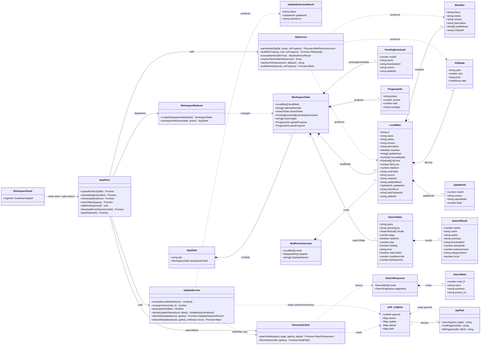
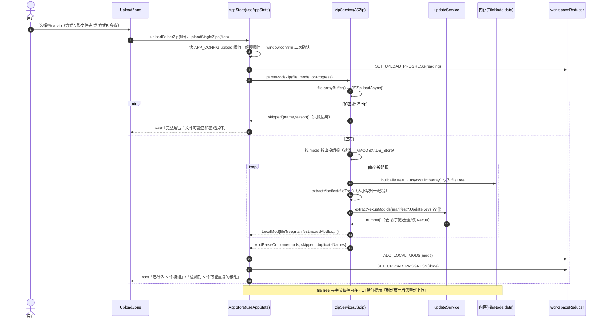
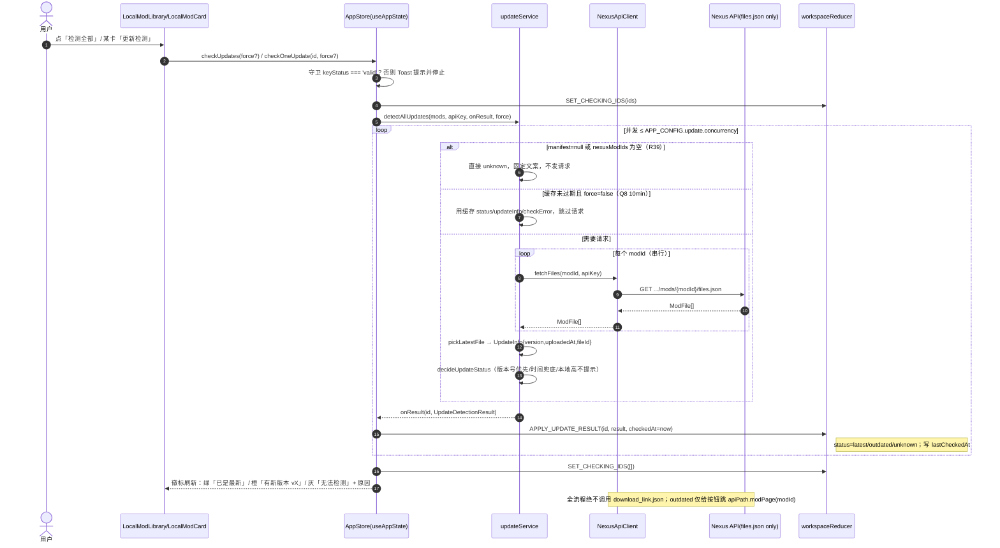
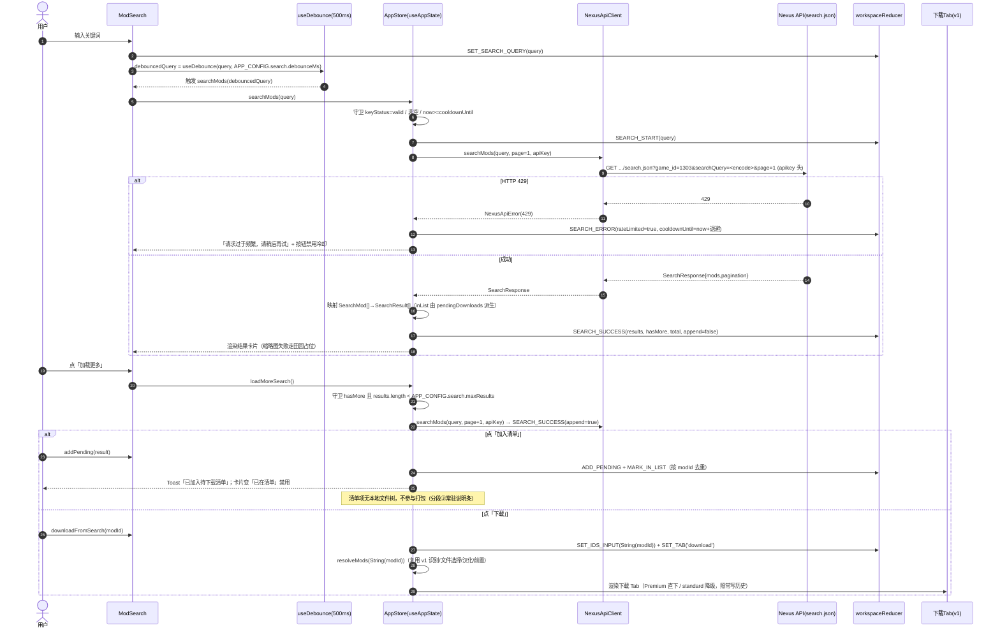
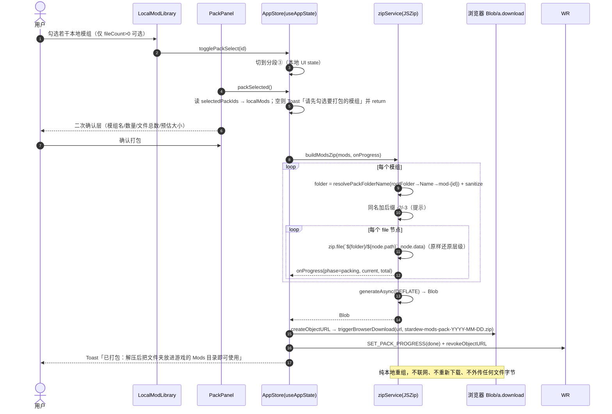
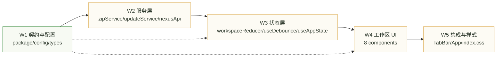

# 星露谷模组下载助手 — 增量架构设计与任务分解（v3）

> 文档版本：v3.0（增量文档）　|　架构师：高见远（Gao）　|　需求来源：`docs/PRD-v3.md`（许清楚 v3.0，**唯一需求来源**）
> 基线：`DESIGN.md`（v1，R01–R22）＋ `DESIGN-v2.md`（v2，R23–R31 已交付）　|　形态：纯静态 PWA，无后端
> 阅读约定：本文**只描述本次增量**，不重复 v1/v2 全文。**【修改】**＝在已有文件上最小改动；**【新增】**＝新文件；**【不变】**＝本次不碰、回归时只需确认未受影响。
> 任务编号用 `W1…W5`，与 v1 的 `T01…T05`、v2 的 `E1…E5` 区分。
> 核心纪律：**最小变更 ＋ 失败隔离 ＋ 非 Premium 铁律 ＋ 模组文件绝不出本地**。

---

## 0. 增量概述

### 0.1 主理人已拍板决策的落地方式（Q1–Q8，严格遵守，不再讨论）

| # | 决策（本次按此实施） | 本设计落地位置 | 对工程师的硬约束 |
| --- | --- | --- | --- |
| Q1 | v3 文件树 / Blob **只在内存维护、不持久化**；刷新后需重新上传（UI 明确提示）。模组清单元数据也不做 IndexedDB，降低复杂度 | §1.1 `LocalMod.fileTree` 携带 `Uint8Array`、§6.3 内存/localStorage 边界、§4 `UploadZone` 常驻提示条 | `FileNode.data`、`LocalMod[]`、`Blob` **绝不**写入 `localStorage` / `useLocalStorage`；刷新即丢失属预期，UI 必须写明"刷新后需重新上传" |
| Q2 | 更新比对**版本号优先、时间兜底**；本地版本高于线上不提示有更新 | §2.2 `compareVersions` + `decideUpdateStatus` | 本地 > 线上 → `latest`（附"本地版本较新"说明），**绝不**产出 `outdated` |
| Q3 | 非 `Nexus:` UpdateKeys 仅展示原始值、不检测、不计入 unknown 错误原因 | §2.2 `extractNexusModIds` + `decideUpdateStatus`、§1.1 `LocalMod.updateKeys` | `GitHub:`/`ModDB:` 等只进卡片标签；有 `Nexus:` 键按 Nexus 检测，完全没有时按 R39 说明 |
| Q4 | 待下载清单**会话内内存维护**，不持久化 | §1.1 `PendingDownload`、§6.3 | 不新增任何 `sdmh.*` storage key |
| Q5 | 批量下载沿用逐个触发 ＋「允许多个下载」提示；非 Premium 逐条降级 | §2.4 `downloadAllPending` 编排、§6.6 | 复用 v1 `buildDownloadPlan`+`runPlanAndRecord`；standard 逐条走 `open`/`copy`，**不假装直下** |
| Q6 | 打开 N 网跳**模组主页** `mods/{modId}` | §1.4 `apiPath.modPage()` | 新增独立路径函数，`filePage()` 一字不动 |
| Q7 | 打包顶层文件夹**优先原目录名** → `manifest.Name` → `mod-{id}` 兜底；文件名安全化 | §2.1 `resolvePackFolderName` + `sanitizeFileName` | 三级兜底顺序不可颠倒；非法字符 `/ \ : * ? " < > |` 等必须去除 |
| Q8 | 限频数值**集中到 `APP_CONFIG`**：防抖 500ms、每页 20、上限 100、冷却 10–30s、检测缓存 10min、并发 ≤3、大小阈值 100/300MB | §1.4 `APP_CONFIG.search/update/upload/pack` | 业务代码禁止硬编码这些数值，一律读配置 |

### 0.2 受影响文件总览

| 文件 | 类型 | 变更摘要 | 对应需求 |
| --- | --- | --- | --- |
| `package.json` | 【修改】 | `dependencies` 增加 `jszip`（JSZip 3.x 自带 TS 类型，**不装** `@types/jszip`） | R33 |
| `src/config/index.ts` | 【修改】 | 增 `gameId:1303`、`search`/`update`/`upload`/`pack` 配置块；`apiPath` 增 `search()`、`modPage()` | R40 / R45 / Q8 / Q6 |
| `src/types/nexus.ts` | 【修改】 | 追加 `SearchMod` / `SearchPagination` / `SearchResponse` 三个 DTO | R40 |
| `src/types/workspace.ts` | 【新增】 | 工作区全部领域类型：`FileNode`/`Manifest`/`LocalMod`/`UpdateStatus`/`UpdateInfo`/`SearchState`/`SearchResult`/`PendingDownload`/`WorkspaceState`/进度类型 | R32–R45 |
| `src/types/domain.ts` | 【修改】 | `TabKey` 加 `'workspace'`；`AppState` 平铺追加 7 个 v3 字段（从 `workspace.ts` import 类型） | R32 |
| `src/services/zipService.ts` | 【新增】 | JSZip 加载/解压、双模式拆模组、manifest 解析、文件树构建、打包 Blob | R33/R34/R35/R43/R44 |
| `src/services/updateService.ts` | 【新增】 | UpdateKeys 提取、版本号比对、主文件选择、单模组/批量检测（缓存＋并发） | R37/R38/R39/R45 |
| `src/services/nexusApi.ts` | 【修改】 | 仅追加 `searchMods()`，`request`/`validateKey`/`fetchFiles`/`getDownloadLink` **语义一字不动** | R40 |
| `src/hooks/workspaceReducer.ts` | 【新增】 | 工作区状态切片 reducer + action 类型 + 初始态工厂 | R32/R36/R41/R42/R43 |
| `src/hooks/useDebounce.ts` | 【新增】 | 泛型防抖 hook（搜索框用，500ms 读配置） | R41 |
| `src/hooks/useAppState.tsx` | 【修改】 | reducer `default` 分支转发 `workspaceReducer`；`AppActions` 追加 14 个 action；`createInitialState` 展开工作区初始态 | R32 及全部 |
| `src/components/workspace/WorkspacePanel.tsx` | 【新增】 | 工作区容器 + 三分段 | R32 |
| `src/components/workspace/UploadZone.tsx` | 【新增】 | 双上传入口 + 拖放 + 大小预警 + 内存态提示 | R33/R34/R44 |
| `src/components/workspace/LocalModLibrary.tsx` | 【新增】 | 分段①：模组库列表 + 搜索/排序 + 检测全部 + 打包入口 | R36/R37/R45/R43 |
| `src/components/workspace/LocalModCard.tsx` | 【新增】 | 本地模组卡片：勾选/状态/UpdateKeys/检测/跳转/移除 | R36/R38/R39 |
| `src/components/workspace/ModSearch.tsx` | 【新增】 | 分段②：搜索框 + 防抖 + 结果 + 加载更多 + 429 冷却 | R40/R41/R42 |
| `src/components/workspace/SearchResultCard.tsx` | 【新增】 | 搜索结果卡片：下载 / 加入清单 | R42 |
| `src/components/workspace/PackPanel.tsx` | 【新增】 | 分段③：待下载清单 + 打包确认 + 进度 + 边界说明 | R42/R43/R44 |
| `src/components/workspace/ProgressBar.tsx` | 【新增】 | 通用进度条骨架（读 `ProgressInfo`） | R44 |
| `src/components/TabBar.tsx` | 【修改】 | `tabs` 加一项 `workspace`；`TabIcon` 加一个分支 | R32 |
| `src/App.tsx` | 【修改】 | 主区渲染三元分支加 `workspace` 一路 + 1 行 import | R32 |
| `src/index.css` | 【修改】 | 追加 `.chip--muted` 与 `.progress-*` 少量样式（复用现有变量） | R38/R44 |

**明确【不变】的文件（本次不动，回归时只需确认未受影响）**：
`index.html`、`vite.config.ts`、`tsconfig*.json`、`postcss.config.js`、`tailwind.config.js`、`public/*`、`src/main.tsx`、`src/vite-env.d.ts`、`src/services/downloadService.ts`、`src/services/modParser.ts`、`src/services/exportService.ts`、`src/utils/*`（bbcode/format/download/errors/history/version）、`src/data/*`、`src/hooks/useLocalStorage.ts`、`src/hooks/useToast.tsx`、`src/components/ui/*`、`StatusBar.tsx`、`ApiKeyPanel.tsx`、`ModIdInput.tsx`、`ModCard.tsx`、`FileList.tsx`、`PrerequisiteList.tsx`、`DownloadActions.tsx`、`HistoryPanel.tsx`。

> **变更面**：新增 11 个文件、修改 10 个文件；v1/v2 的**网络层核心、下载执行层、解析层、历史/下载业务组件零改动**。
> **回归风险点仅有 3 处**：① `AppState` 形状变化（影响 `createInitialState` 与 `useMemo` 依赖）；② `TabBar` 从 2 项到 3 项；③ `App.tsx` 渲染分支。三处都有"只加不改"的最小补丁，其余新增能力全部落在独立文件，风险可控。

### 0.3 实现方案与框架选型

| 难点 | 对策 |
| --- | --- |
| 浏览器内解压 zip 且不外传文件 | 新增唯一运行时依赖 **`jszip@^3.10.1`**（自带 TS 声明，`import JSZip from 'jszip'`）；`File.arrayBuffer()` → `JSZip.loadAsync()` → 逐文件 `async('uint8array')`，全程内存 |
| 双模式拆模组结构差异大 | 统一抽象为"模组根路径数组"：`folder-zip` 取所有顶层目录；`single-zip` 取剥离同名外层后的根或 zip 整体作为单根。后续流程共用 |
| manifest 大小写/类型不统一 | `extractManifest` 对键名做 lowercase 归一化查找；`UpdateKeys` 兼容 `string` 与 `string[]` |
| 更新检测不能碰 `download_link.json` | 检测链路只调现有 `fetchFiles()`（即 `files.json`）；`getDownloadLink()` 完全不出现在 `updateService`/`useAppState` 的 v3 代码中 |
| 批量检测拖垮 / 触发 429 | `detectAllUpdates` 用并发 ≤3 的 worker pool + 10min 内存缓存 + `force` 手动刷新；单条异常转 `unknown`，不整体回滚 |
| 搜索高频请求 | `useDebounce` 500ms + 手动「加载更多」+ 100 条上限 + 429 冷却读配置，冷却期内 action 直接返回 |
| iOS 大包内存压力 | 上传前按 `APP_CONFIG.upload` 阈值提示/二次确认；进度回调切分 reading/unzip/manifest 阶段；按钮禁用防重复提交 |
| 搜索结果"下载"要复用 v1 | `downloadFromSearch()` 仅做「写 `idsInput` → `setTab('download')` → `resolveMods(id)`」三步组合，不改 `resolveMods`/`download` 任何代码 |

> **架构模式**：沿用 v1/v2 的 Context + useReducer（状态）＋ services（副作用）＋ utils（纯函数）分层；工作区不引入新状态库、不引入路由、不引入 MUI。新增 UI 全部使用 `.app-card` / `.tap-target` / `.chip--*` 与现有 CSS 变量。

---

## 1. 数据结构与类型

### 1.1 `src/types/workspace.ts`【新增】—— 工作区领域类型（完整定义）

> **为何独立文件**：v3 新增 10+ 个类型，若全塞进 `domain.ts` 会扩大 `domain.ts` 的 diff 面；独立文件让 `domain.ts` 只加 2 处最小改动（import + 字段），回归风险更低。

```ts
/** 【新增 v3】工作区专属领域类型。本地模组数据仅存内存（Q1），绝不持久化。 */

/** 文件树节点；file 节点携带解压后的字节，打包时按相对路径原样还原。 */
export interface FileNode {
  /** 相对该模组根的路径，'/' 分隔，无前导 './'，与 zip 内相对路径一致 */
  path: string;
  /** 字节数；dir 节点为 0 */
  size: number;
  kind: 'file' | 'dir';
  /** file 节点才有：JSZip async('uint8array') 的结果；dir 节点为 undefined */
  data?: Uint8Array;
}

/** SMAPI manifest.json 解析后的归一化结构（键名按 lowercase 匹配后填入）。 */
export interface Manifest {
  Name: string;
  Author: string;
  Version: string;
  Description: string;
  UpdateKeys: string[];
  UniqueID: string;
}

/** manifest 解析结果：缺失 / JSON 非法时 manifest=null 且带 reason（R39）。 */
export interface ManifestParseResult {
  manifest: Manifest | null;
  reason?: string;
}

/** 更新状态三值；"检测中"用 checkingIds 表达，不污染此联合类型（PRD 5.2）。 */
export type UpdateStatus = 'latest' | 'outdated' | 'unknown';

/** 本地模组来源。 */
export type ModSource = 'folder-zip' | 'single-zip';

/** 线上最新主文件信息（只来自 files.json，绝不来自 download_link.json）。 */
export interface UpdateInfo {
  modId: number;
  version: string;
  /** ISO 8601 UTC */
  uploadedAt: string;
  fileId: number;
}

/** 本地模组（上传解压后生成）。 */
export interface LocalMod {
  /** 上传时生成的本地唯一标识（UUID）；用于勾选、定位、检测回调 */
  id: string;
  /** manifest.Name ?? rootFolder ?? zip 文件名（Q7 兜底顺序展示用） */
  name: string;
  author: string;
  version: string;
  description: string;
  /** 原始解析对象；无 / 解析失败为 null（R39 判定依据） */
  manifest: Manifest | null;
  /** 原始 UpdateKeys，保留 'Nexus:2400@X' 原样，仅供卡片展示（Q3） */
  updateKeys: string[];
  /** 去 @子键、仅 Nexus: 前缀、数字校验后去重的 modId（供检测与跳转） */
  nexusModIds: number[];
  /** 解压文件树；含 file 节点字节。**仅内存（Q1） */
  fileTree: FileNode[];
  fileCount: number;
  /** 总字节数，卡片展示与大小提示 */
  totalSize: number;
  /** zip 内顶层文件夹名；无文件夹时为 ''（Q7 一级优先来源） */
  rootFolder: string;
  source: ModSource;
  /** manifest.UniqueID，去重提示用，可空 */
  uniqueId: string;
  updateStatus: UpdateStatus;
  updateInfo: UpdateInfo | null;
  /** unknown 时必填：无 manifest / 无 Nexus UpdateKeys / 401 / 429 / 网络错误等 */
  checkError: string;
  /** ISO 8601 UTC；null 表示未检测。缓存判定基准（Q8 10min） */
  lastCheckedAt: string | null;
  /** 加入本地库时间（ISO 8601 UTC），时间兜底检测的首次基准 */
  addedAt: string;
  // 注意：勾选态只存 AppState.selectedPackIds，不在模组上重复维护（单一数据源）
}

/** 单次上传的解析产出；坏包隔离到 skipped，不阻断其他文件。 */
export interface ModParseOutcome {
  mods: LocalMod[];
  skipped: Array<{ name: string; reason: string }>;
  /** UniqueID 或名称疑似重复的名字，供 UI Toast「检测到 N 个可能重复的模组」 */
  duplicateNames: string[];
}

/** 更新检测的单条结果（service 内部吞异常后返回，便于失败隔离）。 */
export interface UpdateDetectionResult {
  status: UpdateStatus;
  updateInfo: UpdateInfo | null;
  checkError: string;
}

/** N 网搜索结果项（由 nexus SearchMod 映射，字段 camelCase）。 */
export interface SearchResult {
  modId: number;
  name: string;
  author: string;
  summary: string;
  thumbnailUrl: string;
  downloads: number;
  endorsements: number;
  categoryName: string;
  /** 派生字段：pendingDownloads 是否含此 modId，防重复加入 */
  inList: boolean;
}

/** 搜索状态机（R40/R41）。 */
export interface SearchState {
  /** 输入框当前值 */
  query: string;
  /** 防抖后实际请求的关键词；空则不请求 */
  activeQuery: string;
  results: SearchResult[];
  /** 当前页码，从 1 开始 */
  page: number;
  hasMore: boolean;
  total: number;
  loading: boolean;
  error: string;
  /** 429 后为 true，冷却期内禁用搜索 */
  rateLimited: boolean;
  /** 冷却截止时间戳（Date.now() 毫秒），0 表示无冷却 */
  cooldownUntil: number;
  /** 上次请求时间戳（毫秒），配合配置做最小间隔保护 */
  lastSearchAt: number;
}

/** 待下载清单项（Q4：会话内内存，不持久化）。 */
export interface PendingDownload {
  modId: number;
  name: string;
  thumbnailUrl: string;
  /** 固定 'search'；无本地文件树，不参与打包（R42） */
  source: 'search';
  /** ISO 8601 UTC */
  addedAt: string;
}

/** 统一进度载荷；上传/解压/manifest/检测/打包共用。 */
export type ProgressPhase = 'reading' | 'unzip' | 'manifest' | 'checking' | 'packing' | 'done';
export interface ProgressInfo {
  phase: ProgressPhase;
  current: number;
  total: number;
  message?: string;
}
export type ProgressCallback = (progress: ProgressInfo) => void;
export type ProgressTarget = 'upload' | 'pack';

/** 工作区状态切片：在 AppState 中平铺展开，同时是 workspaceReducer 的初始态契约。 */
export interface WorkspaceState {
  localMods: LocalMod[];
  selectedPackIds: string[];
  searchState: SearchState;
  pendingDownloads: PendingDownload[];
  /** 正在检测的本地模组 id 集合（UI 显示旋转图标、禁用按钮） */
  checkingIds: string[];
  uploadProgress: ProgressInfo | null;
  packProgress: ProgressInfo | null;
}
```

### 1.2 `src/types/nexus.ts`【修改】—— 搜索响应 DTO（追加，不改现有 DTO）

```ts
/** 【新增】GET .../mods/search.json 的单个结果项（保持 snake_case）。 */
export interface SearchMod {
  mod_id: number;
  name: string;
  summary: string;
  picture_url: string | null;
  authors?: NexusAuthor[];
  category_name?: string;
  downloads?: number;
  endorsements?: number;
  uploaded_at?: string;
  [key: string]: unknown;
}

/** 【新增】search.json 的分页信息；Nexus 字段名不完全稳定，全部可选 + 索引签名兜底。 */
export interface SearchPagination {
  current_total?: number;
  total?: number;
  page?: number;
  [key: string]: unknown;
}

/** 【新增】GET .../mods/search.json 响应。 */
export interface SearchResponse {
  mods: SearchMod[];
  pagination?: SearchPagination;
}
```

> `ValidateResponse`/`Mod`/`ModFile`/`DownloadLink` **完全不变**。

### 1.3 `src/types/domain.ts`【修改】—— 仅 2 处增量

```ts
import type { LocalMod, PendingDownload, ProgressInfo, SearchState } from './workspace'; // 【新增 import】

/** 【修改】TabKey：下载 → 工作区 → 历史 */
export type TabKey = 'download' | 'workspace' | 'history';

/** 【修改】全局状态：v1/v2 字段全部保留，末尾平铺追加 7 个 v3 字段。 */
export interface AppState {
  apiKey: string;
  keyStatus: KeyStatus;
  tier: PremiumTier;
  userName: string | null;
  keyMessage: string;
  idsInput: string;
  mods: ParsedMod[];
  loadingIds: number[];
  loadErrors: Record<number, string>;
  selectedFiles: Record<number, number>;
  includeChinese: Record<number, boolean>;
  history: HistoryEntry[];
  theme: ThemeMode;
  tab: TabKey;
  // ↓↓↓ 【新增 v3，全部来自 workspace.ts 类型】↓↓↓
  localMods: LocalMod[];
  selectedPackIds: string[];
  searchState: SearchState;
  pendingDownloads: PendingDownload[];
  checkingIds: string[];
  uploadProgress: ProgressInfo | null;
  packProgress: ProgressInfo | null;
}
```

> `ParsedMod`/`Prerequisite`/`DownloadPlan`/`HistoryEntry` 等其余领域类型**不变**。

### 1.4 `src/config/index.ts`【修改】—— 限频数值唯一来源（Q8）

```ts
export const APP_CONFIG = {
  appName: '星露谷模组下载助手',
  applicationName: 'stardew-mod-helper',
  applicationVersion: '1.0.0',
  gameDomain: 'stardewvalley',
  apiBaseUrl: 'https://api.nexusmods.com/v1/',
  webBaseUrl: 'https://www.nexusmods.com',
  gameVersionBaseline: '1.6',
  exportFileNamePrefix: 'stardew-mods',
  /** 【新增 Q8】N 网游戏 ID，search.json 的 game_id 参数唯一来源 */
  gameId: 1303,
  /** 【新增 Q8】搜索限频：防抖 / 分页 / 上限 / 429 冷却 */
  search: {
    debounceMs: 500,
    pageSize: 20,
    maxResults: 100,
    cooldownMs: 10_000,        // 冷却下限，实际按失败次数指数退避到 maxCooldownMs
    maxCooldownMs: 30_000,
  },
  /** 【新增 Q8】更新检测：缓存有效期与并发上限 */
  update: {
    cacheTtlMs: 10 * 60 * 1000, // 10 分钟
    concurrency: 3,
  },
  /** 【新增 Q8】上传大小阈值（字节）：100MB 提示 / 300MB 二次确认 */
  upload: {
    softLimitBytes: 100 * 1024 * 1024,
    hardLimitBytes: 300 * 1024 * 1024,
  },
  /** 【新增 Q7/Q8】打包文件名前缀，最终 stardew-mods-pack-YYYY-MM-DD.zip */
  pack: { fileNamePrefix: 'stardew-mods-pack' },
  storageKeys: {
    apiKey: 'sdmh.apiKey',
    history: 'sdmh.history',
    theme: 'sdmh.theme',
    lastIds: 'sdmh.lastIds',
  },
} as const;

export const apiPath = {
  validate: () => '/users/validate.json',
  modInfo: (modId: number) => `/games/${APP_CONFIG.gameDomain}/mods/${modId}.json`,
  files: (modId: number) => `/games/${APP_CONFIG.gameDomain}/mods/${modId}/files.json`,
  downloadLink: (modId: number, fileId: number) =>
    `/games/${APP_CONFIG.gameDomain}/mods/${modId}/files/${fileId}/download_link.json`,
  filePage: (modId: number, fileId: number) =>
    `${APP_CONFIG.webBaseUrl}/${APP_CONFIG.gameDomain}/mods/${modId}?tab=files&file_id=${fileId}`,
  /** 【新增 R40】搜索：game_id 走配置，关键词 encode，page 默认 1 */
  search: (query: string, page = 1) =>
    `/games/${APP_CONFIG.gameDomain}/mods/search.json?game_id=${APP_CONFIG.gameId}` +
    `&searchQuery=${encodeURIComponent(query)}&page=${page}`,
  /** 【新增 Q6】模组主页（不带 file_id），与 filePage() 并存、互不覆盖 */
  modPage: (modId: number) =>
    `${APP_CONFIG.webBaseUrl}/${APP_CONFIG.gameDomain}/mods/${modId}`,
} as const;
```

> **不新增任何 storage key**（Q1/Q4）。`apiPath.filePage()` 一字不动，`downloadLink()` 仍只服务 Premium 直链。

### 1.5 `AppActions` 新增 action 签名（在 `useAppState.tsx` 内扩展）

```ts
export interface AppActions {
  /* ===== 以下 v1/v2 全部保持不变 ===== */
  setKey(apiKey: string): void;
  clearKey(): void;
  validate(): Promise<void>;
  setIdsInput(value: string): void;
  resolveMods(input?: string): Promise<void>;
  selectFile(modId: number, fileId: number): void;
  toggleChinese(modId: number): void;
  download(modId: number, manualAction?: 'open' | 'copy'): Promise<void>;
  redownload(entry: HistoryEntry, manualAction?: 'open' | 'copy'): Promise<void>;
  setTheme(theme: ThemeMode): void;
  setTab(tab: TabKey): void;
  clearHistory(): void;

  /* ===== 【新增 v3 工作区】 ===== */
  /** R33：整个 Mods 文件夹 zip → 拆顶层子文件夹为多个模组 */
  uploadFolderZip(file: File): Promise<void>;
  /** R34：单个/多个模组 zip（多选） */
  uploadSingleZips(files: File[]): Promise<void>;
  /** R36/R43：勾选/取消勾选打包（仅 fileTree 非空者可选） */
  togglePackSelect(localId: string): void;
  /** R36：从模组库移除（同时清 selectedPackIds） */
  removeLocalMod(localId: string): void;
  /** R37/R45：检测全部；force=true 忽略 10min 缓存 */
  checkUpdates(force?: boolean): Promise<void>;
  /** R38/R45：检测单个；force=true 强制刷新 */
  checkOneUpdate(localId: string, force?: boolean): Promise<void>;
  /** R40/R41：新关键词搜索（重置 page=1 并覆盖 results） */
  searchMods(query: string): Promise<void>;
  /** R41：加载更多（page+1，追加 results，不自动预加载） */
  loadMoreSearch(): Promise<void>;
  /** R41：仅更新输入值，不发请求（防抖由 UI 层负责） */
  setSearchQuery(query: string): void;
  /** R42：加入待下载清单（按 modId 去重；来源固定 search） */
  addPending(result: SearchResult): void;
  /** R42：移除待下载项 */
  removePending(modId: number): void;
  /** R42/Q5：逐条触发 v1 下载流程（Premium 直下 / standard 逐条降级） */
  downloadAllPending(): Promise<void>;
  /** R42：搜索结果「下载」——写 idsInput → 切下载 Tab → resolveMods(modId) */
  downloadFromSearch(modId: number): Promise<void>;
  /** R43：打包勾选模组（二次确认在 UI 层），生成 Blob 下载 */
  packSelected(): Promise<void>;
  /** R44：设置上传/打包进度 */
  setProgress(target: ProgressTarget, progress: ProgressInfo | null): void;
}
```

> `ReducerAction` 合并方式见 §5.2 W3；v1 的 `SET_KEY`/`ADD_HISTORY`/`SET_THEME` 等分支**原样保留**。

### 1.6 增量类图（Mermaid）

> 同步保存于 `docs/class-diagram-v3.mermaid`。仅画本次新增/变更类型与服务；v1 类图见 `docs/class-diagram.mermaid`。



---

## 2. 服务层设计

### 2.1 `src/services/zipService.ts`【新增】

```ts
import JSZip from 'jszip';
import { APP_CONFIG } from '../config';
import type {
  FileNode, LocalMod, Manifest, ManifestParseResult, ModParseOutcome,
  ModSource, ProgressCallback,
} from '../types/workspace';
import { extractNexusModIds } from './updateService';

export type ZipMode = 'folder-zip' | 'single-zip';

/**
 * 上传入口：读 File → ArrayBuffer → JSZip.loadAsync → 按 mode 拆模组根 → 逐根建文件树/解析 manifest。
 * 入参用 File 而非裸 ArrayBuffer：需要 file.name 兜底命名、file.size 做阈值提示（Q7/Q8）。
 * 损坏/加密 zip 捕获后写入 skipped，已成功的模组照常返回（失败隔离）。
 */
export async function parseModsZip(
  file: File,
  mode: ZipMode,
  onProgress?: ProgressCallback,
): Promise<ModParseOutcome>;

/** 从 JSZip 内某一根目录收集文件树（过滤 __MACOSX/.DS_Store/._* 等系统项），file 节点带字节。 */
export async function buildFileTree(
  zip: JSZip,
  root: string,
  onProgress?: ProgressCallback,
): Promise<FileNode[]>;

/**
 * 从文件树中找根路径下的 manifest.json（大小写不敏感、允许一层同名目录内的根 manifest），
 * 用 TextDecoder 解码 + JSON.parse；键名 lowercase 归一化后填入 Manifest。
 * 缺失/非法 JSON → { manifest: null, reason: '未找到有效的 manifest.json' }（R39）。
 */
export function extractManifest(fileTree: FileNode[]): ManifestParseResult;

/** Q7 三级兜底：rootFolder → manifest?.Name → `mod-${id}`，再 sanitize。 */
export function resolvePackFolderName(mod: LocalMod): string;

/** 去非法字符 `<>:"/\|?*` 与控制字符、压缩空白、去首尾空格与结尾点；空串返回 fallback。 */
export function sanitizeFileName(name: string, fallback: string): string;

/**
 * 打包：按模组名建顶层文件夹，fileTree 相对路径原样放入（保持层级）。
 * 同名目录加后缀 `-2`/`-3`；generateAsync 的 onUpdate 折算为 packing 进度。
 * 返回 Blob，由调用方 triggerBrowserDownload 下载。
 */
export async function buildModsZip(
  mods: LocalMod[],
  onProgress?: ProgressCallback,
): Promise<Blob>;
```

**实现要点（工程师逐条落地）**：

1. **加载**：`const buffer = await file.arrayBuffer(); const zip = await JSZip.loadAsync(buffer);` 用 `onProgress({phase:'reading',current:file.size,total:file.size})` 起始、`phase:'unzip'` 覆盖解压阶段。加密 zip 会在 `loadAsync` 或 `async()` 抛错 → `skipped.push({name:file.name, reason:'无法解压：文件可能已加密或损坏'})`。
2. **拆根（`folder-zip`）**：遍历 `Object.values(zip.files)`，取路径第一段；过滤系统项与 files；顶层是文件而非目录 → 整体视为单个"无文件夹"模组，`rootFolder=''`，并提示。每个顶层目录一个根。
3. **拆根（`single-zip`）**：去掉 zip 扩展名得 `baseName`；若顶层**只有一个目录**且目录名与 `baseName` 一致（不区分大小写、允许 `-1` 后缀）→ 剥离该层，根为该目录；否则以整个 zip 为单模组、`rootFolder=''`、名用 `baseName`。
4. **文件树**：`zip.file(relativePath)` → `async('uint8array')` 拿字节，`size = bytes.byteLength`；目录节点由路径层级补出（`kind:'dir', size:0, data:undefined`）；`path` 用 `'/'` 分隔、去前导 `./`。
5. **manifest**：`extractManifest` 在 fileTree 里找 `/^manifest\.json$/i` 的节点（若模组根来自剥离的同名目录，manifest 已在该根的相对路径下）；`new TextDecoder('utf-8').decode(data)` → `JSON.parse` → lowercase 键映射；`UpdateKeys` 为字符串时包成单元素数组。
6. **组装 LocalMod**：`id` 用 `crypto.randomUUID()`（不支持时 `Date.now()+Math.random()` 兜底）；`uniqueId = manifest?.UniqueID ?? ''`；`name = manifest?.Name || rootFolder || baseName`（展示名，Q7 语义对齐）；`nexusModIds = extractNexusModIds(manifest?.UpdateKeys ?? [])`；`updateStatus='unknown'`、`updateInfo=null`、`checkError='尚未检测'`、`lastCheckedAt=null`、`addedAt=new Date().toISOString()`。
7. **重复检测**：按 `uniqueId`（非空）与 `name` 做 `Set` 去重比对，重复名字收集进 `duplicateNames`，**不自动删除**，UI Toast 提示由用户决定。
8. **打包**：`const zip = new JSZip();` 对每个 mod：
   - `const folder = sanitizeFileName(resolvePackFolderName(mod), \`mod-${mod.id}\`);`（Q7）
   - 同名处理：`const used = new Map<string, number>()`；若 `used.has(folder)`，`n = used.get(folder)+1`，`folder = \`${folder}-${n}\`` 并 Toast 提示。
   - 每个 file 节点：`zip.file(\`${folder}/${node.path}\`, node.data!)`，`onProgress({phase:'packing', current:done, total:totalFiles})`。
   - `zip.generateAsync({ type:'blob', compression:'DEFLATE', compressionOptions:{ level:6 } }, meta => onProgress?.({phase:'packing', current: Math.round(meta.percent), total:100}))`。
   - 文件名：`\`${APP_CONFIG.pack.fileNamePrefix}-${new Date().toISOString().slice(0,10)}.zip\``。
9. **隐私**：本文件无任何 `fetch`；只产出 Blob，不经网络。

### 2.2 `src/services/updateService.ts`【新增】—— 更新检测（只读 files.json）

```ts
import { APP_CONFIG } from '../config';
import type { ModFile } from '../types/nexus';
import type {
  LocalMod, UpdateDetectionResult, UpdateInfo,
} from '../types/workspace';
import { formatError } from '../utils/errors';
import { fetchFiles } from './nexusApi';

/** 【纯函数 Q3】UpdateKeys → Nexus modId：仅 'Nexus:' 前缀、去 @子键、数字校验、去重保序。 */
export function extractNexusModIds(updateKeys: string[]): number[];

/** 【纯函数 Q2】版本号逐段比较：a>b → 1，a<b → -1，相等 → 0，任一不可解析 → null（触发时间兜底）。 */
export function compareVersions(a: string, b: string): -1 | 0 | 1 | null;

/** 【纯函数】选最新主文件：is_primary 优先（多个取 uploaded_at 最新），无主文件取 uploaded_at 最新。 */
export function pickLatestFile(files: ModFile[]): ModFile | null;

/**
 * 【纯函数】按 PRD 4.5 判定：
 *  - 版本号可解析：本地>线上 → latest(附"本地版本较新")；相等 → latest；本地<线上 → outdated
 *  - 不可解析：latest.uploadedAt 晚于 (lastCheckedAt ?? addedAt) → outdated，否则 latest
 *  - 多 modId：任一 outdated → outdated（取版本号最高者展示）；全部一致 → latest；全部失败 → unknown
 */
export function decideUpdateStatus(
  local: Pick<LocalMod, 'version' | 'lastCheckedAt' | 'addedAt'>,
  latest: UpdateInfo[],
  failedIds?: number[],
): UpdateDetectionResult;

/**
 * 检测单个模组：manifest=null 或 nexusModIds 为空 → 直接 unknown（固定 R39 文案），不发请求；
 * 否则对每个 modId 串行 fetchFiles（files.json），汇总后 decideUpdateStatus。内部吞异常转 unknown。
 */
export async function detectModUpdate(
  localMod: LocalMod,
  apiKey: string,
): Promise<UpdateDetectionResult>;

/**
 * 批量检测：并发 ≤ APP_CONFIG.update.concurrency 的 worker pool；
 * 缓存命中（now-lastCheckedAt < cacheTtlMs 且 force=false）跳过并回传缓存结果；
 * 每条完成即 onResult(id, result)（UI 逐条更新），单条失败不中断；返回 id→结果 映射。
 */
export async function detectAllUpdates(
  mods: LocalMod[],
  apiKey: string,
  onResult: (id: string, result: UpdateDetectionResult) => void,
  force?: boolean,
): Promise<Record<string, UpdateDetectionResult>>;
```

**判定逻辑细节（务必照此实现）**：

- `extractNexusModIds`：`/^Nexus:/i` 过滤 → `slice(6).split('@')[0].trim()` → `/^\d+$/` 校验 → `Number()` → `Number.isSafeInteger && >0` → `Set` 去重保序。**非 `Nexus:` 键直接跳过，不写进 `checkError`（Q3）**。
- `compareVersions`：两段正则 `/^v?(\d+(?:\.\d+)*)/` 抽数字段，补 0 对齐后逐段比；任一侧无匹配返回 `null`。
- `decideUpdateStatus` 的 `failedIds` 只用于"全部失败 → unknown（取首个错误文案）"；**部分失败按成功结果判定**，失败项不写进原因文案（Q3 精神）。
- `unknown` 文案分流：
  - 无 manifest / 无 Nexus 键 → `"此模组缺少 manifest.json 或 UpdateKeys，无法自动检测更新，请到 N 网手动查看。"`（R39）
  - `fetchFiles` 抛错 → `formatError(err)`（401→Key 无效、429→请求过于频繁、网络→网络异常）
  - files 为空 → `"N 网未找到可用文件"`
- **本文件唯一的网络调用是 `fetchFiles()`；出现 `getDownloadLink` 即为实现错误。**

**并发池参考实现（可直接用）**：

```ts
export async function detectAllUpdates(mods, apiKey, onResult, force = false) {
  const results: Record<string, UpdateDetectionResult> = {};
  let cursor = 0;
  const size = Math.min(APP_CONFIG.update.concurrency, mods.length);
  const workers = Array.from({ length: size }, async () => {
    while (cursor < mods.length) {
      const mod = mods[cursor++];
      const cached = mod.lastCheckedAt !== null &&
        Date.now() - Date.parse(mod.lastCheckedAt) < APP_CONFIG.update.cacheTtlMs &&
        mod.updateStatus !== 'unknown';
      let result: UpdateDetectionResult;
      if (cached && !force) {
        result = { status: mod.updateStatus, updateInfo: mod.updateInfo, checkError: mod.checkError };
      } else {
        try {
          result = await detectModUpdate(mod, apiKey);
        } catch (err) {
          result = { status: 'unknown', updateInfo: null, checkError: formatError(err) };
        }
      }
      results[mod.id] = result;
      onResult(mod.id, result); // UI 逐条落库 + 清除 checkingIds
    }
  });
  await Promise.all(workers);
  return results;
}
```

> **纯函数归属说明（回应"放 `updateService` 还是新 util"）**：`extractNexusModIds` 与 `compareVersions` 只服务更新检测链路，且 `compareVersions` 的解析规则必须与 `detectModUpdate`/`decideUpdateStatus` 完全一致；放同一文件可避免两处规则漂移，也让单测集中覆盖。`zipService` 单向 import `extractNexusModIds`（无循环依赖）。因此**不新建 util 文件**，符合最小变更。

### 2.3 `src/services/nexusApi.ts`【修改】—— 仅追加一个函数

```ts
import type { SearchResponse } from '../types/nexus'; // 【新增 import】

/** 【新增 R40】搜索模组；经 request 注入 apikey 与错误归一化，401/429 由 NexusApiError.status 表达。 */
export async function searchMods(
  query: string,
  page: number,
  apiKey: string,
  signal?: AbortSignal,
): Promise<SearchResponse> {
  return request<SearchResponse>(apiPath.search(query, page), apiKey, signal);
}
```

> `apiPath.search` 需加入 import（`import { APP_CONFIG, apiPath } from '../config'` 已存在，仅扩展解构? 不改该行——`apiPath` 已整体导入，直接用即可）。
> **不改** `request()` 的任何逻辑；**不改** `validateKey`/`fetchModInfo`/`fetchFiles`/`getDownloadLink` 的语义；**不新增** `abort` 之外的请求分支。
> `searchMods` 返回结构若异常（如 `mods` 非数组），在 `useAppState.searchMods` 里兜底为 `[]`，不改服务层契约。

### 2.4 `useAppState.tsx` 中新增 action 的编排要点

| action | 编排逻辑（关键约束） |
| --- | --- |
| `uploadFolderZip` / `uploadSingleZips` | 守卫 `file.size`（读 `APP_CONFIG.upload`；硬阈值先 `window.confirm` 二次确认）→ `setProgress('upload', {phase:'reading',...})` → `zipService.parseModsZip` → `dispatch(ADD_LOCAL_MODS)` → Toast（含重复提示）→ `setProgress('upload', {phase:'done',...})`；异常 Toast友好错误 |
| `togglePackSelect` | 仅当目标 mod 的 `fileCount > 0` 才 dispatch；dispatch `TOGGLE_PACK_SELECT` |
| `removeLocalMod` | dispatch `REMOVE_LOCAL_MOD`（reducer 内同步清 `selectedPackIds`，避免脏 id） |
| `checkUpdates` / `checkOneUpdate` | 守卫 `keyStatus==='valid'`（无 Key 只提示、不改状态）→ 填 `checkingIds` → 调 `detectAllUpdates`/`detectModUpdate` → `dispatch(APPLY_UPDATE_RESULT)`（写 status/info/checkError/lastCheckedAt=now）→ 清该 id。单条失败只置 unknown，Toast 汇总 |
| `searchMods` | 守卫 `keyStatus==='valid'` + `query.trim()!==''` + `Date.now() >= cooldownUntil`；`dispatch(SEARCH_START)` → `searchMods(api)` → 映射 `SearchMod[]`→`SearchResult[]`（`inList` 由 `pendingDownloads` 派生；作者用 `formatAuthors`）→ `dispatch(SEARCH_SUCCESS{append:false})`；429 → `dispatch(SEARCH_ERROR{rateLimited:true, cooldownUntil: now + min(1000*2^n, maxCooldownMs)})` |
| `loadMoreSearch` | 同守卫 + `hasMore` + `results.length < APP_CONFIG.search.maxResults` → `page+1` 请求 → `SEARCH_SUCCESS{append:true}`；达上限 Toast"结果较多，请细化关键词" |
| `addPending` / `removePending` | 按 `modId` 去重；`MARK_IN_LIST` 同步 `searchState.results[].inList`；来源固定 `'search'`；无文件树，UI 说明条常驻 |
| `downloadFromSearch` | 三步：`setIdsInput(String(modId))` → `setTab('download')` → `void resolveMods(String(modId))`。**不调用** `download()`、`buildDownloadPlan()`、`getDownloadLink()` |
| `downloadAllPending` | Q5：Toast「请在弹窗中允许多个下载」→ `for...of`（串行）每条走 `downloadFromSearch` 等价链路后调用现有 `download()`；standard 的 `manualAction` 默认 `'open'`（逐条打开网页/复制），**不假装直下**；任一条失败继续下一条 |
| `packSelected` | 取 `selectedPackIds` 对应 `localMods`（`fileTree` 非空）→ 空则 Toast「请先勾选要打包的模组」并 return → `zipService.buildModsZip(mods, p => setProgress('pack', p))` → `triggerBrowserDownload(url, filename)` + `revokeObjectURL` → Toast「已打包：解压后把文件夹放进游戏的 Mods 目录即可使用」 |
| `setProgress` | dispatch `SET_UPLOAD_PROGRESS` / `SET_PACK_PROGRESS` |

> **`runPlanAndRecord` / `executeDownloadPlan` / `buildDownloadPlan` 完全不改动**；v3 只是复用它们。任何用户下载路径触发的 `download_link.json` 仍只发生在 `tier==='premium' && action==='direct'`（v1 双重守卫）。

---

## 3. 程序调用流程

> 4 张时序图同步保存于 `docs/sequence-diagram-v3.mermaid`（单图分段）。

### 3.1 ① 上传 zip → 解压 → manifest → LocalMod（R33/R34/R35）



### 3.2 ② 更新检测（含 unknown 分支与限流/缓存，R37/R38/R39/R45）



### 3.3 ③ 搜索 → 加入清单 / 下载（R40/R41/R42）



### 3.4 ④ 勾选 → 打包下载（R43/R44）



---

## 4. UI 组件设计

### 4.1 新增组件清单与职责（全部放 `src/components/workspace/`）

| 组件 | 职责 | 读取的 state | 调用的 action / 服务 |
| --- | --- | --- | --- |
| `WorkspacePanel.tsx` | 工作区容器；顶部三分段控件（Segmented），用**局部 `useState<'local'|'search'|'pack'>`**（不进全局 state，减少 reducer 面） | `state.keyStatus`（Status 提示） | 无（向下渲染三个子组件） |
| `UploadZone.tsx` | 两个上传按钮 + 拖放区；100MB 提示、300MB 确认提示；**常驻「刷新后需重新上传」说明条** | `state.uploadProgress` | `uploadFolderZip`、`uploadSingleZips` |
| `LocalModLibrary.tsx` | 分段①：UploadZone + 本地搜索/排序工具条 +「检测全部」+「打包所选」（切分段③） | `state.localMods`、`state.checkingIds` | `checkUpdates`、`setTab`?（不切 Tab，仅切分段）、向下传 props |
| `LocalModCard.tsx` | 单模组卡片：勾选框、来源徽标、三态徽标、信息行、UpdateKeys 标签（可点击跳 modPage）、文件树摘要（可展开）、操作行 | 单个 `LocalMod`、`state.selectedPackIds`、`state.checkingIds` | `togglePackSelect`、`checkOneUpdate`、`removeLocalMod`；跳转用 `apiPath.modPage(modId)` |
| `ModSearch.tsx` | 分段②：搜索框（`useDebounce` 500ms + 回车手动触发）、「加载更多」、429 冷却倒计时、空状态 | `state.searchState`、`state.pendingDownloads` | `setSearchQuery`、`searchMods`、`loadMoreSearch`、`addPending`、`downloadFromSearch` |
| `SearchResultCard.tsx` | 结果卡片：缩略图（`onError` 田园占位）、名称/作者/摘要 2 行/下载量/分类、两按钮 | 单个 `SearchResult` | `addPending`、`downloadFromSearch` |
| `PackPanel.tsx` | 分段③：待下载清单（名称/modId/缩略图/移除/全部下载）+ 打包确认层 + 打包进度 + **「无本地文件树、不参与打包」说明条** | `state.pendingDownloads`、`state.localMods`、`state.selectedPackIds`、`state.packProgress` | `removePending`、`downloadAllPending`、`setProgress`、`packSelected` |
| `ProgressBar.tsx` | 通用进度条，读 `ProgressInfo.phase/current/total`，配简单文案（读取/解压/解析/检测/打包） | props: `progress` | 无（纯展示） |

### 4.2 `TabBar.tsx`【修改】—— 最小补丁

```ts
const tabs: Array<{ key: TabKey; label: string }> = [
  { key: 'download', label: '下载' },
  { key: 'workspace', label: '工作区' }, // 【新增】仅加一项
  { key: 'history', label: '历史' },
];
```
- `TabIcon` 加 `if (tab === 'workspace')` 一个分支（三段式线性图标，如"文件夹/格子"，`viewBox 0 0 24 24`、`strokeWidth 1.8`，与另两个图标同风格）。
- **其余不动**：`min-h-[56px]`、`flex-1`、`env(safe-area-inset-bottom)`、`role="tablist"`、`aria-selected` 全部保留；3 项时每项仍 ≥44px（最大屏宽 `max-w-2xl` 足够）。

### 4.3 `App.tsx`【修改】—— 最小补丁

```tsx
import WorkspacePanel from './components/workspace/WorkspacePanel'; // 【新增 1 行 import】

// 主区渲染：把原来的二元判断改成三元，download/history 两个分支代码一字不动
{state.tab === 'download' ? (
  /* ...原有代码完全保留... */
) : state.tab === 'workspace' ? (
  <WorkspacePanel />            // 【新增分支】
) : (
  <HistoryPanel />
)}
```
- `StatusBar`、`Toast`、`UpdatePrompt`、`ToastProvider`/`AppStoreProvider` 包裹结构**不变**（更新检测/搜索依赖已校验的 Key 徽标全局可见）。

### 4.4 `index.css`【修改】—— 追加最小样式（复用现有变量）

```css
@layer components {
  /* 更新状态 unknown 用灰 chip，不需要新 CSS 变量 */
  .chip--muted { background: var(--app-surface-raised); color: var(--app-muted); }

  /* 进度条：brand 现有色阶，深色下自动协调 */
  .progress-track { height: 6px; border-radius: 9999px; background: var(--app-border); overflow: hidden; }
  .progress-fill  { height: 100%; border-radius: 9999px; background: #5FAE57; transition: width .2s ease; }
}
```
> 不新增 Tailwind 配置、不改 `tailwind.config.js`、不改 chip 既有语义类；新卡片统一 `app-card`、按钮统一 `primary-btn`/`secondary-btn`/`tap-target`。三态徽标映射：`latest → chip chip--main`、`outdated → chip chip--version`、`unknown → chip chip--muted`。

### 4.5 iOS 体验落点（R44）

| 项 | 落地位置 |
| --- | --- |
| 阶段进度 | `ProgressBar` + `ProgressInfo.phase`；上传/打包期间对应按钮 `disabled` |
| 骨架屏 | 复用现有 `Skeleton`（列表加载态）；检测结果逐条刷新 |
| 空状态 | 复用 `EmptyState`（模组库空、搜索空各一次调用，标题/描述不同） |
| 错误降级 | 坏 zip / 429 / 网络错误均有具体文案 + 「重试」按钮，绝不白屏 |
| 大小提示 | `UploadZone` 读 `APP_CONFIG.upload`；软阈值文案 + 硬阈值 `window.confirm` |
| 触控/安全区 | 新按钮全部 `.tap-target` ≥44px；底部 Tab 沿用 safe-area |

---

## 5. 增量任务列表（W1–W5，工程师严格按此批量写入）

### 5.1 主表

| 任务编号 | 文件 | 类型 | 依赖 | 说明 |
| --- | --- | --- | --- | --- |
| **W1** | `package.json`<br/>`src/config/index.ts`<br/>`src/types/nexus.ts`<br/>`src/types/workspace.ts`<br/>`src/types/domain.ts` | 改 / 改 / 改 / **新** / 改 | 无 | 契约与配置：加 `jszip` 依赖；`APP_CONFIG` 四组限频数值 + `gameId`；`apiPath.search/modPage`；搜索 DTO；工作区全部类型；`TabKey`+`AppState` 扩展。严格按 §1.1–1.4、§8.1 |
| **W2** | `src/services/zipService.ts`<br/>`src/services/updateService.ts`<br/>`src/services/nexusApi.ts` | **新** / **新** / 改 | W1 | 服务层：JSZip 双模式解析+manifest+打包；更新检测（纯函数+并发池）；`searchMods` 追加。严格按 §2.1–2.3 |
| **W3** | `src/hooks/workspaceReducer.ts`<br/>`src/hooks/useDebounce.ts`<br/>`src/hooks/useAppState.tsx` | **新** / **新** / 改 | W1, W2 | 状态层：工作区 reducer 独立成文件（reducer `default` 分支转发，零改 v1 分支）；防抖 hook；14 个新 action + `createInitialState` 展开初始态。严格按 §1.5、§2.4、§5.2 W3 |
| **W4** | `src/components/workspace/WorkspacePanel.tsx`<br/>`src/components/workspace/UploadZone.tsx`<br/>`src/components/workspace/LocalModLibrary.tsx`<br/>`src/components/workspace/LocalModCard.tsx`<br/>`src/components/workspace/ModSearch.tsx`<br/>`src/components/workspace/SearchResultCard.tsx`<br/>`src/components/workspace/PackPanel.tsx`<br/>`src/components/workspace/ProgressBar.tsx` | 全部**新** | W1, W3 | 工作区 UI 8 组件：按 §4.1 表格读 state / 调 action；全部用 `.app-card`/`.tap-target`/`.chip--*`/CSS 变量 |
| **W5** | `src/components/TabBar.tsx`<br/>`src/App.tsx`<br/>`src/index.css` | 改 / 改 / 改 | W1, W4 | 集成与样式：TabBar 加「工作区」项及图标；App 加三元分支 + import；index.css 加 `.chip--muted`/`.progress-*`。严格按 §4.2–4.4 |

> 依赖链：W1 → W2 → W3 → W4 → W5（W2 内部两个新服务可并行；W4 的 8 个组件可并行编写）。全部落盘后执行 `npm install && npm run build && npm test`。

### 5.2 每批次写入要点

**W1 — 契约与配置**
- `package.json`：`dependencies` 加 `"jszip": "^3.10.1"`；**不装** `@types/jszip`（JSZip 3.x 自带声明）。`devDependencies` 不动（vitest/jsdom 已在）。
- `config/index.ts`：按 §1.4 原样扩 `APP_CONFIG` 与 `apiPath`，保留 `as const`；`storageKeys` 不加新键。
- `types/nexus.ts`：文末追加三个 DTO，现有四个 DTO 不动。
- `types/workspace.ts`：按 §1.1 完整新建（含 `ProgressCallback` 类型别名）。
- `types/domain.ts`：只加一行 import + 改 `TabKey` + 在 `AppState` 末尾追加 7 字段；`ParsedMod`/`HistoryEntry` 等一律不动。

**W2 — 服务层**
- `zipService.ts`：按 §2.1 写 6 个函数；注意 `import JSZip from 'jszip'`、`TextDecoder` 解码 manifest、`crypto.randomUUID()` 兜底；**无任何 `fetch`**。
- `updateService.ts`：按 §2.2 写 6 个函数；`fetchFiles` 是唯一网络出口；并发池用 §2.2 参考实现；检查全文件无 `getDownloadLink` 字样。
- `nexusApi.ts`：文末追加 `searchMods()`（§2.3），文件其余部分**逐字不动**。

**W3 — 状态层**
- `workspaceReducer.ts`：导出 `createWorkspaceInitialState()`（服务/检测初始态见下）、`WorkspaceAction` 联合类型、`workspaceReducer(state: AppState, action: WorkspaceAction): AppState`（含 `ADD_LOCAL_MODS`/`REMOVE_LOCAL_MOD`（同步清 selectedPackIds）/`TOGGLE_PACK_SELECT`/`SET_CHECKING_IDS`/`APPLY_UPDATE_RESULT`/`RESET_UPDATE_RESULT`/`SET_SEARCH_QUERY`/`SEARCH_START`/`SEARCH_SUCCESS`/`SEARCH_ERROR`/`MARK_IN_LIST`/`ADD_PENDING`/`REMOVE_PENDING`/`SET_UPLOAD_PROGRESS`/`SET_PACK_PROGRESS`）。
  - 初始态：`localMods:[]`、`selectedPackIds:[]`、`pendingDownloads:[]`、`checkingIds:[]`、`uploadProgress:null`、`packProgress:null`、`searchState:{query:'',activeQuery:'',results:[],page:1,hasMore:false,total:0,loading:false,error:'',rateLimited:false,cooldownUntil:0,lastSearchAt:0}`。
- `useDebounce.ts`：`useDebounce<T>(value: T, delayMs: number): T`，`useEffect` + `setTimeout` + cleanup；延迟值由调用方传 `APP_CONFIG.search.debounceMs`。
- `useAppState.tsx`：
  1. import `createWorkspaceInitialState`/`workspaceReducer`/`WorkspaceAction` 与 v3 类型。
  2. `createInitialState` 返回对象末尾加 `...createWorkspaceInitialState()`。
  3. `ReducerAction` 扩展为 `LegacyAction | WorkspaceAction`；switch 的 `default` 分支改为 `return workspaceReducer(state, action)`（v1 各 case 一字不动）。
  4. 按 §2.4 表实现 14 个 action，`useMemo<AppActions>` 对象与依赖数组同步补齐；`runPlanAndRecord`/`download`/`redownload` 保持原样。

**W4 — 工作区组件**
- 8 个组件按 §4.1 表实现；分段局部 state 放 `WorkspacePanel`，通过 props 传给 `LocalModLibrary`/`ModSearch`/`PackPanel` 的切段回调。
- `SearchResultCard` 缩略图 `onError` 走与 `ModCard` 同款幼苗 SVG 占位；`LocalModCard` 的 UpdateKeys 标签用 `chip chip--muted`，`Nexus:id` 点击 `window.open(apiPath.modPage(id),'_blank','noopener')`，非 Nexus 键仅文本不可点（Q3）。
- 所有长操作按钮在 `checkingIds`/`uploadProgress`/`packProgress` 非空时 `disabled`；空列表用 `EmptyState`。

**W5 — 集成与样式**
- `TabBar.tsx`：按 §4.2 加一项 + 一个图标分支，其余不动。
- `App.tsx`：按 §4.3 加 import + 三元分支；download/history 分支代码**逐字保留**。
- `index.css`：按 §4.4 在 `@layer components` 末尾追加两个 chip/进度类；既有 `:root`、`:root.dark`、`.chip--*` 不动。

---

## 6. 共享知识补充（跨文件约定，工程师必须遵守）

### 6.1 JSZip 使用约定
- 唯一入口 `import JSZip from 'jszip'`；**不装** `@types/jszip`（3.x 自带类型）。
- 解压：`JSZip.loadAsync(arrayBuffer)`；取字节：`zip.file(path)!.async('uint8array')` → `Uint8Array`（直接放进 `FileNode.data`）。
- 打包：`new JSZip()` → `zip.file(folder + '/' + node.path, node.data!)` → `generateAsync({type:'blob', compression:'DEFLATE', compressionOptions:{level:6}}, onUpdate)`。
- 路径统一 `'/'` 分隔；**禁止**把 `JSZip` 实例自身放进 reducer state（不可序列化、无意义），只放 `FileNode[]`。
- 系统项过滤：`__MACOSX/`、` .DS_Store`、`._*`、`Thumbs.db` 一律跳过。

### 6.2 文件树数据结构约定
- `FileNode.path` 是**相对模组根**的路径（不含顶层文件夹名），打包时由 `resolvePackFolderName` 补顶层。
- `kind:'file'` 才有 `data`；目录由路径层级补 `kind:'dir', size:0` 节点（仅用于展示，打包不写入）。
- `fileCount` = file 节点数，`totalSize` = file 节点 `size` 之和；卡片与打包确认层共用这两个汇总值。

### 6.3 内存态与 localStorage 边界（Q1/Q4）
- **写入 `localStorage` 的永远只有** `sdmh.apiKey`/`sdmh.history`/`sdmh.theme`/`sdmh.lastIds` 四项，经现有 `useLocalStorage` 读写。
- **绝不持久化**：`LocalMod[]`（含 `fileTree`/`data`）、`pendingDownloads`、`searchState`、任何 `Blob`、`checkingIds`、进度对象。
- UI 必须在上传区与打包区常驻提示：「模组文件只在当前页面内存中处理，刷新或关闭页面后需重新上传」。

### 6.4 更新检测限流实现（Q8）
- 缓存：每个 `LocalMod.lastCheckedAt` + `updateInfo`；`now - lastCheckedAt < APP_CONFIG.update.cacheTtlMs` 且非 force → 跳过请求。
- 并发：`detectAllUpdates` 的 worker 数 = `min(APP_CONFIG.update.concurrency, mods.length)`；模组内多 modId 串行。
- 失败隔离：单条异常 → `{status:'unknown', checkError: formatError(err)}`，`Promise.all` 不 reject；清 `checkingIds` 用 `finally` 语义。
- 进入工作区**不自动检测**；只有 `checkUpdates`/`checkOneUpdate` 才发请求。

### 6.5 打包同名与安全化规则（Q7）
- 顶层目录名：`sanitizeFileName(mod.rootFolder || mod.manifest?.Name || \`mod-${mod.id}\`, \`mod-${mod.id}\`)`。
- 同名：`Map<string,number>` 计数，第二次起追加 `-2`、`-3`…并 Toast 提示，绝不覆盖。
- 安全化：去除 `< > : " / \ | ? *` 与 `\x00-\x1F`，压缩连续空白，去首尾空格与结尾 `.`/空格，空串用兜底名。
- 文件名：`${APP_CONFIG.pack.fileNamePrefix}-YYYY-MM-DD.zip`（日期取 `new Date().toISOString().slice(0,10)`）。

### 6.6 进度回调签名与下载策略（Q5）
- 统一 `ProgressCallback = (p: ProgressInfo) => void`，`phase` 按 `reading → unzip → manifest → checking → packing → done` 推进，`current/total` 为已处理/总数（generateAsync 阶段用 percent/100）。
- 「全部下载」为**串行 for...of + await**，开始前 Toast「请在弹窗中允许多个下载」；Premium 直下逐条间隔沿用 v1 300ms；standard 逐条 `open`（或复制），不调用 `download_link.json`。
- 任一路径触发 `getDownloadLink()` 前必须通过 v1 双重守卫（`tier==='premium' && action==='direct'`）。

### 6.7 隐私与错误归一化
- 新增网络请求只有 `search.json` 与 `files.json`，二者只发关键词/modId，不发文件字节；Key 只由 `request()` 注入头，不进日志/Toast/元数据/埋点。
- 服务层抛错、UI 层用 `formatError()` 转中文 Toast；`NexusApiError.endpoint` 不含 Key。
- 搜索 401 → "API Key 无效或已过期"、429 → "请求过于频繁，请稍后再试"（由 `formatError` 统一处理，不另写文案逻辑）。

---

## 7. 待明确事项（Anything UNCLEAR，均给推荐，工程师按推荐直接实施）

| # | 事项 | 取舍 | 推荐（本次按此实施） |
| --- | --- | --- | --- |
| U1 | 模组清单元数据是否用 IndexedDB 持久化（PRD Q1） | 跨会话展示 vs 复杂度/配额 | **不做**。v3 全部内存，刷新重传，UI 明示；后续若强需求再单独排期 IndexedDB |
| U2 | `SearchState` 与进度是否进全局 state | reducer 统一 vs 组件本地 | **进全局**（跨分段/跨 Tab 协作需要），但三分段当前选中项放 `WorkspacePanel` 局部 state，减少全局面 |
| U3 | `extractNexusModIds`/`compareVersions` 放哪 | 新 util vs updateService | **放 `updateService.ts`**（§2.2 理由：规则单一来源、集中单测），不新建 util 文件 |
| U4 | 搜索结果「下载」是否复用 `resolveMods` 的异步等待 | 等待完成 vs 触发即走 | **触发即走**（`void resolveMods(id)`）；切到下载 Tab 后由 v1 流程自行展示加载态，避免工作区阻塞 |
| U5 | 429 退避策略 | 固定冷却 vs 指数退避 | **指数退避**：`min(APP_CONFIG.search.cooldownMs * 2^(n-1), maxCooldownMs)`，`n` 为连续 429 次数（会话内内存计数），成功后归零 |
| U6 | manifest 在子目录的情况 | 只查根 vs 向下找一层 | **只查模组根**（SMAPI 标准），避免误读子模组 manifest；无则按 R39 兜底 |
| U7 | 大列表虚拟滚动 | 虚拟列表 vs 限制展示 | **v3 不引入虚拟列表**；用每页 20 + 手动加载更多 + 100 上限控制 DOM 规模；模组库数量大时按名称排序并计数展示 |
| U8 | `SearchResult.inList` 存储时机 | 存结果里 vs 派生 | **派生**（从 `pendingDownloads` 计算），避免两处状态不一致；`MARK_IN_LIST` 只更新展示字段 |

> 以上均为实现细节取舍，不需要主理人再拍板。R32–R45 的验收要点已在 `PRD-v3.md` §7 给出，可直接对照。

---

## 8. 依赖包变更

**新增 1 个运行时依赖**：

```json
// package.json dependencies 增量
"jszip": "^3.10.1"
```

- JSZip 3.x **自带 TypeScript 声明**，不需要 `@types/jszip`。
- `devDependencies` 不变（`vitest`/`jsdom` 已具备，可为 `updateService`/`zipService` 纯函数补单测）。
- 不引入状态库、路由库、UI 组件库、埋点 SDK（延续 v1/v2 取舍）。

---

## 9. 任务依赖图（Mermaid）



> W2 内两服务、W4 内 8 组件可并行编写；主链路严格 W1→W2→W3→W4→W5。全部落盘后统一 `npm install && npm run build && npm test`。

---

## 10. 验收自检清单（工程师完成后逐项确认）

| # | 检查项 | 预期 |
| --- | --- | --- |
| 1 | `npm install && npm run build && npm test` | 通过，无 TS 错误 |
| 2 | 底部 3 Tab（下载/工作区/历史） | 切换正常，各区数据保持；历史 Tab 无回归 |
| 3 | 下载全流程回归 | 校验/ID 识别/文件选择/汉化/前置/Premium 直下/非 Premium 降级/历史/PWA 全通过 |
| 4 | 方式 A 上传 | 顶层子文件夹正确拆成多个模组；系统项被过滤 |
| 5 | 方式 B 上传 | 多选 zip 各成一模组；同名外层目录正确剥离；重复有提示 |
| 6 | manifest 解析 | 五字段正确；`Nexus:2400@X` → modId 2400 去重；无 manifest 标记 unknown |
| 7 | 更新检测 | 只调 `files.json`（**未**调 `download_link.json`）；版本号优先/时间兜底/本地高不提示；三态徽标正确；unknown 有原因 |
| 8 | 缓存与并发 | 进入工作区不自动检测；10min 内不重复请求；并发 ≤3；单条失败可重试 |
| 9 | 搜索 | 路径含 `game_id=1303` 且编码正确；防抖 500ms；每页 20/上限 100/手动加载；429 冷却；缩略图占位 |
| 10 | 搜索协作 | 「下载」切回下载 Tab 走 v1 并写历史；「加入清单」去重可移除；清单明确不参与打包 |
| 11 | 打包 | 顶层目录优先原文件夹名；文件树层级原样；同名加后缀；非法字符安全化；空勾选不可打包；文件名带日期 |
| 12 | 体验 | 各阶段进度/骨架/空状态/错误重试齐全；100/300MB 提示；按钮 ≥44px；安全区保留 |
| 13 | 隐私 | 无模组文件外传；API Key 不出现在日志/元数据/埋点；刷新后数据按预期清空并已提示 |

---

> 交付说明：本文与 `PRD-v3.md` 配套，供工程师一次性批量落地 R32–R45。所有"最小变更"均标注到具体文件与函数；任何超出本文的改动请先回到架构师确认，避免扩大回归面。类图/时序图另存于 `docs/class-diagram-v3.mermaid`、`docs/sequence-diagram-v3.mermaid`。
