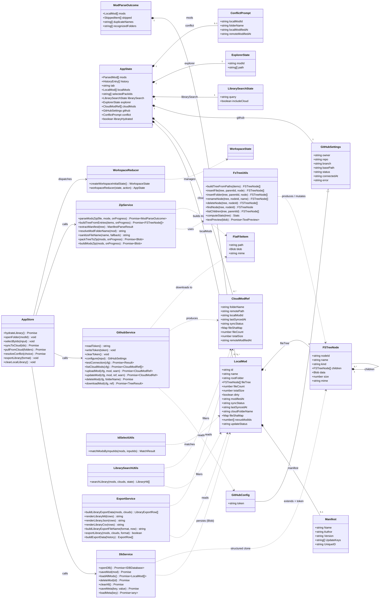
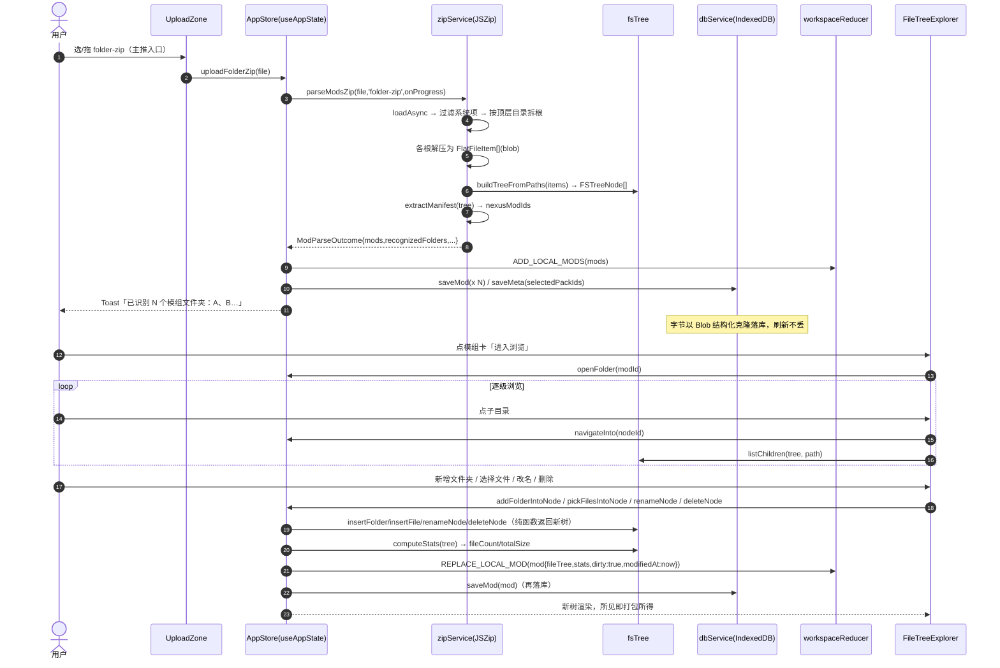
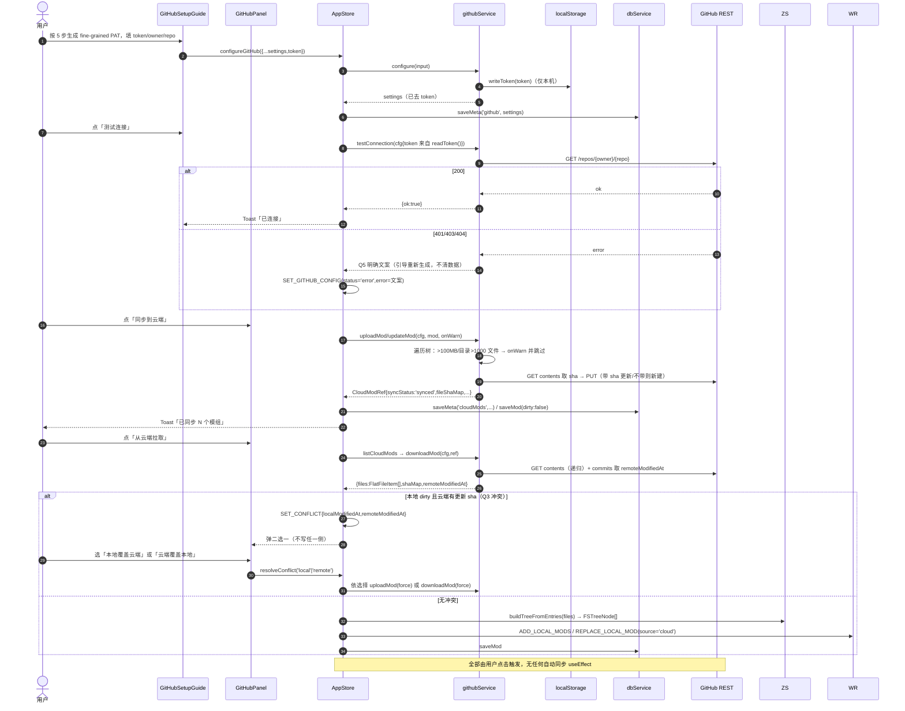
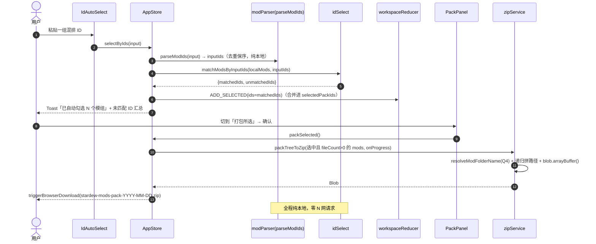
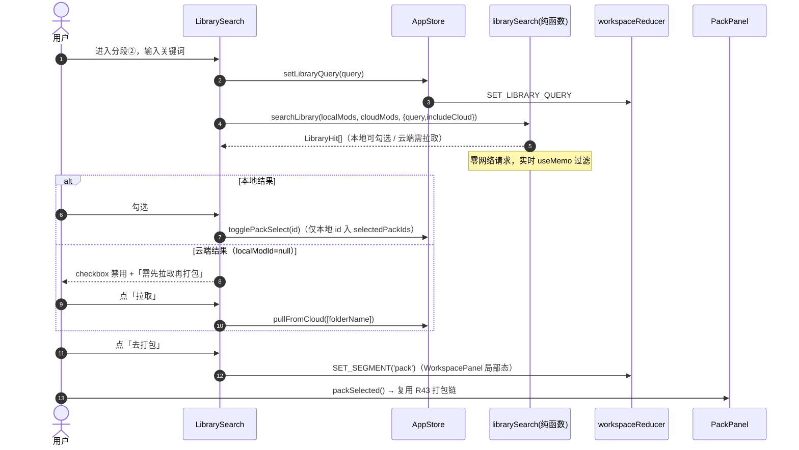
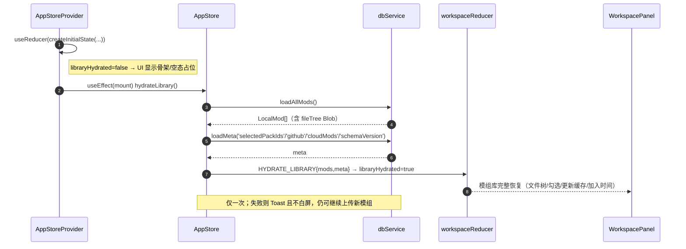
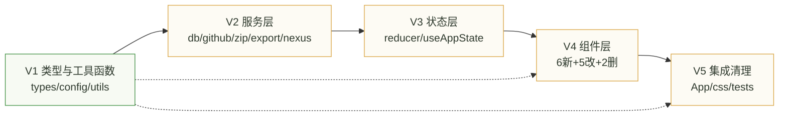

# 星露谷模组下载助手 — 增量架构设计与任务分解（v4）

> 文档版本：v4.0（增量文档）　|　架构师：高见远（Gao）　|　需求来源：`docs/PRD-v4.md`（许清楚 v4.0，**唯一需求来源**，R46–R56）
> 基线：`DESIGN.md`（v1 R01–R22）＋ `DESIGN-v2.md`（v2 R23–R31）＋ `DESIGN-v3.md`（v3 R32–R45，已交付）　|　形态：纯静态 PWA，无后端
> 阅读约定：本文**只描述本次增量**，不重复 v1/v2/v3 全文。**【修改】**＝在已有文件上改造；**【新增】**＝新文件；**【删除】**＝本次移除；**【不变】**＝本次不碰、回归时只需确认未受影响。
> 任务编号用 `V1…V5`，与 v1 的 `T01…T05`、v2 的 `E1…E5`、v3 的 `W1…W5` 区分。
> 核心纪律：**三处结构性重构一次到位 ＋ 删除项零残留 ＋ 下载/历史 Tab 零回归 ＋ 非 Premium 铁律 ＋ 隐私铁律（模组文件默认不出本地）**。

---

## 0. 设计输入与已拍板决策（Q1–Q9，严格遵守，不再讨论）

| # | 主理人已拍板决策 | 本设计落地位置 | 对工程师的硬约束 |
| --- | --- | --- | --- |
| Q1 | 文件字节在 IndexedDB 用 **`Blob`** 存（结构化克隆友好、省内存），读取时按需 `arrayBuffer()`，打包时喂给 JSZip | §2.1 `FSTreeNode.data: Blob`、§3.1 `dbService`、§3.3 `packTreeToZip` | 内存中 `data` 也统一为 `Blob`；**禁止**退回 `Uint8Array` 造成保存时二次转换；JSZip 打包前 `await blob.arrayBuffer()` |
| Q2 | 本地↔云端同步**全手动**（显式"同步到云端"/"从云端拉取"），不做自动双向合并 | §3.2 `syncToCloud`/`pullFromCloud`、§5 `GitHubPanel` | **无**任何挂载即同步的 `useEffect`；进度靠用户点击触发 |
| Q3 | 冲突弹窗二选一（本地覆盖云端 / 云端覆盖本地），显示各自修改时间，不静默合并 | §2.2 `ConflictPrompt`、§3.2 冲突判定、§5.2 `GitHubPanel` 内冲突层 | 冲突时先 `SET_CONFLICT`，用户不点 `resolveConflict` 前不得写入任一侧 |
| Q4 | 仓库目录名优先用原 `rootFolder`，缺失用安全化模组名 | §3.3 `resolveModFolderName()` | 顺序固定：`rootFolder → sanitize(name) → mod-{id}`，打包与云端**共用**此函数 |
| Q5 | token 失效/权限不足给明确提示引导重新生成，**不清除已同步数据** | §3.2 `testConnection` 错误映射、§7.5 | 401/403 只改 `github.status/error`；**禁止**调用 `clearAll`/`deleteMod`/`removeLocalMod` |
| Q6 | 文本文件（json/txt/cfg…）显示内容摘要；二进制仅"可下载/删除"，不在线编辑 | §3.4 `textPreview`、§5.2 `FileTreeExplorer` | 无"在线编辑"入口；文本预览只读 |
| Q7 | unknown 状态保留一行简短原因，不显示冗长灰底条 | §5.2 `LocalModCard` | latest/outdated **不渲染** `checkError`；unknown 仅一行 |
| Q8 | 模组库搜索含云端已同步模组元数据，但其文件树不在本地——勾选云端项提示"需先拉取再打包"，不直接纳入打包 | §2.1 `LibrarySearchState.includeCloud`、§3.6 `searchLibrary`、§5.2 `LibrarySearch` | 云端项 checkbox 禁用 + 拉取按钮；`selectedPackIds` 只收本地 id |
| Q9 | 本地库总大小 >500MB 软阈值提示，不做硬限制，提供清空入口 | §2.4 `librarySoftLimitBytes`、§5.2 `LocalModLibrary` | 只 Toast/横幅提示，不拦截上传；`clearLocalLibrary()` 二次确认 |

---

## 1. 增量概述

### 1.1 三处结构性重构的边界与回归风险

本次**不是打补丁**，是三处互相牵动的结构性重构。边界与风险如下：

| # | 结构性重构 | 改动面（旧 → 新） | 主要回归风险 | 隔离手段 |
| --- | --- | --- | --- | --- |
| **S1** | 文件树模型 | `FileNode[]` 扁平带 `path`+`Uint8Array` → `FSTreeNode[]` 层级树、`data:Blob` | ① `extractManifest` 找不到根节点；② `packTreeToZip` 层级/顺序错；③ 测试 `FileNode` 构造失效 | 树操作全部收敛到 `utils/fsTree.ts` 纯函数；`zipService` 双向改造同一套遍历；测试 fixture 在 V5 统一迁移 |
| **S2** | 本地持久化 | 内存态（v3 Q1）→ IndexedDB `mods/meta/cloudMods` | ① 刷新后库为空；② Blob 被 JSON 序列化损坏；③ 首屏闪烁空库 | `dbService` 唯一出口、`structuredClone` 原生存 Blob；`libraryHydrated` 门控渲染；`HYDRATE_LIBRARY` 一次性落 state |
| **S3** | 云端同步 | 无 → `githubService` 直连 GitHub Contents API | ① token 泄漏；② 误覆盖本地/云端；③ 大文件超限 | token 仅 `localStorage`+调用期内存；全手动 + 冲突二选一；100MB/1000 文件预警 |

> **关键结论**：S1–S3 全部落在**工作区（workspace）**这一条支线上。下载 Tab 与历史 Tab 走的是 v1 的 `resolveMods → buildDownloadPlan → runPlanAndRecord → executeDownloadPlan` 链路，与 `LocalMod.fileTree` / `workspaceReducer` 的搜索分支**无数据耦合**。只要 §1.3 的"不变清单"被遵守，下载/历史即零回归。

### 1.2 受影响文件总览

**【修改】**

| 文件 | 变更摘要 | 需求 |
| --- | --- | --- |
| `src/types/workspace.ts` | `FileNode`→`FSTreeNode`（层级/`Blob`）；`LocalMod.fileTree` 换类型 + 加脏标记/同步字段；删 `SearchState`/`SearchResult`/`PendingDownload`；`WorkspaceState` 字段重组 | R48/R49/R50 |
| `src/types/domain.ts` | `AppState` 去 `searchState`/`pendingDownloads`，加 `librarySearch`/`explorer`/`cloudMods`/`github`/`syncBusy`/`conflict`/`libraryHydrated`；import 调整 | R48/R49/R50 |
| `src/types/nexus.ts` | 删 `SearchMod`/`SearchPagination`/`SearchResponse`（保留 4 个原 DTO） | R48 |
| `src/config/index.ts` | 删 `gameId`/`search{}`/`apiPath.search`；加 `github{}`/`librarySoftLimitBytes`/`libraryExportFileNamePrefix`/`db{}`；保留 `modPage()` | R48/R49/R53/Q9 |
| `src/services/zipService.ts` | `buildTreeFromEntries` 层级建树；`packTreeToZip` 递归打包（`buildModsZip` 保留别名）；`extractManifest` 适配树；新增 `resolveModFolderName` | R47/R50/Q4 |
| `src/services/nexusApi.ts` | **仅删** `searchMods()` 及其 import；其余函数逐字不动 | R48 |
| `src/services/exportService.ts` | **追加** `buildLibraryExportData`/`renderLibrary*`/`buildLibraryExportFileName`/`exportLibrary`；历史导出函数不动 | R53 |
| `src/hooks/workspaceReducer.ts` | 删 7 个搜索/清单 case；加库/树/云/冲突 case；初始态重组 | R48/R49/R50/R51 |
| `src/hooks/useAppState.tsx` | 删 7 个搜索 action + `rateLimitedCount` ref；加 ~18 个 action；接入 `dbService`/`githubService`；启动 hydrate | R48–R53 |
| `src/components/workspace/WorkspacePanel.tsx` | 分段②`search→library`、文案"模组库搜索"；Key 提示改文案 | R48 |
| `src/components/workspace/LocalModLibrary.tsx` | 去本地关键词过滤（移到分段②）；加 ID 勾选/导出/清空/GitHub 入口/500MB 提示 | R48/R49/R51/R53/Q9 |
| `src/components/workspace/LocalModCard.tsx` | 平铺 `<ul>`→"文件夹卡片+进入浏览"；状态文案极简；unknown 一行；加同步徽标 | R50/R52/Q7 |
| `src/components/workspace/UploadZone.tsx` | 主推 folder-zip 文案；单包降级次要；去掉"刷新需重传"改为"已本地持久化" | R47/R49 |
| `src/components/workspace/PackPanel.tsx` | 删"待下载清单"（PendingDownload 移除）；只保留"打包所选" | R48 |
| `src/App.tsx` | 删 `UpdatePrompt` import 与渲染；其余逐字不动 | R46 |
| `src/index.css` | **追加** `.tree-row`/`.breadcrumb`/`.modal-*` 少量类（复用现有变量） | R50/Q3 |
| `tests/v3.test.ts` | 删搜索相关测试与 import；`FileNode` fixture 改 `FSTreeNode`；保留更新/打包/安全回归测试 | 全量回归 |

**【新增】**

| 文件 | 职责 | 需求 |
| --- | --- | --- |
| `src/utils/fsTree.ts` | 层级树纯函数：建树/增删改名/查找/列举/统计/文本预览 | R50/Q1/Q6 |
| `src/utils/idSelect.ts` | `matchModsByInputIds` 纯函数（复用 v1 `parseModIds`） | R51 |
| `src/utils/librarySearch.ts` | `searchLibrary` 纯函数（本地+云端元数据模糊匹配） | R48/Q8 |
| `src/services/dbService.ts` | IndexedDB：`openDB`/`saveMod`/`loadAllMods`/`deleteMod`/`clearAll`/`saveMeta`/`loadMeta` | R49/Q1 |
| `src/services/githubService.ts` | GitHub Contents API：配置/测试/列举/上传/更新/删除/下载 + token 存取 | R49/Q2/Q3/Q5 |
| `src/components/workspace/FileTreeExplorer.tsx` | 文件夹树浏览 + 增删改名 + 文本预览（核心 UI） | R50 |
| `src/components/workspace/Breadcrumb.tsx` | 面包屑导航（返回上级/任一级） | R50 |
| `src/components/workspace/LibrarySearch.tsx` | 分段②：模组库本地/云端搜索 + 勾选 + 拉取 | R48/Q8 |
| `src/components/workspace/IdAutoSelect.tsx` | 按一组 ID 自动勾选 + 未匹配汇总 | R51 |
| `src/components/workspace/GitHubSetupGuide.tsx` | fine-grained PAT 5 步引导 + 配置表单 + 测试连接 | R49 |
| `src/components/workspace/GitHubPanel.tsx` | 云端模组列表 + 同步/拉取/删除 + 冲突二选一 + 大文件预警 | R49/Q2/Q3 |
| `tests/v4.test.ts` | fsTree/idSelect/librarySearch/exportLibrary 纯函数单测 | 回归 |

**【删除】**

| 文件/符号 | 需求 |
| --- | --- |
| `src/components/ui/UpdatePrompt.tsx` | R46 |
| `src/components/workspace/ModSearch.tsx` | R48 |
| `src/components/workspace/SearchResultCard.tsx` | R48 |
| `src/hooks/useDebounce.ts`（失去唯一调用方，可选保留但推荐删） | R48 |
| `nexusApi.searchMods` + `SearchResponse`/`SearchMod`/`SearchPagination` | R48 |
| `APP_CONFIG.gameId`/`APP_CONFIG.search`/`apiPath.search` | R48 |
| `SearchState`/`SearchResult`/`PendingDownload` + reducer 7 case + AppState 2 字段 | R48 |

**【不变】——回归时只需确认未受影响**

`package.json`（**本次零新增依赖**，理由见 §1.4）、`index.html`、`vite.config.ts`（保持 `registerType:'autoUpdate'` + `injectRegister:null`，见 §7.5）、`tsconfig*.json`、`tailwind.config.js`、`postcss.config.js`、`public/*`、`src/main.tsx`、`src/vite-env.d.ts`、`src/services/downloadService.ts`、`src/services/modParser.ts`、`src/utils/{bbcode,format,download,errors,history,version}.ts`、`src/data/*`、`src/hooks/{useLocalStorage,useToast}.tsx`、`src/components/ui/{Toast,Skeleton,EmptyState}.tsx`、`src/components/{StatusBar,ApiKeyPanel,ModIdInput,ModCard,FileList,PrerequisiteList,DownloadActions,HistoryPanel,TabBar}.tsx`、`src/components/workspace/ProgressBar.tsx`、`tests/{parser,utils,downloadService,v2}.test.ts`、`tests/fixtures.ts`。

### 1.3 下载/历史 Tab 零回归的保证

| 不变量 | 落地保证 |
| --- | --- |
| `buildDownloadPlan` / `runPlanAndRecord` / `executeDownloadPlan` 语义 | `modParser.ts`/`downloadService.ts`/`useAppState` 中这三个函数体**逐字不动**，V3 只在其旁新增 action |
| `resolveMods`/`download`/`redownload` / `validate` / `setKey` 链路 | 完整保留，仅从其依赖数组移除已删的搜索项 |
| 下载 Tab / 历史 Tab 渲染分支 | `App.tsx` 仅删 `UpdatePrompt` 两行；`download` 分支与 `HistoryPanel` 分支不动 |
| 非 Premium 铁律 | `buildDownloadPlan` 不动 ⇒ standard 永不进入 `download_link.json`；`updateService` 仍只调 `fetchFiles()`（files.json） |
| API Key 边界 | `request()` 不动；新增的 GitHub 请求走**独立** `githubService`，只带 `Authorization: Bearer <PAT>`，与 `apikey` 完全隔离 |
| Tab 结构 | `TabKey` 仍为 `'download'|'workspace'|'history'`；`TabBar.tsx` 不动 |

### 1.4 实现方案与框架选型

| 难点 | 对策 |
| --- | --- |
| 浏览器内层级树 + 字节持久化 | `FSTreeNode.data: Blob`；原生 `indexedDB` 结构化克隆直接存 Blob，无需序列化/Base64，**零新增依赖** |
| IndexedDB 用原生还是 idb | **决策：原生 API + `dbService.ts` 内薄 promise 封装**。理由：仅需 6 个单 store 操作、无游标/复合查询/升级迁移；原生 `IDBRequest` 用 ~70 行即可覆盖；省一个依赖与构建体积，契合 v1–v3 "不引入不必要依赖"纪律。若后续出现多 store 事务/迁移，可在 `dbService` 内部无感替换为 `idb@^8`（见 §8 U1） |
| 树增删改名保持 nodeId 稳定 | `nodeId` 用 `crypto.randomUUID()`（兜底时间戳），`name` 仅当前层级；改名只改 `name`，路径在渲染/打包时现拼，**不存 path** |
| GitHub 文件字节上传 | Contents API PUT 需 base64：用 `Uint8Array` 分块（每块 `0x8000`）转字符串后 `btoa`，避免 `String.fromCharCode(...bigArray)` 爆栈 |
| 冲突检测 | 本地 `dirty`/`modifiedAt` vs 云端 `fileShaMap`/最近 commit 时间；命中即弹二选一（Q3） |
| 大库/大文件 | Contents API 单文件 100MB、目录 1000 文件；上传前按树统计预警并跳过；本地总大小 >500MB 软提示（Q9） |
| iOS 触控 | 新增按钮统一 `.tap-target`（≥44px）、`.app-card`、`.chip--*`/CSS 变量；面包屑/确认层适配安全区 |

> **架构模式**：延续 v1–v3 的 `Context + useReducer`（状态）＋ `services`（副作用）＋ `utils`（纯函数）分层。新增纯函数一律进 `utils/*`，副作用进 `services/*`，组件只调 action。不引入状态库、路由库、UI 组件库、埋点。

---

## 2. 数据结构与类型

> 同步保存于 `docs/class-diagram-v4.mermaid`。

### 2.1 `src/types/workspace.ts`【修改】—— 层级树与云同步契约

```ts
/** 【重构 S1】层级文件树节点；data 用 Blob（Q1），nodeId 稳定、name 仅当前层级。 */
export interface FSTreeNode {
  /** 稳定唯一 id（crypto.randomUUID 兜底）；增删改名定位用，绝不随改名变化 */
  nodeId: string;
  /** 文件名或文件夹名，仅当前层级，不含路径分隔符 */
  name: string;
  kind: 'dir' | 'file';
  /** 仅 dir 有；file 为 [] */
  children: FSTreeNode[];
  /** 仅 file 有：字节 Blob；打包前 await blob.arrayBuffer() */
  data?: Blob;
  /** file 字节数；dir 恒为 0（汇总由 computeStats 现场算） */
  size: number;
  /** 由扩展名推断，供 textPreview 判断，如 application/json */
  mime?: string;
}

/** 扁平文件项：zip 解压 / 云端下载 → 建树的中间结构。 */
export interface FlatFileItem {
  /** 相对模组根、'/' 分隔、无前导 './' */
  path: string;
  blob: Blob;
  mime?: string;
}

/** SMAPI manifest（不变） */
export interface Manifest {
  Name: string; Author: string; Version: string; Description: string;
  UpdateKeys: string[]; UniqueID: string;
}
export interface ManifestParseResult { manifest: Manifest | null; reason?: string; }

export type UpdateStatus = 'latest' | 'outdated' | 'unknown';
/** 【扩展】来源新增 'cloud'（从云端拉取到本地） */
export type ModSource = 'folder-zip' | 'single-zip' | 'cloud';
/** 【新增】本地模组与云端的同步关系（Q2/Q3） */
export type LocalSyncStatus =
  | 'local-only' | 'synced' | 'local-ahead' | 'remote-ahead' | 'conflict' | 'error';

export interface UpdateInfo {
  modId: number; version: string; uploadedAt: string; fileId: number;
}

/** 【重构+扩展】本地模组 */
export interface LocalMod {
  id: string;
  name: string;
  author: string;
  version: string;
  description: string;
  manifest: Manifest | null;
  updateKeys: string[];
  nexusModIds: number[];
  /** 【换类型】FSTreeNode[] 层级树（原 FileNode[]） */
  fileTree: FSTreeNode[];
  fileCount: number;
  totalSize: number;
  rootFolder: string;
  source: ModSource;
  uniqueId: string;
  updateStatus: UpdateStatus;
  updateInfo: UpdateInfo | null;
  checkError: string;
  lastCheckedAt: string | null;
  addedAt: string;
  /** 【新增】本地有未同步改动（上传/树增删改名/更新检测结果后标脏） */
  dirty: boolean;
  /** 【新增】最近一次本地内容改动时间 ISO（冲突比对用） */
  modifiedAt: string;
  /** 【新增】同步状态（Q2/Q3） */
  syncStatus: LocalSyncStatus;
  /** 【新增】最近成功同步到云端的时间 ISO；null 表示未同步过 */
  lastSyncedAt: string | null;
  /** 【新增】仓库内目录名（Q4：rootFolder 优先，缺失用安全化 name） */
  cloudFolderName: string;
  /** 【新增】文件相对路径 → GitHub blob sha（增量更新/冲突判断） */
  fileShaMap: Record<string, string>;
}

export interface ModParseOutcome {
  mods: LocalMod[];
  skipped: Array<{ name: string; reason: string }>;
  duplicateNames: string[];
  /** 【新增 R47】识别到的顶层文件夹名，供 Toast「已识别 N 个模组文件夹：A、B…」 */
  recognizedFolders: string[];
}

export interface UpdateDetectionResult {
  status: UpdateStatus; updateInfo: UpdateInfo | null; checkError: string;
}

/** 【新增】GitHub 连接设置（存 state/IDB meta，**永不含 token**） */
export interface GitHubSettings {
  owner: string;
  repo: string;
  branch: string;                 // 默认 'main'
  basePath: string;              // 默认 'mods/'
  status: 'unconfigured' | 'connected' | 'error';
  connectedAt: string | null;    // ISO
  error: string;
}
/** 【新增】服务层配置：设置 + 调用期 token（仅内存，来自 localStorage） */
export interface GitHubConfig extends GitHubSettings {
  token: string;
}

/** 【新增】云端模组映射（PRD 5.3） */
export interface CloudModRef {
  folderName: string;
  remotePath: string;                 // `${basePath}${folderName}`
  localModId: string | null;          // 未拉取到本地时为 null（Q8）
  lastSyncedAt: string;               // ISO
  syncStatus: LocalSyncStatus;
  /** 文件相对路径 → blob sha */
  fileShaMap: Record<string, string>;
  fileCount: number;
  totalSize: number;
  /** 云端最近提交时间 ISO（冲突比对用） */
  remoteModifiedAt: string;
}

/** 【新增 R48/Q8】模组库搜索状态（纯本地，零网络） */
export interface LibrarySearchState {
  query: string;
  /** 是否把云端已同步元数据纳入结果（Q8 默认 true） */
  includeCloud: boolean;
}

/** 【新增 R50】文件浏览器导航状态（提升到 useAppState） */
export interface ExplorerState {
  /** 正在浏览的本地模组 id；null 表示未进入 */
  modId: string | null;
  /** 从模组根开始的 nodeId 路径；[] 表示当前在模组根 */
  path: string[];
}

/** 【新增 Q3】冲突提示载荷 */
export interface ConflictPrompt {
  localModId: string;
  folderName: string;
  localModifiedAt: string;   // LocalMod.modifiedAt
  remoteModifiedAt: string;  // CloudModRef.remoteModifiedAt
}

/* ---- 进度类型（不变） ---- */
export type ProgressPhase = 'reading' | 'unzip' | 'manifest' | 'checking' | 'packing' | 'syncing' | 'done';
export interface ProgressInfo {
  phase: ProgressPhase; current: number; total: number; message?: string;
}
export type ProgressCallback = (progress: ProgressInfo) => void;
export type ProgressTarget = 'upload' | 'pack' | 'sync';

/** 【重组】工作区状态切片 = AppState 中 v4 工作区字段的契约 */
export interface WorkspaceState {
  localMods: LocalMod[];
  selectedPackIds: string[];
  librarySearch: LibrarySearchState;
  explorer: ExplorerState;
  checkingIds: string[];
  uploadProgress: ProgressInfo | null;
  packProgress: ProgressInfo | null;
  syncProgress: ProgressInfo | null;
  cloudMods: CloudModRef[];
  github: GitHubSettings;
  syncBusy: boolean;
  conflict: ConflictPrompt | null;
  libraryHydrated: boolean;
}
```

**【删除】以下三个类型从 `workspace.ts` 整体移除，禁止任何残留引用：**

```ts
// ❌ 全部删除（search 语义整体移除，R48）
// export interface SearchResult { modId; name; author; summary; thumbnailUrl; downloads; endorsements; categoryName; inList }
// export interface SearchState { query; activeQuery; results; page; hasMore; total; loading; error; rateLimited; cooldownUntil; lastSearchAt }
// export interface PendingDownload { modId; name; thumbnailUrl; source:'search'; addedAt }
```

### 2.2 `src/types/domain.ts`【修改】—— AppState

```ts
import type { Mod, ModFile } from './nexus';
// 【修改 import】删 PendingDownload / SearchState，引入 v4 新类型
import type {
  CloudModRef, ConflictPrompt, ExplorerState, GitHubSettings,
  LibrarySearchState, LocalMod, ProgressInfo,
} from './workspace';

// 其余联合类型 / Prerequisite / ParsedMod / DownloadItem / DownloadPlan /
// DownloadResult / HistoryEntry / KeyValidationResult 全部【不变】

/** AppState：v1/v2 字段全部保留，工作区字段按 v4 重组 */
export interface AppState {
  apiKey: string;
  keyStatus: KeyStatus;
  tier: PremiumTier;
  userName: string | null;
  keyMessage: string;
  idsInput: string;
  mods: ParsedMod[];
  loadingIds: number[];
  loadErrors: Record<number, string>;
  selectedFiles: Record<number, number>;
  includeChinese: Record<number, boolean>;
  history: HistoryEntry[];
  theme: ThemeMode;
  tab: TabKey;                       // 'download' | 'workspace' | 'history'（不变）

  // ↓↓↓ v4 工作区字段（替换 v3 的 searchState / pendingDownloads）↓↓↓
  localMods: LocalMod[];
  selectedPackIds: string[];
  librarySearch: LibrarySearchState;
  explorer: ExplorerState;
  checkingIds: string[];
  uploadProgress: ProgressInfo | null;
  packProgress: ProgressInfo | null;
  syncProgress: ProgressInfo | null;
  cloudMods: CloudModRef[];
  github: GitHubSettings;            // 无 token
  syncBusy: boolean;
  conflict: ConflictPrompt | null;
  libraryHydrated: boolean;          // 防止 hydrate 前渲染空库闪烁
}
```

**`TabKey` / 分段 key 调整**

```ts
export type TabKey = 'download' | 'workspace' | 'history';   // 不变
/** 【新增】WorkspacePanel 三分段 key：v3 的 'search' 更名 'library' */
export type WorkspaceSegment = 'local' | 'library' | 'pack';
// 文案：① 本地模组库 ② 模组库搜索 ③ 打包所选
```

### 2.3 `src/types/nexus.ts`【修改】

删除文件末尾三个搜索 DTO（`SearchMod`/`SearchPagination`/`SearchResponse`）；`NexusAuthor`/`ValidateResponse`/`Mod`/`ModFile`/`DownloadLink` **逐字不动**。

### 2.4 `src/config/index.ts`【修改】

```ts
export const APP_CONFIG = {
  // ...v1/v2 既有字段全部保留（appName/applicationName/applicationVersion/
  // gameDomain/apiBaseUrl/webBaseUrl/gameVersionBaseline/exportFileNamePrefix）...
  /** 【删除】gameId、search{} —— v3 搜索专用，本次移除 */
  update: { cacheTtlMs: 10 * 60 * 1000, concurrency: 3 },     // 不变
  upload: { softLimitBytes: 100*1024*1024, hardLimitBytes: 300*1024*1024 }, // 不变
  pack: { fileNamePrefix: 'stardew-mods-pack' },              // 不变
  /** 【新增 R49】GitHub 直连配置（限频数值唯一来源） */
  github: {
    apiBase: 'https://api.github.com',
    apiVersion: '2022-11-28',
    defaultBranch: 'main',
    defaultBasePath: 'mods/',
    maxFileBytes: 100 * 1024 * 1024,     // Contents API 单文件上限
    maxFilesPerDir: 1000,                // Contents API 目录列表上限
    tokenStorageKey: 'sdmh.githubToken',
  },
  /** 【新增 Q9】本地库软阈值：>500MB 提示，不硬限制 */
  librarySoftLimitBytes: 500 * 1024 * 1024,
  /** 【新增 R53】库清单文件名前缀 → stardew-mod-library-YYYY-MM-DD.{md|json|csv} */
  libraryExportFileNamePrefix: 'stardew-mod-library',
  /** 【新增 R49】IndexedDB 库约定 */
  db: { name: 'stardew-mod-helper', version: 1 },
  storageKeys: { apiKey: 'sdmh.apiKey', history: 'sdmh.history',
                 theme: 'sdmh.theme', lastIds: 'sdmh.lastIds' }, // 不变；token 不入此表
} as const;

export const apiPath = {
  validate, modInfo, files, downloadLink, filePage, modPage,   // 全部不变
  // 【删除】search(query, page)
} as const;
```

### 2.5 AppActions 新增/删除签名清单（`src/hooks/useAppState.tsx`）

```ts
export interface AppActions {
  /* ===== v1/v2 全部不变 ===== */
  setKey(apiKey: string): void;
  clearKey(): void;
  validate(): Promise<void>;
  setIdsInput(value: string): void;
  resolveMods(input?: string): Promise<void>;
  selectFile(modId: number, fileId: number): void;
  toggleChinese(modId: number): void;
  download(modId: number, manualAction?: 'open' | 'copy'): Promise<void>;
  redownload(entry: HistoryEntry, manualAction?: 'open' | 'copy'): Promise<void>;
  setTheme(theme: ThemeMode): void;
  setTab(tab: TabKey): void;
  clearHistory(): void;

  /* ===== v3 工作区保留（上传/勾选/检测/打包/进度） ===== */
  uploadFolderZip(file: File): Promise<void>;
  uploadSingleZips(files: File[]): Promise<void>;
  togglePackSelect(localId: string): void;
  removeLocalMod(localId: string): void;
  checkUpdates(force?: boolean): Promise<void>;
  checkOneUpdate(localId: string, force?: boolean): Promise<void>;
  packSelected(): Promise<void>;
  setProgress(target: ProgressTarget, progress: ProgressInfo | null): void;

  /* ===== 【删除】v3 搜索 7 action（禁止残留） =====
   * searchMods / loadMoreSearch / setSearchQuery /
   * addPending / removePending / downloadAllPending / downloadFromSearch */

  /* ===== v4 新增：模组库搜索 / ID 勾选 / 文件树浏览与编辑 ===== */
  setLibraryQuery(query: string): void;
  setIncludeCloud(include: boolean): void;
  selectByIds(input: string): void;                          // R51
  openFolder(modId: string): void;                           // 进入模组根
  navigateInto(nodeId: string): void;                        // 进入子目录
  navigateUp(): void;                                        // 返回上级
  closeFolder(): void;
  pickFilesIntoNode(modId: string, parentId: string | null, files: File[]): Promise<void>;
  addFolderIntoNode(modId: string, parentId: string | null, name: string): void;
  renameNode(modId: string, nodeId: string, name: string): void;
  deleteNode(modId: string, nodeId: string): void;

  /* ===== v4 新增：GitHub 云端（全手动 Q2） ===== */
  configureGitHub(input: GitHubSettings & { token: string }): void;
  clearGitHubConfig(): void;
  testGitHubConnection(): Promise<void>;
  refreshCloudMods(): Promise<void>;
  syncToCloud(ids?: string[]): Promise<void>;                // 本地 → 云
  pullFromCloud(folderNames?: string[]): Promise<void>;      // 云 → 本地
  deleteCloudMod(folderName: string): Promise<void>;
  resolveConflict(choice: 'local' | 'remote'): Promise<void>; // Q3

  /* ===== v4 新增：库管理 / 导出 / 启动恢复 ===== */
  exportLibrary(format: ExportFormat): void;                 // R53
  clearLocalLibrary(): void;                                 // Q9
  hydrateLibrary(): Promise<void>;                           // 启动从 IDB 恢复
}
```

### 2.6 类图（Mermaid）



---

## 3. 服务层设计

### 3.1 `src/services/dbService.ts`【新增】—— IndexedDB 持久化（Q1）

```ts
import { APP_CONFIG } from '../config';
import type { LocalMod, CloudModRef, GitHubSettings } from '../types/workspace';

/** 打开（必要时建库）数据库；stores: mods(keyPath id) / meta(keyPath key) / cloudMods(keyPath folderName) */
export function openDB(): Promise<IDBDatabase>;

/** 保存单个模组（含 fileTree 的 Blob，原生结构化克隆，不序列化） */
export function saveMod(mod: LocalMod): Promise<void>;

/** 读取全部本地模组（顺序按 addedAt 由调用方排序） */
export function loadAllMods(): Promise<LocalMod[]>;

/** 删除单个模组 */
export function deleteMod(id: string): Promise<void>;

/** 清空本地库：clear(mods) + clear(cloudMods)；meta 按参数决定是否清 */
export function clearAll(includeMeta?: boolean): Promise<void>;

/** 保存 meta：selectedPackIds / github 设置 / schemaVersion（**永不含 token**） */
export function saveMeta(key: string, value: unknown): Promise<void>;
export function loadMeta<T>(key: string): Promise<T | undefined>;

/** 云端模组快照缓存（加速分段②/③展示，可缺省） */
export function saveCloudMod(ref: CloudModRef): Promise<void>;
export function loadAllCloudMods(): Promise<CloudModRef[]>;
```

实现要点：

- `openDB` 用 `indexedDB.open(APP_CONFIG.db.name, APP_CONFIG.db.version)`，`onupgradeneeded` 里幂等建 3 个 store（`if (!db.objectStoreNames.contains(...)) createObjectStore`）。
- 每个方法统一 `new Promise((resolve, reject) => { const req = ...; req.onsuccess=()=>resolve(req.result); req.onerror=()=>reject(req.error); })`；`saveMod` 用 `store.put(mod)`（幂等 upsert）。
- **绝不** `JSON.stringify(mod)`：Blob 会变成 `{}`。直接 `put(mod)` 让浏览器结构化克隆处理 Blob（Q1）。
- 读写失败（隐私模式/配额）由调用方 `useAppState` catch 并 Toast，**不抛到 UI 白屏**。
- 首版 `schemaVersion=4` 写入 meta；meta 中 github 只存 `GitHubSettings`（无 token）。

### 3.2 `src/services/githubService.ts`【新增】—— GitHub Contents API（Q2/Q3/Q5）

```ts
import type { GitHubConfig, GitHubSettings, CloudModRef, FlatFileItem, LocalMod } from '../types/workspace';

/* ---- token 边界：仅 localStorage + 调用期内存 ---- */
export function readToken(): string;              // localStorage.getItem(APP_CONFIG.github.tokenStorageKey) ?? ''
export function writeToken(token: string): void;  // 仅写 localStorage
export function clearToken(): void;               // 仅删 localStorage 项

/** 配置：写 token 到 localStorage，返回可存 state/IDB 的**无 token** 设置 */
export function configure(input: GitHubSettings & { token: string }): GitHubSettings;

/** 只读校验：GET /repos/{owner}/{repo}。200→成功；401/403→token 失效或权限不足；404→仓库不存在 */
export function testConnection(cfg: GitHubConfig): Promise<{ ok: boolean; message: string }>;

/** 列举：GET /repos/{o}/{r}/contents/{basePath}?ref={branch}，顶层目录映射为 CloudModRef[] */
export function listCloudMods(cfg: GitHubConfig): Promise<CloudModRef[]>;

/** 全量上传：逐文件 PUT，空目录写 .gitkeep；返回含 shaMap 的 ref */
export function uploadMod(
  cfg: GitHubConfig, mod: LocalMod,
  onWarn?: (msg: string) => void,
): Promise<CloudModRef>;

/** 增量更新：按 fileShaMap 跳过未变文件，仅 PUT 变更文件 */
export function updateMod(
  cfg: GitHubConfig, mod: LocalMod, ref: CloudModRef,
  onWarn?: (msg: string) => void,
): Promise<CloudModRef>;

/** 删除：逐文件 DELETE（需 sha）；调用方在 resolveConflict/删除确认后调用 */
export function deleteMod(cfg: GitHubConfig, folderName: string): Promise<void>;

/** 下载回本地：递归读取目录 → FlatFileItem[]（blob），供 buildTreeFromPaths 建树 */
export function downloadMod(
  cfg: GitHubConfig, ref: CloudModRef,
): Promise<{ folderName: string; files: FlatFileItem[]; shaMap: Record<string,string>; remoteModifiedAt: string }>;
```

**REST 路径与 sha 增量约定**

| 操作 | 方法与路径 | 要点 |
| --- | --- | --- |
| 测试连接 | `GET /repos/{owner}/{repo}` | 只读，带 Bearer token；不列举私有仓库列表，最小权限 |
| 列举根目录 | `GET /repos/{o}/{r}/contents/{basePath}?ref={branch}` | 数组项 `type==='dir'` 即一个云端模组；404（未建目录）→ 返回 `[]` |
| 读文件/取 sha | `GET /repos/{o}/{r}/contents/{path}?ref={branch}` | 返回 `{ content(base64), sha, encoding:'base64' }`；刷新 sha 用于更新/冲突 |
| 取目录提交时间 | `GET /repos/{o}/{r}/commits?path={remotePath}&per_page=1` | `commit.committer.date` → `remoteModifiedAt`（Q3 冲突展示） |
| 新建文件 | `PUT /repos/{o}/{r}/contents/{path}` body `{ message, content, branch }` | content=分块 btoa 的 base64 |
| 更新文件 | `PUT` 同上 + `sha` | **必须先拿到当前 sha**（来自 `fileShaMap` 或 GET），否则 409 |
| 删除文件 | `DELETE` body `{ message, sha, branch }` | sha 从列举/GET 取得 |

**实现要点（工程师逐条落地）**

1. `requestGithub<T>(cfg, path, init?)` 内部统一拼 `${APP_CONFIG.github.apiBase}${path}`；请求头：`Authorization: Bearer ${cfg.token}`、`Accept: application/vnd.github+json`、`X-GitHub-Api-Version`、`User-Agent: sdmh`。**禁止**打印 cfg.token 或把它拼进错误文案/URL。
2. 错误映射（Q5）：401/403 → `"Token 失效或权限不足：请在 GitHub → Settings → Developer settings → Fine-grained tokens 重新生成（仅授权该私有仓库、Contents: Read and write），再回到工具重新配置。已同步的数据不会被清除。"`；404 → "仓库或路径不存在，请检查 owner/repo/分支/根路径"；429 → "GitHub 请求过于频繁，请稍后重试"；网络错误 → "网络异常，请检查连接"。**只**更新 `github.status/error`，不删数据。
3. base64 编码：`const bytes = new Uint8Array(await blob.arrayBuffer());` 以 `0x8000` 分块 `String.fromCharCode.apply(null, chunk)` 累加后 `btoa()`。解码：`atob(content.replace(/\s/g,''))` → `Uint8Array` → `new Blob([bytes], {type:mime})`。
4. 路径：`remotePath = basePath + folderName`；文件路径 `remotePath + '/' + relativePath`；`basePath` 统一补尾 `/`，`folderName` 用 `resolveModFolderName` 的结果（Q4）。
5. 预警：遍历树时累计单文件 `blob.size > maxFileBytes` → `onWarn('文件 X 超过 100MB，GitHub Contents API 将拒绝，已跳过')` 并跳过；同一目录文件数 `> maxFilesPerDir` → 预警并跳过该目录余下文件（Q9 之外的 API 硬限制）。
6. `uploadMod`：先 `listCloudMods`-等价的目录 GET 拿现有 sha 映射，逐文件 PUT（有 sha 则带），空目录写 `.gitkeep`（内容空字符串）。返回 `CloudModRef`（syncStatus='synced'、lastSyncedAt=now、fileShaMap 更新、fileCount/totalSize 重算）。
7. `updateMod`：对比本地 `fileShaMap`，sha 相同跳过；不同则 GET 取最新 sha 后 PUT；本地已删而云端有的文件 → DELETE。返回更新后的 ref。
8. `downloadMod`：递归 `GET contents`，收集 `FlatFileItem[]`（每个文件再 GET 内容解码成 Blob）+ `shaMap` + 最近 commit 时间。
9. **全手动**：本文件所有函数都是被 action 显式调用的纯服务，**无任何自动触发**。

### 3.3 `src/services/zipService.ts`【修改】—— 建树/打包双向改造（S1/R47/R50/Q4）

```ts
import JSZip from 'jszip';
import type { FlatFileItem, FSTreeNode, LocalMod, ManifestParseResult, ModParseOutcome, ProgressCallback } from '../types/workspace';

export type ZipMode = 'folder-zip' | 'single-zip';

/** 上传入口：读 File → JSZip.loadAsync → 按 mode 拆模组根 → 逐根层级建树/解析 manifest */
export function parseModsZip(file: File, mode: ZipMode, onProgress?: ProgressCallback): Promise<ModParseOutcome>;

/** 【新签名】从扁平文件项层级建树（内部调用 fsTree.buildTreeFromPaths），过滤系统项 */
export function buildTreeFromEntries(items: FlatFileItem[], onProgress?: ProgressCallback): Promise<FSTreeNode[]>;

/** 【适配】从 FSTreeNode[] 中找根下的 manifest.json，TextDecoder 解码 + 键名 lowercase 归一 */
export function extractManifest(fileTree: FSTreeNode[]): ManifestParseResult;

/** 【新增 Q4】rootFolder → sanitize(name) → mod-{id}，打包与云端共用 */
export function resolveModFolderName(mod: LocalMod): string;
export function sanitizeFileName(name: string, fallback: string): string;   // 不变
export function buildPackFileName(now?: Date): string;                      // 不变

/** 【新签名】递归打包 FSTreeNode：dir 递归拼路径，file await blob.arrayBuffer() 后 zip.file() */
export function packTreeToZip(mods: LocalMod[], onProgress?: ProgressCallback): Promise<Blob>;
/** 向后兼容别名（v3 测试与既有调用）：内部直接 return packTreeToZip(...) */
export function buildModsZip(mods: LocalMod[], onProgress?: ProgressCallback): Promise<Blob>;
```

实现要点：

- `parseModsZip` 顶层拆分逻辑**沿用并加固** v3：过滤 `__MACOSX`/`.DS_Store`/`._*`/`Thumbs.db`；`folder-zip` 按顶层目录拆多模组；`single-zip` 同名外层剥离；`recognizedFolders` 收集顶层目录名供 Toast（R47）。**不改变字节内容**。
- 解压得到 `FlatFileItem[]`（`entry.async('blob')` → Blob；mime 由扩展名推断），传入 `buildTreeFromEntries`。
- `buildTreeFromEntries` 只做：过滤系统项 → `fsTree.buildTreeFromPaths(items)` → 返回 `FSTreeNode[]`。**不再**自己拼 `path` 字段（树无 path）。
- `extractManifest`：只在模组根的直接子节点里找 `manifest.json`（大小写不敏感，`node.kind==='file' && node.data`）；`await node.data.text()` → `JSON.parse` → lowercase 键映射。**不递归子目录**（避免误读子模组 manifest）。
- `packTreeToZip`：`for mod → folder=resolveModFolderName(mod)`（同名加 `-2/-3`）→ 递归 `walk(nodes, prefix)`：`dir` 递归、空 dir 跳过或写 `.gitkeep`（与 v3 行为一致：dir 不单独写入）；`file` 用 `new Uint8Array(await node.data!.arrayBuffer())` 喂 `zip.file(prefix+name, bytes)`。`generateAsync({type:'blob',compression:'DEFLATE',level:6})`。
- 全程**无 fetch**；只产出 Blob，符合同一隐私边界。

### 3.4 `src/utils/fsTree.ts`【新增】—— 层级树纯函数（R50/Q1/Q6）

```ts
import type { FSTreeNode, FlatFileItem } from '../types/workspace';

export interface TreeStats { fileCount: number; totalSize: number; }
export interface TextPreview { isText: boolean; preview: string; truncated: boolean; }

/** 生成稳定 nodeId：crypto.randomUUID() 兜底 `${Date.now()}-${random}` */
export function makeNodeId(): string;
/** 扩展名 → mime；未知返回 application/octet-stream */
export function guessMime(name: string): string;
/** 是否文本类（json/txt/cfg/ini/md/xml/yml/yaml/log/csv 等） */
export function isTextFile(name: string, mime?: string): boolean;

/** 扁平项 → 层级树（按 '/' 分段建 dir，系统项过滤由调用方做） */
export function buildTreeFromPaths(items: FlatFileItem[]): FSTreeNode[];
/** 在 parentId（null=树根）下插入 file 节点，返回**新树**（不可变） */
export function insertFile(tree: FSTreeNode[], parentId: string | null, node: FSTreeNode): FSTreeNode[];
/** 在 parentId 下插入空 dir 节点 */
export function insertFolder(tree: FSTreeNode[], parentId: string | null, node: FSTreeNode): FSTreeNode[];
/** 按 nodeId 改名（只改 name，不动 nodeId/children） */
export function renameNode(tree: FSTreeNode[], nodeId: string, name: string): FSTreeNode[];
/** 按 nodeId 删除节点及其子树 */
export function deleteNode(tree: FSTreeNode[], nodeId: string): FSTreeNode[];
/** 按 nodeId 查找（深度优先） */
export function findNode(tree: FSTreeNode[], nodeId: string): FSTreeNode | null;
/** 按 nodeId 路径（string[]）定位当前目录的直接子节点；path=[] 返回根层 */
export function listChildren(tree: FSTreeNode[], path: string[]): FSTreeNode[];
/** 统计 file 节点数与 size 之和 */
export function computeStats(tree: FSTreeNode[]): TreeStats;
/** 文本预览：文本取前 maxChars 字符（默认 2000）；二进制 isText=false、preview='' */
export function textPreview(blob: Blob, name: string, mime?: string, maxChars?: number): Promise<TextPreview>;
/** 安全化节点名（去 `<>:"/\|?*` 与控制符、压缩空白、去首尾点），空串回退 fallback */
export function safeNodeName(name: string, fallback?: string): string;
```

实现要点：所有增删改**返回新树**（递归 map + 局部替换，不改入参），便于 reducer/state 直接替换与 React 重渲染；`renameNode` 只替换 `name`，`nodeId` 与 `children` 原样保留（这是"改名不破坏定位"的关键）。`textPreview` 只读，不提供编辑入口（Q6）。

### 3.5 `src/utils/idSelect.ts`【新增】—— 按 ID 自动勾选（R51）

```ts
import type { LocalMod } from '../types/workspace';

export interface MatchResult { matchedIds: string[]; unmatchedIds: number[]; }

/** 纯函数：inputIds ∩ mod.nexusModIds ≠ ∅ 即命中；未命中的 id 汇总返回。输入解析复用 modParser.parseModIds */
export function matchModsByInputIds(mods: LocalMod[], inputIds: number[]): MatchResult;
```

要点：输入文本由 action 先调 `parseModIds(input)`（v1 既有纯函数，混排/URL/去重）得 `inputIds`；本函数只做集合求交，零网络；返回 `matchedIds`（本地模组 id）由 action 合并进 `selectedPackIds`（**不写回模组对象**）。

### 3.6 `src/utils/librarySearch.ts`【新增】—— 模组库本地搜索（R48/Q8）

```ts
import type { LocalMod, CloudModRef, LibrarySearchState } from '../types/workspace';

export interface LibraryHit {
  key: string;              // 本地 = mod.id；云端 = `cloud:${folderName}`
  kind: 'local' | 'cloud';
  id: string;               // 本地 mod.id / 云端 folderName
  name: string; author: string; folderName: string;
  updateStatus: string; fileCount: number; totalSize: number;
  selectable: boolean;      // 云端且未拉取 → false（Q8：需先拉取再打包）
}

/** 纯函数、零网络：模糊匹配 name/manifest.Name/author/uniqueId/rootFolder/updateKeys/nexusModIds；
 *  大小写不敏感；空 query 返回全部本地模组；includeCloud 时并入云端元数据 */
export function searchLibrary(
  mods: LocalMod[], clouds: CloudModRef[], state: LibrarySearchState,
): LibraryHit[];
```

要点：云端项的 `localModId===null` 或本地无同 folderName 模组时 `selectable=false`，UI 显示"需先拉取再打包"并给"拉取"按钮（Q8）；本地项 `selectable = fileCount>0`。

### 3.7 `nexusApi.ts` / `config/index.ts` 删除 search 相关

- `nexusApi.ts`：删 `import type { SearchResponse }` 与文件末尾 `searchMods()`；`request`/`validateKey`/`fetchModInfo`/`fetchFiles`/`getDownloadLink` **逐字不动**。
- `config/index.ts`：删 `gameId`、`search{}`、`apiPath.search`；`apiPath.modPage()` 保留（`LocalModCard` 仍在用）。
- **验证**：全局搜索 `search.json` / `searchMods` / `gameId` / `SearchState` / `SearchResult` / `PendingDownload` 应为 0 处（测试文件见 V5）。

### 3.8 `src/services/exportService.ts`【修改】—— 库清单导出（R53）

```ts
export type ExportFormat = 'md' | 'json' | 'csv';   // 既有
/** 【新增】库清单行：模组名/文件夹名/作者/版本/Nexus ID/更新状态/文件数/大小/来源/加入时间 */
export interface LibraryExportRow {
  name: string; folderName: string; author: string; version: string;
  nexusIds: string; updateStatus: string; fileCount: number;
  totalSize: number; source: string; addedAt: string;
}
/** 本地 + 云端去重合并（按 folderName），标注来源 */
export function buildLibraryExportData(mods: LocalMod[], clouds: CloudModRef[]): LibraryExportRow[];
export function renderLibraryMd(rows: LibraryExportRow[]): string;
export function renderLibraryJson(rows: LibraryExportRow[]): string;
export function renderLibraryCsv(rows: LibraryExportRow[]): string;      // UTF-8 BOM
export function buildLibraryExportFileName(format: ExportFormat, now?: Date): string; // stardew-mod-library-YYYY-MM-DD.*
export function exportLibrary(mods: LocalMod[], clouds: CloudModRef[], format: ExportFormat): boolean; // 空库 false
```

要点：沿用 v2 `exportService` 风格（一份数据 → 三格式渲染 → Blob + `a.download`）；CSV 加 `\uFEFF`；MD 单元格 `|`→`\|`、换行→空格；纯前端无网络；**历史导出 4 函数不动**。

---

## 4. 程序调用流程（5 张时序图）

> 同步保存于 `docs/sequence-diagram-v4.mermaid`（单文件分段）。

### ① 上传 folder-zip → 层级建树 → IndexedDB 落库 → 浏览 → 编辑 → 再落库（R47/R49/R50/Q1）



### ② 配置 GitHub → 测试连接 → 同步到云端 → 拉取 + 冲突（R49/Q2/Q3/Q5）



### ③ 输入 ID → 自动勾选 → 打包（R51）



### ④ 模组库搜索 → 勾选 → 打包（R48/Q8）



### ⑤ 应用启动 → 从 IndexedDB 恢复库（R49）



---

## 5. UI 组件设计

### 5.1 新增/改造组件清单与职责

| 组件 | 类型 | 职责 | 读取 state | 调用 action / 服务 |
| --- | --- | --- | --- | --- |
| `FileTreeExplorer.tsx` | 【新增】 | 文件夹树浏览主体：当前目录列表（文件夹优先、文件按扩展名图标）、逐项重命名/删除、操作栏（+文件/+文件夹）、文本预览、空态 | `state.explorer`、`localMods`（当前 mod 的 fileTree） | `navigateInto`/`navigateUp`/`pickFilesIntoNode`/`addFolderIntoNode`/`renameNode`/`deleteNode`；`fsTree.listChildren`/`textPreview` |
| `Breadcrumb.tsx` | 【新增】 | `模组根 / 子目录A / …`，点任一级返回；左侧"返回上级" | `state.explorer.path`、当前 mod.fileTree | `navigateUp`、`openFolder`、`navigateInto(index)` |
| `LibrarySearch.tsx` | 【新增】 | 分段②：搜索框（实时、零防抖需求）、结果卡（本地勾选 / 云端拉取）、空态、"去打包" | `state.librarySearch`、`localMods`、`cloudMods`、`selectedPackIds` | `setLibraryQuery`、`setIncludeCloud`、`togglePackSelect`、`pullFromCloud`、`setSegment('pack')` |
| `IdAutoSelect.tsx` | 【新增】 | "按 ID 勾选"输入区 + 未匹配汇总展示 | 无（局部输入态） | `selectByIds` |
| `GitHubSetupGuide.tsx` | 【新增】 | 5 步 PAT 引导 + token/owner/repo/branch/basePath 表单 + 测试连接 + 清除配置 | `state.github` | `configureGitHub`、`testGitHubConnection`、`clearGitHubConfig` |
| `GitHubPanel.tsx` | 【新增】 | 云端模组列表 + 同步/拉取/删除 + 冲突二选一层（显示两侧修改时间）+ 大文件预警 | `state.cloudMods`、`github`、`syncBusy`、`conflict`、`localMods` | `refreshCloudMods`、`syncToCloud`、`pullFromCloud`、`deleteCloudMod`、`resolveConflict` |
| `LocalModCard.tsx` | 【改造】 | 由"平铺文件列表"改为"文件夹卡片+进入浏览"；勾选独立；状态 chip 极简；同步徽标 | 单个 `LocalMod`、`selectedPackIds`、`checkingIds` | `togglePackSelect`、`openFolder`、`checkOneUpdate`、`removeLocalMod` |
| `UploadZone.tsx` | 【改造】 | 主推 folder-zip 文案；单包入口降级次要；去掉"刷新需重传"提示，改"已本地持久化" | `state.uploadProgress` | `uploadFolderZip`、`uploadSingleZips` |
| `LocalModLibrary.tsx` | 【改造】 | 分段①：上传 + 排序 + 检测全部 + 打包入口 + ID勾选/导出/清空/GitHub 入口 + 500MB 横幅 | `localMods`、`selectedPackIds`、`checkingIds` | `checkUpdates`、`exportLibrary`、`clearLocalLibrary`、`selectByIds` 面板显隐（局部态） |
| `PackPanel.tsx` | 【改造】 | 删"待下载清单"整段；只保留"打包所选"+二次确认+进度 | `selectedPackIds`、`localMods`、`packProgress` | `packSelected`、`setProgress` |
| `WorkspacePanel.tsx` | 【改造】 | 分段 key 改 `local|library|pack`，②文案"模组库搜索"；Key 提示文案改 | `state.keyStatus`（提示） | 无（分段局部 `useState`） |
| `App.tsx` | 【改造】 | 删 UpdatePrompt import 与 `<UpdatePrompt />`；其余逐字不动 | — | — |

### 5.2 关键组件契约与文案（工程师按此落地）

**`LocalModCard`（R52/Q7）**

```tsx
// 状态 chip 文案（极简）
const statusMeta = {
  latest:   { label: '已是最新版', className: 'chip chip--main' },
  outdated: { label: mod.updateInfo ? `有新版本 v${mod.updateInfo.version}` : '有新版本', className: 'chip chip--version' },
  unknown:  { label: '无法检测', className: 'chip chip--muted' },
} as const;
// latest / outdated：不渲染 checkError
// unknown：仅一行 <p class="text-[11px] text-[var(--app-muted)]">{mod.checkError}</p>，无灰底块
// 文件夹卡片主点击区 → actions.openFolder(mod.id)；勾选框独立 → togglePackSelect
// 同步徽标：syncStatus==='synced'→「已同步」chip--main；'local-ahead'/'conflict'→「待同步」chip--version；'local-only'→「仅本地」chip--muted
// 文件摘要：显示 fileCount + totalSize + rootFolder，不再平铺 <ul>
```

**`FileTreeExplorer`（R50/Q6/iOS）**

```tsx
// 顶部 Breadcrumb；操作栏按钮全部 .tap-target（≥44px）+ aria-label
// 行：dir 用 folder 图标 + 子项数；file 按扩展名图标 + size
// 点 dir → navigateInto(nodeId)；点 text 文件 → await textPreview(blob,name,mime) 显示摘要弹层（只读）
// 点二进制 → 仅「下载 / 删除」两按钮，无编辑入口（Q6）
// 删除文件夹（含子内容）→ window.confirm 二次确认后 deleteNode
// 空目录 → <EmptyState title="此文件夹为空" .../>
```

**`GitHubPanel` 冲突层（Q3）**

```tsx
// state.conflict 非空时渲染 role="dialog" 覆盖层：
// 「本地改动时间：{localModifiedAt}　云端改动时间：{remoteModifiedAt}」
// 两按钮：「以本地覆盖云端」→ resolveConflict('local')；「以云端覆盖本地」→ resolveConflict('remote')
// 未选择前不触发任何写入；取消则 SET_CONFLICT(null)（保留现状）
```

**`UploadZone` 文案（R47/R49）**

```text
主按钮：上传把 Mods 文件夹里所有模组文件夹一起压缩的 zip
副文案：工具会按每个顶层文件夹识别为一个模组
次要入口（折叠"更多方式"）：上传单个模组 zip（可多选）—— 适合单个模组单独分发时
底部提示：模组文件已保存在本机浏览器（IndexedDB），刷新/关闭后仍在；仅当你主动"同步到云端"时才发往你自己的私有仓库。
```

**状态提升原则**：三段当前选中项仍放 `WorkspacePanel` 局部 `useState`（跨组件无关）；文件浏览路径、库搜索词、云端列表、GitHub 设置、冲突载荷提升到 `useAppState`（跨分段/跨 Tab 协作需要）。组件一律不直接 `fetch`/`indexedDB`，只调 action。

### 5.3 iOS 体验落点

| 项 | 落地 |
| --- | --- |
| 触控 | 新增按钮/面包屑/树行操作全部 `.tap-target`（≥44px）；`aria-label` 齐备 |
| 安全区 | .nav 底部沿用 `env(safe-area-inset-bottom)`；模态层 `padding-bottom` 含安全区 |
| 视觉 | 卡片 `.app-card`、chip `.chip--*`/`.chip--muted`、主按钮 `.primary-btn`、CSS 变量浅色田园；`FileTreeExplorer` 层级缩进用浅绿左边线 |
| 空态/进度 | 复用 `EmptyState` / `ProgressBar`（`phase` 扩 `syncing`）；上传/打包/同步期间按钮 `disabled` |

---

## 6. 增量任务列表（V1–V5，工程师严格按此批量写入）

### 6.1 主表

| 编号 | 文件 | 类型 | 依赖 | 说明 |
| --- | --- | --- | --- | --- |
| **V1** | `src/types/workspace.ts`<br/>`src/types/domain.ts`<br/>`src/types/nexus.ts`<br/>`src/config/index.ts`<br/>`src/utils/fsTree.ts`<br/>`src/utils/idSelect.ts`<br/>`src/utils/librarySearch.ts` | 改/改/改/改/新/新/新 | 无 | **类型与工具函数契约**：层级树/云同步/库搜索类型；删搜索 DTO 与 config；三组纯函数。严格按 §2.1–2.4、§3.4–3.6 |
| **V2** | `src/services/dbService.ts`<br/>`src/services/githubService.ts`<br/>`src/services/zipService.ts`<br/>`src/services/exportService.ts`<br/>`src/services/nexusApi.ts` | 新/新/改/改/改 | V1 | **服务层**：IndexedDB 薄封装、GitHub REST（token 边界/sha/预警）、zip 双向改造、库清单导出、删 searchMods。严格按 §3.1–3.3、§3.7–3.8 |
| **V3** | `src/hooks/workspaceReducer.ts`<br/>`src/hooks/useAppState.tsx`<br/>`src/hooks/useDebounce.ts` | 改/改/删 | V1, V2 | **状态层**：reducer 删 7 case 加新 case；useAppState 删 7 action + `rateLimitedCount`，加 ~18 action + hydrate；删失去调用方的 useDebounce。严格按 §2.5、§3 |
| **V4** | `src/components/workspace/FileTreeExplorer.tsx`<br/>`src/components/workspace/Breadcrumb.tsx`<br/>`src/components/workspace/LibrarySearch.tsx`<br/>`src/components/workspace/IdAutoSelect.tsx`<br/>`src/components/workspace/GitHubSetupGuide.tsx`<br/>`src/components/workspace/GitHubPanel.tsx`<br/>`src/components/workspace/LocalModCard.tsx`<br/>`src/components/workspace/UploadZone.tsx`<br/>`src/components/workspace/LocalModLibrary.tsx`<br/>`src/components/workspace/PackPanel.tsx`<br/>`src/components/workspace/WorkspacePanel.tsx`<br/>`src/components/workspace/ModSearch.tsx`<br/>`src/components/workspace/SearchResultCard.tsx` | 新×6/改×5/删×2 | V1, V3 | **组件层**：6 新组件 + 5 改造 + 删 2 搜索组件。按 §5 表格读 state/调 action |
| **V5** | `src/App.tsx`<br/>`src/components/ui/UpdatePrompt.tsx`<br/>`src/index.css`<br/>`tests/v3.test.ts`<br/>`tests/v4.test.ts` | 改/删/改/改/新 | V2, V4 | **集成与清理**：App 删 UpdatePrompt；CSS 追加；测试迁移 + 新单测；`main.tsx`/`vite.config.ts` 【不变】但核验 SW 唯一注册。按 §7.5 |

> 依赖链：V1 → V2 → V3 → V4 → V5。全部落盘后 `npm install && npm run build && npm test`（**无新依赖**，`npm install` 可省）。

### 6.2 每批写入要点

**V1 — 类型与工具函数**

- `workspace.ts`：按 §2.1 完整写 `FSTreeNode`/`FlatFileItem`/`LocalSyncStatus`/扩展 `LocalMod`/`GitHubSettings`/`GitHubConfig`/`CloudModRef`/`LibrarySearchState`/`ExplorerState`/`ConflictPrompt`/重组 `WorkspaceState`；`ProgressPhase` 加 `'syncing'`、`ProgressTarget` 加 `'sync'`；**删除** `SearchResult`/`SearchState`/`PendingDownload`。
- `domain.ts`：只改 import + `AppState` 字段（§2.2）；`TabKey` 不改为 `'download'|'workspace'|'history'`；其余类型逐字不动。
- `nexus.ts`：删文末 3 个搜索 DTO。
- `config/index.ts`：按 §2.4 删 3 项加 5 项；`apiPath` 其余不动。
- `fsTree.ts`/`idSelect.ts`/`librarySearch.ts`：按 §3.4–3.6 原样写签名；纯函数无副作用。

**V2 — 服务层**

- `dbService.ts`：原生 IndexedDB，3 store，`put` 存 Blob，禁止 `JSON.stringify(mod)`。
- `githubService.ts`：按 §3.2 写 10 个函数 + 内部 `requestGithub`；token 只 `localStorage`；错误文案 Q5；分块 btoa；100MB/1000 预警。
- `zipService.ts`：按 §3.3 改 4 处签名 + 保留 `buildModsZip` 别名；`extractManifest` 只查根；`resolveModFolderName` Q4；全程无 fetch。
- `exportService.ts`：追加库导出 6 函数；历史导出 4 函数不动；CSV BOM。
- `nexusApi.ts`：**只删** `searchMods` 与 `SearchResponse` import。

**V3 — 状态层**

- `workspaceReducer.ts`：`WorkspaceAction` 删 7 个搜索/清单 case，加 `ADD_LOCAL_MODS`/`REPLACE_LOCAL_MOD`/`SET_LIBRARY_QUERY`/`SET_INCLUDE_CLOUD`/`ADD_SELECTED`/`SET_EXPLORER`/`SET_CLOUD_MODS`/`SET_GITHUB_CONFIG`/`SET_SYNC_BUSY`/`SET_CONFLICT`/`HYDRATE_LIBRARY`/`SET_UPLOAD_PROGRESS`/`SET_PACK_PROGRESS`/`SET_SYNC_PROGRESS`/`APPLY_UPDATE_RESULT`/`RESET_UPDATE_RESULT`/`SET_CHECKING_IDS`/`TOGGLE_PACK_SELECT`/`REMOVE_LOCAL_MOD`；`createWorkspaceInitialState()` 返回新字段全 idle。
- `useAppState.tsx`：
  1. import 调整：删 `searchMods as searchModsApi`/`SearchResult`/`PendingDownload`；加 `dbService`/`githubService`/`fsTree`/`idSelect`/`searchLibrary`/`exportLibrary`。
  2. `createInitialState` 展开新初始态（含 `libraryHydrated:false`）。
  3. 删 `rateLimitedCount` ref 与 `performSearch`/7 个搜索 action 及其 `useMemo` 项/依赖。
  4. upload action 成功后 `dbService.saveMod` × N + `saveMeta`；检测成功后 `REPLACE_LOCAL_MOD` + `saveMod`。
  5. 树编辑 action：调 `fsTree` 纯函数得新树 → `computeStats` → `REPLACE_LOCAL_MOD{dirty:true,modifiedAt:now}` → `saveMod`。
  6. `hydrateLibrary()`：`loadAllMods`+`loadMeta` → `HYDRATE_LIBRARY`；在 Provider 内 `useEffect(mount)` 调用一次；catch 不白屏。
  7. GitHub actions：全手动；`configureGitHub` 经 `githubService.configure` 拆 token；`syncToCloud`/`pullFromCloud` 冲突先 `SET_CONFLICT`；`resolveConflict` 再执行写。
  8. `clearLocalLibrary()`：`window.confirm` 二次确认 → `dbService.clearAll(true)` → reducer 清空。
  9. `AppActions` 接口与 `useMemo<AppActions>` 对象/依赖数组同步补齐。
- `useDebounce.ts`：删除（无调用方）。

**V4 — 组件层**

- 6 个新组件按 §5.1 表实现；`FileTreeExplorer` 用 `useMemo(()=>listChildren(...))`；文本预览弹层只读。
- `LocalModCard`：平铺 `<ul>` 整体替换为"进入浏览"按钮 + 摘要行；chip 文案按 §5.2；去掉 latest/outdated 的 `checkError`。
- `UploadZone`：文案按 §5.2；单包入口包进 `<details>`"更多方式"。
- `LocalModLibrary`：删内部 `keyword`/`filtered`；工具栏加"按 ID 勾选/导出清单/清空本地库/GitHub 同步"；`totalSize>softLimit` 显示横幅。
- `PackPanel`：删"待下载清单"整段与其 EmptyState；保留打包确认层。
- `WorkspacePanel`：`segments` 改 `local|library|pack`，②label"模组库搜索"；分支渲染 `LibrarySearch`；Key 提示改为"更新检测需要已校验的 API Key；模组库搜索与打包无需 Key"。
- 删除 `ModSearch.tsx`/`SearchResultCard.tsx`（确认无任何 import 残留）。

**V5 — 集成与清理**

- `App.tsx`：删 `import UpdatePrompt` 与 `<UpdatePrompt />`；**其余逐字不动**（download/history 分支保留）。
- `index.css`：在 `@layer components` 末尾追加 `.tree-row`/`.breadcrumb`/`.modal-mask` 等少量类，复用 `var(--app-*)`；既有 `:root`/`.chip--*`/`.progress-*` 不动。
- `tests/v3.test.ts`：删 F 段搜索 reducer 测试（SEARCH_*/ADD_PENDING/REMOVE_PENDING）、G1 `apiPath.search` 测试、import 中 `SearchResult`/`PendingDownload`；`textNode`/`makeLocalMod` 的 `fileTree` 改 `FSTreeNode[]`（用 `fsTree.buildTreeFromPaths` 或单文件树），`buildModsZip` 别名保留使 E 段打包测试仍通过；A–E、G2、H 段保留。
- `tests/v4.test.ts`：新增 fsTree（建树/改名 nodeId 稳定/删除子树/统计）、idSelect（求交+未匹配）、librarySearch（云端 selectable=false）、exportLibrary（CSV BOM/空库 false）单测。
- `main.tsx`/`vite.config.ts` 【不变】但核验：全局仅 `main.tsx` 一处 `registerSW({immediate:true})`，`vite.config.ts` 仍 `injectRegister:null`+`registerType:'autoUpdate'`，`useRegisterSW` 全仓 0 处（见 §7.5）。

### 6.3 任务依赖图（Mermaid）



---

## 7. 共享知识补充（跨文件约定，工程师必须遵守）

### 7.1 FSTreeNode 约定

- `nodeId` 稳定、`name` 仅当前层级；**树不存 path**，路径在渲染/打包/GitHub 上传时现拼。
- `data` 是 `Blob`（Q1）；dir 无 `data`、`children` 可为 `[]`；`size` 只 file 有意义。
- 所有树变更经 `utils/fsTree` 纯函数（返回新树）；`renameNode` 只改 `name`，绝不重建 `nodeId`。
- `fileCount` = file 节点数、`totalSize` = file `size` 之和，由 `computeStats` 现场算，改动后必写回 `LocalMod`。

### 7.2 IndexedDB 版本与 store 约定

| 项 | 值 |
| --- | --- |
| 库名 / 版本 | `stardew-mod-helper` / `1` |
| `mods` | keyPath `id`，值 = 完整 `LocalMod`（含 `fileTree` Blob） |
| `meta` | keyPath `key`：`selectedPackIds` / `github`（无 token）/ `cloudMods` / `schemaVersion=4` |
| `cloudMods` | keyPath `folderName`，值 = `CloudModRef` 快照（可选缓存） |
| 写入时机 | 上传解析完成、树增删改名、更新检测结果、同步状态变更、勾选变化（meta） |
| 升级 | `onupgradeneeded` 幂等建 store；本次首版无历史数据迁移（v3 不持久化） |

### 7.3 GitHub API 路径与 sha 增量约定

- base `https://api.github.com`；`Authorization: Bearer <token>`；版本头 `2022-11-28`。
- 路径模板见 §3.2 表；`remotePath = basePath + cloudFolderName`（Q4）。
- **sha 增量**：更新/删除必须先有目标文件当前 sha（优先 `LocalMod.fileShaMap`，失效则 GET 刷新）；PUT 带 sha = 更新，无 sha = 新建（已存在会 409）。
- 目录空 → `.gitkeep`；单文件 100MB / 目录 1000 文件为 API 硬限，超则预警跳过。

### 7.4 token 存取边界（隐私铁律）

- **唯一存储**：`localStorage['sdmh.githubToken']`（`githubService.readToken/writeToken/clearToken`）。
- **不进**：AppState、`dbService.meta`、日志/console、Toast 详情、模组元数据、任何非 GitHub 域名的请求。
- 调用期把 token 临时拼进 `GitHubConfig` 传给 service；`configure()` 返回的 `GitHubSettings` 必须**无 token 字段**。
- "清除配置"只删 `localStorage` token + 重置 `github.status`；**不删**已同步的本地库与云端仓库（Q5）。
- API Key（`sdmh.apiKey`）与 PAT 完全隔离：Nexus 请求只带 `apikey`，GitHub 请求只带 `Bearer`。

### 7.5 SW 唯一注册约定（R46）

- 修复后全局**仅一处**注册：`src/main.tsx` 的 `registerSW({ immediate: true })`（`virtual:pwa-register`）。
- `vite.config.ts` 保持 `registerType:'autoUpdate'` + `injectRegister:null`（不自动注入，避免二次注册）。
- 删除 `UpdatePrompt.tsx` 后，`useRegisterSW` 全仓应为 **0 处**；**不新增**任何更新提示条/Toast/badge。
- 验收：`grep` 全仓 `useRegisterSW|UpdatePrompt|registerSW` → 仅 `main.tsx` 1 处 `registerSW` + `vite.config.ts` 注释。

### 7.6 删除项清理清单（避免残留 import/type 导致 tsc 失败）

`tsconfig.json` 开了 `noUnusedLocals`/`noUnusedParameters`，残留 import 会直接编译失败。逐项核对：

| 符号/文件 | 需清理的位置 |
| --- | --- |
| `UpdatePrompt` | `App.tsx` import + JSX；删文件 |
| `ModSearch` | `WorkspacePanel.tsx` import + 分支；删文件 |
| `SearchResultCard` | `ModSearch.tsx`（随删）；删文件 |
| `useDebounce` | `useAppState`/组件无引用；删文件（可选） |
| `searchMods`（nexusApi） | `nexusApi.ts` 函数 + `SearchResponse` import；`useAppState` import 别名 `searchModsApi` |
| `apiPath.search` / `gameId` / `APP_CONFIG.search` | `config/index.ts`；`tests/v3.test.ts` G1 |
| `SearchMod`/`SearchPagination`/`SearchResponse` | `types/nexus.ts` |
| `SearchState`/`SearchResult`/`PendingDownload` | `types/workspace.ts`、`types/domain.ts` import、`workspaceReducer.ts` import、`useAppState.tsx` import、`tests/v3.test.ts` import + 测试 |
| 搜索 7 action | `useAppState.tsx` 接口/实现/`useMemo` 对象与依赖数组、`rateLimitedCount` ref、`performSearch` |
| reducer 7 case | `workspaceReducer.ts` `WorkspaceAction` 联合 + switch |
| `FileNode` | `types/workspace.ts`、`zipService.ts` import、`tests/v3.test.ts` fixture |
| `pendingDownloads`/`searchState` 字段 | `AppState`、`createInitialState`、`workspaceReducer`、`PackPanel`、`tests/v3.test.ts` F 段 |

### 7.7 回归底线清单（完成后逐项确认）

1. `npm run build` 无 TS 错误（`noUnusedLocals` 通过）；`npm test` 全绿。
2. 下载 Tab：校验 Key → 贴 ID → 选文件/汉化 → Premium 直下 / standard 降级 → 写历史，全通过。
3. 历史 Tab：搜索/筛选/再次下载/导出/清空保持 v2 形态；**N 网账号下载历史未实现**（R54）。
4. 更新检测：只调 `files.json`；**零** `download_link.json`；版本号优先/时间兜底/本地高不提示；文案 latest"已是最新版"、outdated"有新版本 vX"、unknown 一行。
5. 隐私：无模组文件外传（除主动"同步到云端"到用户自有私有仓库）；token 不进日志/元数据/非 GitHub 请求。
6. SW：全局唯一注册，无任何更新提示条。
7. 搜索：`search.json` 全仓 0 处；模组库搜索零网络、可勾选可打包；云端项需先拉取。
8. 持久化：刷新/重开后库完整恢复；500MB 软提示 + 清空入口；删除二次确认。

---

## 8. 待明确事项（Anything UNCLEAR，均给推荐，工程师按推荐直接实施）

| # | 事项 | 取舍 | 推荐（本次按此实施） |
| --- | --- | --- | --- |
| U1 | IndexedDB 原生 vs `idb` | 零依赖 vs 写法简洁 | **原生 + `dbService` 薄封装**；未来若加多 store 事务/迁移，可在 `dbService` 内无感替换 `idb@^8`（见 §1.4） |
| U2 | 内存字节形态 | Blob vs Uint8Array | **统一 Blob**（Q1）：解压即得 Blob、IDB 直存、预览 `.text()`、打包 `.arrayBuffer()`，全链路一次转换 |
| U3 | 冲突判定依据 | mtime vs sha | **双条件**：本地 `dirty===true` 且云端 `fileShaMap` 与本地不一致 → 冲突；展示两侧 `modifiedAt`/`remoteModifiedAt`（Q3）。简化实现可仅用 dirty（保守弹窗），不静默合并 |
| U4 | 云端搜索结果能否直接打包 | Q8 明确 | **不能**：`selectable=false` + "需先拉取再打包" + 拉取按钮；`selectedPackIds` 只收本地 id，打包链不变 |
| U5 | `buildModsZip` 兼容别名 | 删 vs 保留 | **保留别名**指向 `packTreeToZip`，使 v3 打包测试零改动通过；新代码统一用 `packTreeToZip` |
| U6 | `useDebounce.ts` 去留 | 删 vs 留 | **推荐删**（唯一调用方 ModSearch 已删）；保留也不影响构建（未被 type-check 报 unused 的单文件），但徒增死代码 |
| U7 | `cloudMods` 是否入 IDB | 缓存 vs 每次列举 | **入 `meta` 作快照缓存**（加速分段②/③），但 `refreshCloudMods` 后覆盖；token 不入 |
| U8 | 更新检测 Timing | 自动 vs 手动 | **保持 v3**：进入工作区不自动检测，仅 `checkUpdates`/`checkOneUpdate` 发请求；结果写回 `LocalMod` 并落库 |
| U9 | 500MB 提示形态 | Toast vs 横幅 | **常驻横幅**（`LocalModLibrary` 顶部）+ 导出/清空快捷入口；不做硬拦截（Q9） |
| U10 | 大目录打包 | 全打 vs 跳过 | 打包沿用 v3 行为（不设 API 限制，打包是本地 zip）；**100MB/1000 限制仅用于 GitHub 同步上传** |

> 以上均为实现细节取舍，不需要主理人再拍板。R46–R53 的验收要点已在 `PRD-v4.md` §8 给出，可直接对照。

---

## 9. 验收自检清单（工程师完成后逐项确认）

| # | 检查项 | 预期 |
| --- | --- | --- |
| 1 | `npm run build && npm test` | 通过，无 TS 错误，测试全绿 |
| 2 | 更新提示 | 任意页面/升级后均无"发现新版本"深色条；`useRegisterSW` 0 处；仅 `main.tsx` 一处 `registerSW` |
| 3 | 上传理解 | 主按钮为"把 Mods 文件夹里所有模组文件夹一起压缩的 zip"；顶层多文件夹拆成多模组并反馈数量；单包入口次要；系统项过滤 |
| 4 | N 网搜索删除 | 全仓 `search.json`/`searchMods`/`SearchState`/`PendingDownload` 0 处；分段②为"模组库搜索"，零网络 |
| 5 | 双轨存储 | 刷新/重开库完整恢复；token 仅 localStorage 可清除；可上传/列举/删除/更新/下载；大文件预警；Q5 失效提示不清数据 |
| 6 | 文件树浏览 | 模组卡为"文件夹卡片+进入浏览"；逐级浏览+面包屑；新增/重命名/删除（含二次确认）；文本摘要/二进制仅下载删除；所见即打包所得 |
| 7 | ID 勾选 | 混排 ID 正确解析自动勾选；未匹配汇总；纯本地零请求；可微调后打包 |
| 8 | 更新文案/导出 | latest"已是最新版"、outdated"有新版本 vX"、unknown 一行；库清单 MD/JSON/CSV 字段齐全、CSV 不乱码、空库提示 |
| 9 | 取消/回归 | N 网账号下载历史未做；下载/历史 Tab 零回归；Premium 降级与 Key 校验/非 Premium 铁律未被破坏 |

---

> 交付说明：本文与 `PRD-v4.md` 配套，供工程师一次性批量落地 R46–R53（R54 取消、R55 交付、R56 建议不在代码范围）。类图/时序图另存于 `docs/class-diagram-v4.mermaid`、`docs/sequence-diagram-v4.mermaid`。任何超出本文的改动请先回到架构师确认，避免扩大回归面。
