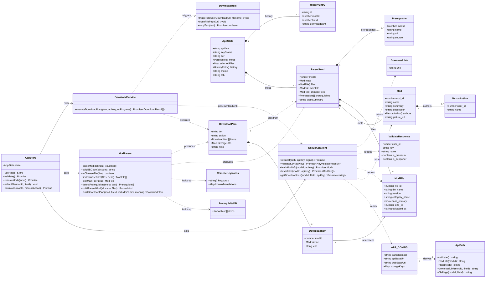
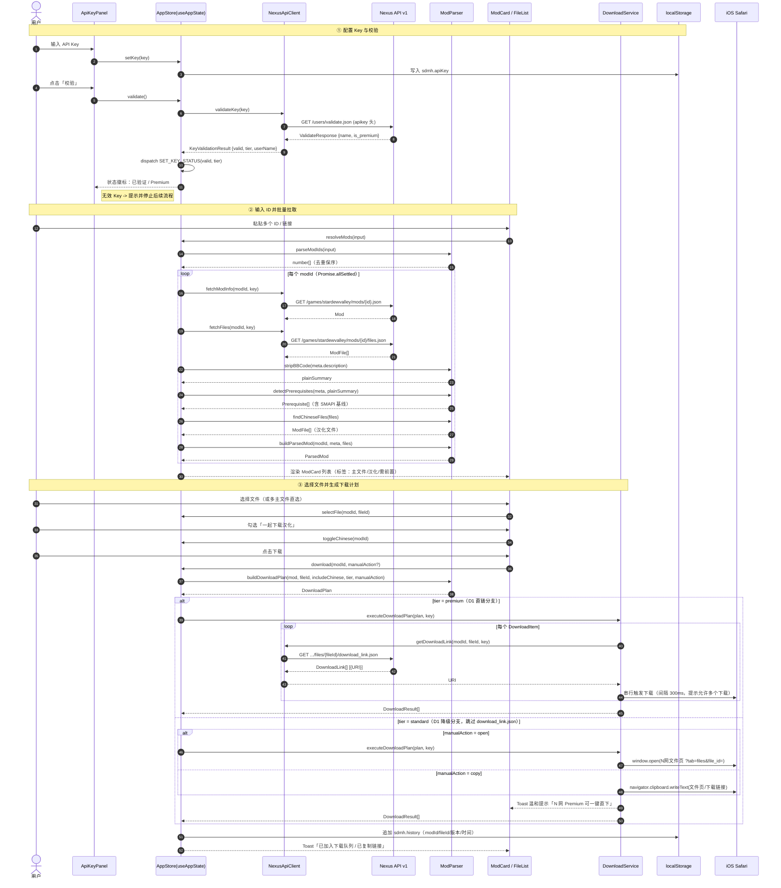
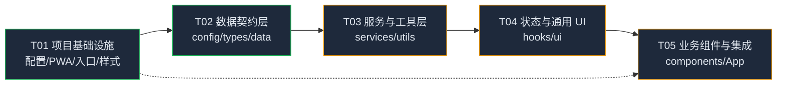

# 星露谷模组下载助手 — 系统架构设计与任务分解

> 文档版本：v1.0　|　架构师：高见远（Gao）　|　需求来源：`docs/PRD.md`（许清楚 v1.0）
> 交付对象：主理人 / 工程师　|　形态：纯静态 PWA，无后端

---

## 0. 设计输入与已拍板决策

本设计严格以 PRD 为唯一需求来源，并落实主理人已拍板的 6 项决策：

| # | 决策 | 本设计的落地方式 |
| --- | --- | --- |
| D1 | Premium 降级 | `validate.json` 读取 `is_premium`；Premium 走 `download_link.json` 直链；非 Premium **跳过该端点**，提供「打开 N 网文件页 + 复制下载链接」双按钮 + 温和提示 |
| D2 | API Key 存 localStorage | `sdmh.apiKey`，提供「清除密钥」按钮；任何请求/日志/错误上报都不回传 key |
| D3 | v1 文本摘要 + 关键词解析 | `stripBBCode()` 生成纯文本摘要；`detectPrerequisites()` 用关键词 + 内置知识库；完整 BBCode 富文本渲染列为 P2 |
| D4 | iOS Safari 逐个下载 | `triggerBrowserDownload()` 串行触发并延时，提示「请允许多个下载」；失败引导复制链接 |
| D5 | game domain 配置项 | `APP_CONFIG.gameDomain = 'stardewvalley'`，所有端点由 `apiPath()` 派生，未来换游戏只改一处 |
| D6 | 纯静态 PWA | Vite + React + TS + Tailwind + vite-plugin-pwa；无服务端、无数据库 |

---

# Part A：系统设计

## 1. 实现方案 + 框架选型

### 1.1 为什么纯前端可行

Nexus Mods API v1 已开启 CORS：`Access-Control-Allow-Origin: *`，且允许自定义请求头 `apikey`。这意味着浏览器可直接携带用户 Key 请求 API，无需代理层。关键推论：

- **无后端 = 无密钥托管**：API Key 只存在于浏览器 localStorage 与内存，天然满足隐私要求（D2）。
- **无服务端状态**：模组元数据、文件列表均为只读 GET，下载是浏览器行为，状态全部可在前端管理。
- **部署极简**：产物是静态文件，任意静态托管（含 GitHub Pages / CDN）即可；PWA 由 Service Worker 缓存应用壳。

需要注意的边界：`download_link.json` 需要 Premium，因此**必须**在调用前判断 `tier`，避免无效请求（详见 1.5 与 §4）。

### 1.2 技术栈选型

| 层次 | 选型 | 版本范围 | 理由 |
| --- | --- | --- | --- |
| 构建 | Vite | `^5.4.10` | 启动快、PWA 插件生态成熟、Node 22 兼容 |
| UI 框架 | React + TypeScript | `^18.3.1` / `^5.6.3` | 组件化、类型安全，契合卡片式交互 |
| 样式 | Tailwind CSS + PostCSS | `^3.4.14` | 工具类快速构建 iOS 观感；v3 配置稳定、工程师零学习成本 |
| PWA | vite-plugin-pwa | `^0.20.5` | 自动生成 manifest + Workbox SW，支持 `virtual:pwa-register` |
| 网络 | 原生 `fetch` 封装 | — | 只需 4 个 GET，无需 axios 的体积与抽象 |
| 状态 | React Context + useReducer | 内置 | 零依赖、够用；状态规模小，避免引入状态库 |
| 路由 | 无路由库，reducer 内 `tab` 字段 | — | 仅「下载 / 历史」两个 Tab，无需 react-router |
| **MUI** | **不引入** | — | 见下方取舍说明 |

**关于 MUI 的取舍（重要）**：PRD 技术栈写了 MUI + Tailwind，但主理人授权自行决定。本设计**决定不引入 MUI**，理由：

1. **体积**：MUI 运行时 + 主题引擎通常增加 80–120 KB gzip，对一个只有 4 个端点的工具是显著负担，直接影响 iOS 首屏与离线启动体验。
2. **视觉契合度**：PRD 3.5 要求「圆角卡片、柔和阴影、适度毛玻璃、iOS 友好」。用 Tailwind 自定义 `rounded-2xl / shadow-lg / backdrop-blur / -apple-system 字体栈` 比覆盖 MUI 默认 Material 风格更直接、更可控。
3. **避免样式冲突**：MUI 的 Emotion 运行时注入与 Tailwind 的 CSS 层叠顺序容易打架，尤其深色主题切换时。
4. **组件数量少**：实际只需输入框、卡片、按钮、徽标、Tab、Toast 等，用语义化 HTML + Tailwind 即可覆盖，无需组件库。

若后续需要复杂表单/弹窗，可在不重构的前提下增量引入。

### 1.3 PWA 关键配置

`vite.config.ts` 中使用 `VitePWA`：

| 配置项 | 值 | 目的 |
| --- | --- | --- |
| `registerType` | `'autoUpdate'` | 新版本自动接管 SW |
| `manifest.name / short_name` | `星露谷模组下载助手` / `模组助手` | 主屏幕名称 |
| `manifest.start_url` | `/` | 启动页 |
| `manifest.display` | `'standalone'` | 无浏览器地址栏，类原生 |
| `manifest.orientation` | `'portrait'` | 竖屏 |
| `manifest.theme_color` | `#0f172a` | 状态栏色 |
| `manifest.background_color` | `#0f172a` | 启动背景 |
| `manifest.icons` | 192 / 512 PNG + `icon.svg`（maskable） | 安装校验与 iOS 图标 |
| `workbox.globPatterns` | `['assets/**/*.{js,css}', 'index.html', 'icon*.{png,svg}']` | 缓存应用壳；**不缓存 API 响应**（Key 与数据不落地 SW 缓存） |
| `workbox.navigateFallback` | `'/index.html'` | 离线 SPA 回退 |
| `devOptions.enabled` | `false` | 开发环境不启用 SW，避免调试缓存干扰 |

`index.html` 必须包含 iOS 适配 meta：

```html
<meta name="viewport" content="width=device-width, initial-scale=1, viewport-fit=cover" />
<meta name="apple-mobile-web-app-capable" content="yes" />
<meta name="apple-mobile-web-app-status-bar-style" content="black-translucent" />
<meta name="apple-mobile-web-app-title" content="模组助手" />
<link rel="apple-touch-icon" href="/apple-touch-icon.png" />
<link rel="icon" type="image/svg+xml" href="/icon.svg" />
```

`src/main.tsx` 通过 `registerSW({ immediate: true })`（`virtual:pwa-register`）注册；`src/components/ui/UpdatePrompt.tsx` 用 `useRegisterSW` 提供「发现新版本，点击更新」轻提示。

> 图标说明：`public/icon.svg` 是源文件（可手写）；`icon-192.png`、`icon-512.png`、`apple-touch-icon.png`（180×180）是二进制资源，工程师需从 SVG 导出（见 §8 与 §9 T01 备注）。缺失图标不影响功能，但会影响 iOS 主屏幕图标与安装体验。

### 1.4 状态管理方案

采用单一 `AppStore`（`src/hooks/useAppState.tsx`）= React Context + `useReducer`。

- **持久化**：仅 `apiKey`、`history`、`theme`、`lastIds` 通过 `useLocalStorage` 写入 `localStorage`；`mods`、`plan` 等运行时数据不持久化。
- **异步编排**：`useAppState` 对外暴露 `actions`（`validate`、`resolveMods`、`selectFile`、`toggleChinese`、`download` 等），内部组合 `services/*`，组件只调用 action 不直接请求 API。
- **错误边界**：每个 modId 的加载错误独立存入 `loadErrors[modId]`，单个失败不阻断其他模组。

State 结构见 §3.2 `AppState`。

### 1.5 关键难点与对策

| 难点 | 对策 |
| --- | --- |
| 用户输入格式混乱（URL / 逗号 / 空格 / 换行混排） | `parseModIds()` 先抽 URL 中的 `mods/(\d+)`，再抽裸数字，去重保序，过滤异常范围 |
| 非 Premium 调用 `download_link.json` 会失败 | 在 `buildDownloadPlan()` 按 `tier` 决定 `action`，standard 永不进入直链分支 |
| BBCode 描述里前置信息藏得深 | `stripBBCode()` 转纯文本 → 扫描 `Requirements/前置/需要/Requires/Dependencies` 段 + 知识库别名/URL ID，去重 |
| 汉化文件误判（如 `CN` 命中无关词） | 关键词表 + `cn` 加边界判定；同时检查 `file_name` 与 `description`；支持内置映射补充 |
| iOS Safari 多文件下载被拦截 | 串行触发 + 300ms 间隔 + Toast 提示「请允许多个下载」；`copyText()` 作为兜底 |
| API Key 泄露风险 | 请求封装中错误对象只保留状态码与端点，显式过滤 `apikey`；不 console 打印 key |
| 单个模组失败拖垮整批 | `Promise.allSettled` + `loadErrors` 局部展示 |

---

## 2. 完整文件列表

所有路径相对于 `/workspace/stardew-mod-helper/`。

```text
stardew-mod-helper/
├── package.json                         # 依赖与 scripts 声明
├── index.html                           # HTML 入口 + iOS meta + 主题色
├── vite.config.ts                       # Vite + React + PWA(manifest/SW) 配置
├── tsconfig.json                        # TS 编译配置（应用）
├── tsconfig.node.json                   # TS 编译配置（构建脚本）
├── tailwind.config.js                   # Tailwind 主题色/字体/darkMode
├── postcss.config.js                    # Tailwind/Autoprefixer 管线
├── .gitignore                           # 忽略 node_modules/dist/*.local
├── public/
│   ├── icon.svg                         # PWA 图标源（可手写矢量）
│   ├── icon-192.png                     # PWA 安装图标 192×192（由 icon.svg 导出）
│   ├── icon-512.png                     # PWA 安装图标 512×512（由 icon.svg 导出）
│   └── apple-touch-icon.png             # iOS 主屏幕图标 180×180（由 icon.svg 导出）
├── docs/
│   ├── PRD.md                           # [已存在] 产品需求文档
│   ├── DESIGN.md                        # [本文件] 系统设计与任务分解
│   ├── class-diagram.mermaid            # 类图（从本文抽取）
│   └── sequence-diagram.mermaid         # 时序图（从本文抽取）
└── src/
    ├── main.tsx                         # React 挂载 + SW 注册 + 全局样式导入
    ├── App.tsx                          # 根组件：Provider、Tab 布局、Toast/更新提示挂载
    ├── index.css                        # Tailwind 指令 + CSS 变量 + iOS 安全区基础样式
    ├── vite-env.d.ts                    # Vite/PWA 客户端类型引用
    ├── config/
    │   └── index.ts                     # APP_CONFIG（game domain/base URL/storage key）+ apiPath()
    ├── types/
    │   ├── nexus.ts                     # Nexus API 返回的 DTO（Mod/ModFile/ValidateResponse/DownloadLink）
    │   └── domain.ts                    # 前端领域模型（ParsedMod/DownloadPlan/AppState 等）
    ├── data/
    │   ├── prerequisites.ts             # 内置高频前置知识库（SMAPI/CP/GMCM/SpaceCore/FTM…）
    │   └── chineseKeywords.ts           # 汉化关键词表 + 已知汉化模组映射
    ├── services/
    │   ├── nexusApi.ts                  # fetch 封装 + 4 个端点调用 + Premium 守卫
    │   ├── modParser.ts                 # 纯函数：ID 提取/BBCode 清洗/汉化与前置识别/计划构建
    │   └── downloadService.ts           # 执行下载计划：直链/打开网页/复制 + iOS 串行下载
    ├── utils/
    │   ├── bbcode.ts                    # BBCode → 纯文本 + 提取文本中的 mod ID
    │   ├── format.ts                    # 文件大小/时间/作者格式化
    │   ├── download.ts                  # 浏览器下载/新窗打开/剪贴板复制
    │   └── errors.ts                    # NexusApiError 与 formatError() 友好文案
    ├── hooks/
    │   ├── useLocalStorage.ts           # 泛型 localStorage 状态 hook（带 JSON 容错）
    │   ├── useAppState.tsx              # Context + reducer + 持久化 + 异步 actions
    │   └── useToast.tsx                 # 轻量 Toast 队列 hook
    └── components/
        ├── StatusBar.tsx                # 顶部状态条：Key 状态徽标（未配置/已验证/Premium）
        ├── ApiKeyPanel.tsx              # Key 输入、校验按钮、清除密钥按钮
        ├── ModIdInput.tsx               # 多行输入 + 实时「已识别 N 个 ID」
        ├── ModCard.tsx                  # 模组卡片：缩略图/名称/作者/摘要/标签/前置展开/文件区
        ├── FileList.tsx                 # 文件清单：选择、汉化高亮与主文件标记
        ├── PrerequisiteList.tsx         # 前置模组可展开列表（含 N 网链接）
        ├── DownloadActions.tsx          # Premium 一键下载 / 非 Premium 双按钮降级
        ├── HistoryPanel.tsx             # 「历史」Tab：已下载清单
        ├── TabBar.tsx                   # 底部 Tab（下载/历史），含 safe-area
        └── ui/
            ├── Toast.tsx                # Toast 渲染容器
            ├── Skeleton.tsx             # 加载骨架屏
            ├── EmptyState.tsx           # 无结果/空状态插画与文案
            └── UpdatePrompt.tsx         # PWA 新版本更新提示
```

---

## 3. 数据结构与接口

### 3.1 Nexus API DTO（`src/types/nexus.ts`）

字段名与 Nexus 返回保持一致（snake_case），不在此层做重命名。

```ts
export interface NexusAuthor {
  user_id: number;
  name: string;
}

/** GET /users/validate.json */
export interface ValidateResponse {
  user_id: number;
  key: string;
  name: string;
  is_premium: boolean;     // 判会员的唯一依据
  is_supporter: boolean;
  profile_url?: string;
}

/** GET /games/{game}/mods/{modId}.json */
export interface Mod {
  mod_id: number;
  game_id: number;
  name: string;
  version: string | null;
  created_at: string;      // ISO 8601
  updated_at: string;      // ISO 8601
  issued_at?: string;
  authors: NexusAuthor[];
  summary: string;
  description: string;     // BBCode
  picture_url: string | null;
  category_name?: string;
  downloads?: number;
  endorsements?: number;
  uploaded_by?: string;
  available?: boolean;
  [key: string]: unknown;  // 兼容未列出的返回字段
}

/** GET /games/{game}/mods/{modId}/files.json -> ModFile[] */
export interface ModFile {
  file_id: number;
  file_name: string;
  version: string;
  category_name: string;   // 'Main Files' | 'Optional Files' | ...
  is_primary: boolean;
  size_kb: number;
  uploaded_at: string;     // ISO 8601
  uploaded_by?: string;
  description?: string;    // BBCode
  downloads?: number;
  game_version?: string[] | string | null;
  content_localized?: string[] | null;
  [key: string]: unknown;
}

/** GET .../files/{fileId}/download_link.json -> DownloadLink[] */
export interface DownloadLink {
  URI: string;
  name?: string;
  short_name?: string;
}
```

### 3.2 前端领域模型（`src/types/domain.ts`）

```ts
import type { Mod, ModFile } from './nexus';

export type PremiumTier = 'premium' | 'standard';
export type KeyStatus = 'unset' | 'checking' | 'valid' | 'invalid' | 'error';
export type DownloadAction = 'direct' | 'open' | 'copy';
export type DownloadKind = 'main' | 'chinese' | 'prerequisite';
export type ThemeMode = 'dark' | 'light';
export type TabKey = 'download' | 'history';

/** 识别出的前置模组 */
export interface Prerequisite {
  modId: number;
  name: string;
  url: string;
  source: 'knowledge' | 'description';
  note?: string;
}

/** 单个模组聚合后的领域对象（UI 直接消费） */
export interface ParsedMod {
  modId: number;
  meta: Mod;
  files: ModFile[];
  mainFile: ModFile | null;
  chineseFiles: ModFile[];
  prerequisites: Prerequisite[];
  plainSummary: string;          // BBCode 清洗后的纯文本摘要
  isChineseTranslation: boolean; // 模组本身即为汉化 MOD
}

/** 下载队列中的一项 */
export interface DownloadItem {
  modId: number;
  file: ModFile;
  kind: DownloadKind;
}

/** 由 ParsedMod + 用户选择 + 会员等级生成的执行计划 */
export interface DownloadPlan {
  tier: PremiumTier;
  action: DownloadAction;        // premium -> 'direct'；standard -> 'open' | 'copy'
  items: DownloadItem[];
  filePageUrls: Record<string, string>; // key = `${modId}:${fileId}`
  note?: string;                 // 降级时「Premium 可一键直下」提示文案
}

export interface DownloadResult {
  item: DownloadItem;
  ok: boolean;
  uri?: string;
  error?: string;
}

export interface HistoryEntry {
  id: string;                    // `${modId}:${fileId}:${Date.now()}`
  modId: number;
  modName: string;
  fileId: number;
  fileName: string;
  version: string;
  tier: PremiumTier;
  action: DownloadAction;
  downloadedAt: string;          // ISO 8601 UTC
}

export interface KeyValidationResult {
  valid: boolean;
  tier: PremiumTier;
  userName: string | null;
  message: string;               // 面向用户的中文文案
}

/** 全局状态（reducer 管理） */
export interface AppState {
  apiKey: string;
  keyStatus: KeyStatus;
  tier: PremiumTier;
  userName: string | null;
  keyMessage: string;
  idsInput: string;
  mods: ParsedMod[];
  loadingIds: number[];
  loadErrors: Record<number, string>;
  selectedFiles: Record<number, number>;   // modId -> fileId
  includeChinese: Record<number, boolean>; // modId -> 是否一起下汉化
  history: HistoryEntry[];
  theme: ThemeMode;
  tab: TabKey;
}
```

### 3.3 配置与服务层函数签名

**配置（`src/config/index.ts`）**

```ts
export const APP_CONFIG = {
  appName: '星露谷模组下载助手',
  applicationName: 'stardew-mod-helper',
  applicationVersion: '1.0.0',
  gameDomain: 'stardewvalley',                 // D5：唯一游戏域配置点
  apiBaseUrl: 'https://api.nexusmods.com/v1/',
  webBaseUrl: 'https://www.nexusmods.com',
  storageKeys: {
    apiKey: 'sdmh.apiKey',
    history: 'sdmh.history',
    theme: 'sdmh.theme',
    lastIds: 'sdmh.lastIds',
  },
} as const;

export const apiPath = {
  validate: () => '/users/validate.json',
  modInfo: (modId: number) => `/games/${APP_CONFIG.gameDomain}/mods/${modId}.json`,
  files: (modId: number) => `/games/${APP_CONFIG.gameDomain}/mods/${modId}/files.json`,
  downloadLink: (modId: number, fileId: number) =>
    `/games/${APP_CONFIG.gameDomain}/mods/${modId}/files/${fileId}/download_link.json`,
  filePage: (modId: number, fileId: number) =>
    `${APP_CONFIG.webBaseUrl}/${APP_CONFIG.gameDomain}/mods/${modId}?tab=files&file_id=${fileId}`,
} as const;
```

**网络层（`src/services/nexusApi.ts`）**

```ts
/** 统一 fetch 封装：拼 URL、注入 apikey/Application-* 头、错误归一化、脱敏 */
export async function request<T>(
  path: string,
  apiKey: string,
  signal?: AbortSignal,
): Promise<T>;

/** 校验 Key：无效 Key 返回 valid:false 而非抛错；网络异常抛 NexusApiError */
export async function validateKey(apiKey: string): Promise<KeyValidationResult>;

export async function fetchModInfo(modId: number, apiKey: string): Promise<Mod>;
export async function fetchFiles(modId: number, apiKey: string): Promise<ModFile[]>;

/** 仅 Premium 调用；内部守卫：非 Premium 直接抛错（调用方不应触发） */
export async function getDownloadLink(
  modId: number,
  fileId: number,
  apiKey: string,
): Promise<string>;
```

**解析层（`src/services/modParser.ts`，全部为纯函数）**

```ts
/** 从混排文本提取 mod ID：先抽 URL，再抽裸数字，去重保序，过滤 1..99999999 */
export function parseModIds(input: string): number[];

/** 判断单个文件是否为汉化文件（文件名 + 描述 + 关键词边界） */
export function isChineseFile(file: ModFile): boolean;

/** 从文件列表中筛出汉化文件 */
export function findChineseFiles(files: ModFile[], metaDescription?: string): ModFile[];

/** 选取主文件：优先 is_primary，其次 category_name==='Main Files'，再退回首项 */
export function pickMainFile(files: ModFile[]): ModFile | null;

/** 前置识别：SMAPI 基线 + 文本关键词/别名/URL ID 关联知识库，按 modId 去重 */
export function detectPrerequisites(meta: Mod, plainText?: string): Prerequisite[];

/** 聚合为 ParsedMod */
export function buildParsedMod(modId: number, meta: Mod, files: ModFile[]): ParsedMod;

/** 生成下载计划：Premium -> direct；standard -> open/copy（manualAction 默认 'open'） */
export function buildDownloadPlan(
  mod: ParsedMod,
  fileId: number,
  includeChinese: boolean,
  tier: PremiumTier,
  manualAction?: 'open' | 'copy',
): DownloadPlan;
```

**下载执行层（`src/services/downloadService.ts`）**

```ts
/** 执行计划；Premium 逐项换直链并串行触发下载，standard 打开网页或复制；iOS 延时防拦截 */
export async function executeDownloadPlan(
  plan: DownloadPlan,
  apiKey: string,
  onProgress?: (result: DownloadResult) => void,
): Promise<DownloadResult[]>;
```

**工具函数**

```ts
// utils/bbcode.ts
export function stripBBCode(bbcode: string): string;              // 移除 BBCode 标签、解码实体、折叠空白
export function extractModIdsFromText(text: string): number[];    // 从文本中的 N 网链接抽 ID

// utils/download.ts
export function triggerBrowserDownload(url: string, filename?: string): void;
export function openFilePage(url: string): void;                  // window.open(url, '_blank', 'noopener')
export async function copyText(text: string): Promise<boolean>;   // navigator.clipboard + textarea 兜底

// utils/format.ts
export function formatFileSize(sizeKb: number): string;           // KB -> 人可读
export function formatDate(iso: string): string;                  // 本地化短日期

// utils/errors.ts
export class NexusApiError extends Error {
  readonly status: number;
  readonly endpoint: string;
  constructor(message: string, status: number, endpoint: string);
}
export function formatError(err: unknown): string;                // 中文友好文案，禁止回显 apiKey
```

**Hooks / Store（`src/hooks/useAppState.tsx`）**

```ts
interface AppActions {
  setKey(apiKey: string): void;
  clearKey(): void;
  validate(): Promise<void>;
  setIdsInput(value: string): void;
  resolveMods(input?: string): Promise<void>;   // parse + 并发拉取 + buildParsedMod
  selectFile(modId: number, fileId: number): void;
  toggleChinese(modId: number): void;
  download(modId: number, manualAction?: 'open' | 'copy'): Promise<void>;
  setTheme(theme: ThemeMode): void;
  setTab(tab: TabKey): void;
  clearHistory(): void;
}
export function useApp(): { state: AppState; actions: AppActions };
```

### 3.4 类图（Mermaid）

> 同步保存于 `docs/class-diagram.mermaid`。



---

## 4. 程序调用流程

### 4.1 主流程时序图（含 Premium / 降级分支）

> 同步保存于 `docs/sequence-diagram.mermaid`。



### 4.2 分支与边界说明

| 场景 | 行为 |
| --- | --- |
| Key 无效 | `validate()` 返回 `valid:false`，`keyStatus='invalid'`，禁用后续下载按钮 |
| 网络错误 | `NexusApiError` → `formatError()` → Toast 中文提示；单个 mod 失败写入 `loadErrors[modId]` |
| 无主文件但有多个可选文件 | 不自动下载，`FileList` 展开让用户选 |
| 仅一个主文件 | `pickMainFile()` 命中且 `files.length===1`，跳过选择直接进入计划 |
| 汉化文件命中 | `chineseFiles.length>0` → 卡片显示「汉化可用」标签 + 勾选框 |
| 前置命中 | `prerequisites.length>0` → 「需前置 N 项」标签，`PrerequisiteList` 可展开 |
| 非 Premium 且用户点「复制链接」 | `manualAction='copy'`，计划 `action='copy'`，不触达 `download_link.json` |

---

## 5. 待明确事项（Anything UNCLEAR）

以下为设计中的取舍与假设，均已给出推荐，工程师可按推荐直接实施；如需变更请主理人拍板。

| # | 事项 | 假设 / 推荐 | 影响面 |
| --- | --- | --- | --- |
| U1 | PWA 图标二进制资源 | 推荐工程师从 `public/icon.svg` 导出 192/512/180 PNG；功能不依赖图标 | T01，安装体验 |
| U2 | `validate.json` 会员字段名 | 按 `is_premium: boolean` 处理，并做 `Boolean(data.is_premium)` 兜底；若实测为其他字段（如 `is_premium_member`）只需改 `validateKey()` 一处 | `nexusApi.ts` |
| U3 | MUI 是否引入 | 推荐不引入（理由见 1.2）；如需引入可在 T05 增量加 | 全局样式 |
| U4 | BBCode 富文本渲染 | v1 仅纯文本摘要（D3），P2 再做完整渲染 | `bbcode.ts` / `ModCard.tsx` |
| U5 | 前置知识库覆盖范围 | v1 内置 SMAPI(2400)、Content Patcher(1915)、GMCM(5098)、SpaceCore(1349)、Farm Type Manager(1924)、Custom Music、SpaceCore 系列等；SMAPI 作为基线始终展示 | `prerequisites.ts` |
| U6 | 汉化判定严格度 | 采用关键词 + `cn` 边界匹配，宁可漏判不误判；内置映射兜底 | `chineseKeywords.ts` |
| U7 | Key 校验时机 | 推荐「失焦自动校验 + 手动按钮」双触发，避免每次输入都请求 | `ApiKeyPanel.tsx` |
| U8 | 历史清单 v1 是否落地 | 推荐落地（实现成本低，P1 但随 T04/T05 一起做），提升复访价值 | `HistoryPanel.tsx` |
| U9 | 主题切换 v1 是否落地 | 推荐落地（默认深色 + 一键切换），Tailwind `darkMode:'class'` | `App.tsx` / `index.css` |
| U10 | 导出清单 / 冲突提示 / 版本兼容 | 均列 P2，v1 不实现，不影响主流程 | 无 |
| U11 | SW 更新策略 | 推荐 `registerType:'autoUpdate'` + 轻量「有新版本」提示，不强制打断下载 | `main.tsx` / `UpdatePrompt.tsx` |
| U12 | API 请求并发数 | 多 ID 时用 `Promise.allSettled` 全并发；若用户一次贴 >20 个 ID 建议后续加并发上限，v1 不做 | `useAppState.tsx` |

---

# Part B：任务分解

## 6. 依赖包列表（`package.json`）

```json
{
  "name": "stardew-mod-helper",
  "private": true,
  "version": "1.0.0",
  "type": "module",
  "scripts": {
    "dev": "vite",
    "build": "tsc -b && vite build",
    "preview": "vite preview",
    "typecheck": "tsc --noEmit"
  },
  "dependencies": {
    "react": "^18.3.1",
    "react-dom": "^18.3.1"
  },
  "devDependencies": {
    "@types/react": "^18.3.12",
    "@types/react-dom": "^18.3.1",
    "@vitejs/plugin-react": "^4.3.3",
    "autoprefixer": "^10.4.20",
    "postcss": "^8.4.47",
    "tailwindcss": "^3.4.14",
    "typescript": "^5.6.3",
    "vite": "^5.4.10",
    "vite-plugin-pwa": "^0.20.5"
  }
}
```

说明：

- **不安装** axios / MUI / react-router / 状态库（理由见 §1.2 与 §1.4）。
- `workbox-window` 由 `vite-plugin-pwa` 传递依赖提供，`virtual:pwa-register` 可直接使用。
- `vite-env.d.ts` 需 `/// <reference types="vite-plugin-pwa/client" />` 以获得虚拟模块类型。

---

## 7. 任务列表（按实现顺序，共 5 个任务）

> 工程师严格按 T01 → T05 顺序写入；全部写完后执行 `npm install && npm run build`。
> 注：`T01` 的 `main.tsx` 引用 `App.tsx`，而 `App.tsx` 在 `T05` 产出，中间步骤暂不可编译属预期，最终批次完成后统一构建即可。

| 任务编号 | 涉及文件 | 依赖任务 | 说明 |
| --- | --- | --- | --- |
| **T01** | `package.json`, `index.html`, `vite.config.ts`, `tsconfig.json`, `tsconfig.node.json`, `tailwind.config.js`, `postcss.config.js`, `.gitignore`, `public/icon.svg`, `public/icon-192.png`, `public/icon-512.png`, `public/apple-touch-icon.png`, `src/main.tsx`, `src/index.css`, `src/vite-env.d.ts` | 无 | 项目基础设施：依赖、构建、PWA manifest/SW、iOS meta、全局样式、入口；按 §1.3 配置 VitePWA 与 Tailwind 主题 |
| **T02** | `src/config/index.ts`, `src/types/nexus.ts`, `src/types/domain.ts`, `src/data/prerequisites.ts`, `src/data/chineseKeywords.ts` | T01 | 数据契约层：配置、API DTO、领域类型、前置知识库、汉化关键词；严格按 §3.1/§3.2/§3.3 定义 |
| **T03** | `src/services/nexusApi.ts`, `src/services/modParser.ts`, `src/services/downloadService.ts`, `src/utils/bbcode.ts`, `src/utils/format.ts`, `src/utils/download.ts`, `src/utils/errors.ts` | T02 | 服务与工具层：fetch 封装 + Premium 守卫、ID/BBCode/汉化/前置解析、下载执行（iOS 串行）；全部函数签名见 §3.3 |
| **T04** | `src/hooks/useLocalStorage.ts`, `src/hooks/useAppState.tsx`, `src/hooks/useToast.tsx`, `src/components/ui/Toast.tsx`, `src/components/ui/Skeleton.tsx`, `src/components/ui/EmptyState.tsx`, `src/components/ui/UpdatePrompt.tsx` | T02, T03 | 状态与通用 UI：reducer + 持久化 + 异步 actions、Toast 队列、骨架屏、空状态、SW 更新提示 |
| **T05** | `src/components/StatusBar.tsx`, `src/components/ApiKeyPanel.tsx`, `src/components/ModIdInput.tsx`, `src/components/ModCard.tsx`, `src/components/FileList.tsx`, `src/components/PrerequisiteList.tsx`, `src/components/DownloadActions.tsx`, `src/components/HistoryPanel.tsx`, `src/components/TabBar.tsx`, `src/App.tsx` | T01, T02, T04 | 业务组件与集成：按 PRD 3.5 实现卡片列表、文件选择、双按钮降级、历史 Tab；`App.tsx` 组装 Provider/布局/全局提示 |

### 7.1 每个任务的写入要点（供工程师逐批执行）

**T01 — 项目基础设施**

- `package.json`：按 §6 原样写入依赖与 scripts。
- `index.html`：写入 §1.3 全部 iOS meta、`<div id="root">`、`lang="zh-CN"`。
- `vite.config.ts`：`defineConfig` + `react()` + `VitePWA({...})`，manifest/workbox 按 §1.3。
- `tsconfig.json`：`target ES2020`、`jsx react-jsx`、`moduleResolution bundler`、`strict true`、`noEmit`、引用 `tsconfig.node.json`。
- `tsconfig.node.json`：`composite true`，仅含 `vite.config.ts`。
- `tailwind.config.js`：`content: ['./index.html','./src/**/*.{ts,tsx}']`、`darkMode:'class'`、扩展 `brand`/`accent`/`surface` 色板与系统字体栈（见 §8）。
- `postcss.config.js`：`tailwindcss` + `autoprefixer`。
- `src/index.css`：`@tailwind base/components/utilities` + `:root` CSS 变量 + `.dark` 变量 + `body` 字体与安全区。
- `src/main.tsx`：创建 root、渲染 `<App />`、`import './index.css'`、`registerSW({ immediate: true })`。
- `src/vite-env.d.ts`：PWA 客户端类型引用。
- `public/icon.svg`：手写一张 512 viewBox 的矢量图标（建议像素风绿色草地 + 像素镐/蘑菇主题）。
- 三个 PNG：**从 `icon.svg` 导出 192×192 / 512×512 / 180×180**（可用任意转换工具，见 §8）。

**T02 — 数据契约层**

- 按 §3.1 完整写出 4 个 DTO（含索引签名 `[key: string]: unknown`）。
- 按 §3.2 完整写出全部领域类型与 `AppState`。
- `config/index.ts` 按 §3.3 原样写入 `APP_CONFIG` 与 `apiPath`。
- `prerequisites.ts`：导出 `KnownMod` 与 `PREREQUISITE_DB`，至少含下列条目（modId / 名称 / aliases）：
  - `2400` SMAPI（`smapi`）— 基线前置，`note: '几乎所有模组都需要'`
  - `1915` Content Patcher（`content patcher`,`cp`）
  - `5098` Generic Mod Config Menu（`gmcm`,`generic mod config menu`,`配置菜单`）
  - `1349` SpaceCore（`spacecore`）
  - `1924` Farm Type Manager（`farm type manager`,`ftm`）
  - `Custom Music` → **名称型条目**（`modId: null`，仅用 `aliases` 匹配展示，不生成 N 网链接）

  `KnownMod` 结构固定为：
  ```ts
  export interface KnownMod {
    modId: number | null;
    name: string;
    aliases: string[];
    note?: string;
    isBaseline?: boolean; // SMAPI = true，始终展示
  }
  ```
  名称型条目命中后产出的 `Prerequisite` 用 `modId: 0`、`url: ''` 表示「无对应 N 网页面」，UI 渲染为纯文本标签、不可点击。
- `chineseKeywords.ts`：导出 `CHINESE_KEYWORDS`（`chinese`,`中文`,`汉化`,`简体`,`繁体`,`zh-cn`,`zh_tw`,`translation`,`localization`,`cn` 带边界）与 `KNOWN_TRANSLATIONS`（modId → 汉化文件关键词，可先留空对象并写清扩展方式）。

**T03 — 服务与工具层**

- `errors.ts`：`NexusApiError`（含 `status`/`endpoint`），`formatError()` 将 401→「API Key 无效或已过期」、403→「没有权限访问该资源」、429→「请求过于频繁，请稍后」、网络错误→「网络异常，请检查连接」，并显式剔除 key。
- `nexusApi.ts`：`request<T>()` 注入 `apikey` / `Application-Name` / `Application-Version` / `Accept: application/json`，非 2xx 抛 `NexusApiError`；`validateKey()` 对 401 返回 `valid:false` 而不抛；`getDownloadLink()` 内部不校验 tier（由计划层守卫），但注释说明调用契约。
- `bbcode.ts`：`stripBBCode()` 覆盖 `[b][i][u][url=..][img][code][quote][list][*][color=..][size=..][spoiler]` 等标签，解码 `&nbsp;` `&amp;`，折叠空白；`extractModIdsFromText()` 用 `/nexusmods\.com\/[^/]+\/mods\/(\d+)/gi`。
- `modParser.ts`：按 §3.3 实现全部纯函数；`parseModIds()` 先 URL 后裸数字、Set 去重保序、范围过滤；`buildDownloadPlan()` 对 `tier==='premium'` 固定 `action:'direct'`，否则 `manualAction ?? 'open'` 并附 `note:'N 网 Premium 可一键直下'`。
- `download.ts`：`triggerBrowserDownload()` 用临时 `<a>` + `URL`/`href`；`copyText()` 优先 Clipboard API、`catch` 用 `textarea + execCommand('copy')` 兜底。
- `downloadService.ts`：`executeDownloadPlan()` 中 premium 分支逐项 `getDownloadLink()` 后串行触发（每项间隔 ~300ms），standard 分支按 `action` 打开网页或复制；逐项回调 `onProgress`；错误逐项记录不中断队列。

**T04 — 状态与通用 UI**

- `useLocalStorage.ts`：泛型 `useLocalStorage<T>(key, initial)`，JSON 解析失败回退初始值，写入用 `try/catch`（隐私模式可能抛错）。
- `useAppState.tsx`：`AppState` 初值从 localStorage 读 `apiKey`/`history`/`theme`/`lastIds`；reducer 实现 §3.2 所有字段的 action；`actions.resolveMods()` 用 `Promise.allSettled` 并发拉取；`actions.download()` 调 `buildDownloadPlan` + `executeDownloadPlan` 并追加 history。
- `useToast.tsx` + `Toast.tsx`：队列式 `{id, type, message}`，3s 自动移除；`type: 'success'|'error'|'info'`。
- `Skeleton.tsx` / `EmptyState.tsx`：卡片骨架屏与空状态文案。
- `UpdatePrompt.tsx`：用 `useRegisterSW()` 的 `needRefresh` 显示「发现新版本，点击更新」。

**T05 — 业务组件与集成**

- `StatusBar.tsx`：读 `keyStatus`/`tier` 渲染徽标（未配置灰 / 已验证绿 / Premium 金），点击进入 Key 设置。
- `ApiKeyPanel.tsx`：密码型输入框、失焦自动校验 + 手动按钮、清除密钥按钮（调 `clearKey()` 并 Toast 确认）。
- `ModIdInput.tsx`：`textarea`，实时调 `parseModIds(value).length` 显示「已识别 N 个 ID」，按钮触发 `resolveMods()`。
- `PrerequisiteList.tsx`：可展开列表，每项显示名称/来源标签，点击跳 N 网 `mods/{modId}`。
- `FileList.tsx`：表格化文件行（文件名/版本/分类/大小/时间/主文件标记），汉化行高亮 + 「一起下载」勾选，单选主文件。
- `ModCard.tsx`：缩略图 + 名称 + 作者 + `plainSummary` 两行截断 + 标签行（主文件/汉化可用/需前置 N 项）+ 展开 `FileList` 与 `PrerequisiteList`。
- `DownloadActions.tsx`：`tier==='premium'` → 主按钮「一键下载」调 `download(modId)`；否则并列两按钮「打开 N 网下载」（`download(modId,'open')`）与「复制下载链接」（`download(modId,'copy')`），下方常驻温和提示。
- `HistoryPanel.tsx`：按时间倒序展示 `history`，支持清空。
- `TabBar.tsx`：底部固定双 Tab，`padding-bottom: env(safe-area-inset-bottom)`，≥44px 触控区。
- `App.tsx`：`AppStoreProvider` 包裹，渲染 `StatusBar` + Tab 内容（`ModIdInput` + `ModCard` 列表 / `HistoryPanel`）+ `TabBar` + `Toast` + `UpdatePrompt` + 骨架屏/空状态分支。

---

## 8. 共享知识（跨文件约定）

所有工程师必须遵守以下约定，避免集成冲突：

### 8.1 API 请求封装

- 所有 API 调用**只能**经 `nexusApi.request<T>()`，组件内禁止直接 `fetch`。
- `path` 必须以 `/` 开头，由 `apiPath()` 生成，禁止在别处硬编码游戏域名或 URL。
- 请求头固定：`apikey`、`Application-Name: stardew-mod-helper`、`Application-Version: 1.0.0`、`Accept: application/json`。
- `request()` 支持传入 `AbortSignal`；组件卸载时可取消。
- **Premium 守卫**：任何代码路径不得对 `tier==='standard'` 调用 `downloadLink()`；该约束在 `buildDownloadPlan()` 与 `DownloadService` 双重保证。
- 响应 JSON 直接 `as T` 返回，不做字段重命名（DTO 保持 snake_case）。

### 8.2 错误处理

- 服务层一律**抛错**，UI 层一律**不抛错**（用 `formatError()` 转中文 Toast）。
- `NexusApiError` 必须携带 `status` 与 `endpoint`，但 `endpoint` 不得包含 apiKey。
- `validateKey()` 对 401 特殊处理：返回 `valid:false`，不抛错。
- 批量拉取用 `Promise.allSettled`；单项错误写入 `loadErrors[modId]`，UI 在对应卡片内联展示，不影响其他卡片。
- 禁止 `console.log(key)` 或把 key 拼进错误文案。

### 8.3 类型与命名

- API DTO 定义在 `types/nexus.ts`，字段与 JSON 一致；领域模型定义在 `types/domain.ts`，字段 camelCase。
- 枚举一律用字符串字面量联合类型（`PremiumTier` / `DownloadAction` / `KeyStatus`），不用 `enum`。
- 组件文件名 PascalCase（`.tsx`），其他文件 camelCase（`.ts`）；默认导出组件，具名导出 hooks/services/utils。
- 纯函数放 `modParser.ts` / `utils/*`；有副作用（网络、DOM、存储）放 `services/*` / `hooks/*`。
- 所有日期在领域层用 ISO 8601 UTC 字符串存储，展示时才本地化。

### 8.4 Tailwind 主题与无障碍

- `darkMode: 'class'`，`<html>` 挂 `dark` 类；默认深色。
- 主题扩展（写入 `tailwind.config.js`）：
  - `brand`: `400 #4ade80`、`500 #22c55e`、`600 #16a34a`
  - `accent`: `400 #fbbf24`、`500 #f59e0b`
  - `surface`: `DEFAULT #0f172a`、`raised #1e293b`
  - 字体栈：`-apple-system, BlinkMacSystemFont, 'SF Pro Text', 'PingFang SC', 'Microsoft YaHei', sans-serif`
- 卡片统一 `rounded-2xl shadow-lg` + 深色下 `bg-surface-raised/80 backdrop-blur`；按钮与 Tab 触控区 ≥ 44px。
- 所有图标按钮加 `aria-label`；状态徽标用 `role="status"`；Toast 用 `aria-live="polite"`。
- 焦点态统一 `focus-visible:ring-2 focus-visible:ring-brand-500`。
- 底部 Tab 必须适配 `env(safe-area-inset-bottom)`（`viewport-fit=cover` 已在 index.html）。

### 8.5 localStorage 约定

| Key | 值类型 | 说明 |
| --- | --- | --- |
| `sdmh.apiKey` | `string` | 用户 Key，明文存本地；「清除密钥」按钮删除此项 |
| `sdmh.history` | `HistoryEntry[]` (JSON) | 下载历史，最新在前，最多保留 200 条 |
| `sdmh.theme` | `'dark' \| 'light'` | 主题偏好 |
| `sdmh.lastIds` | `string` | 上次的 ID 输入文本，提升复访体验 |

- 统一经 `useLocalStorage<T>()` 读写，禁止散落 `localStorage.getItem`。
- 读取失败一律回退默认值；写入失败静默忽略（隐私模式）。
- **绝不**把 Key 写入任何远端、URL 参数、日志或 SW 缓存。

### 8.6 iOS 下载与降级

- Premium 直链下载：`triggerBrowserDownload()` 逐个 `<a>.click()`，相邻间隔 ≥300ms；开始前 Toast「请在弹窗中允许多个下载」。
- 非 Premium：优先 `window.open(filePage, '_blank', 'noopener')`；复制链接走 `copyText()`，失败时 Toast 提示手动复制。
- `filePage` 格式固定：`https://www.nexusmods.com/stardewvalley/mods/{modId}?tab=files&file_id={fileId}`，由 `apiPath.filePage()` 生成。
- 降级时始终显示温和提示文案：「N 网 Premium 用户可一键直链下载」。

---

## 9. 任务依赖图（Mermaid）



> 说明：分层依赖天然呈链式。但本设计已在 §3 完整给出所有类型与函数签名，工程师也可并行编写 T02–T05，最后按 T01→T05 顺序落盘并统一构建。

---

## 10. 验收自检清单（工程师完成后逐项确认）

| # | 检查项 | 预期 |
| --- | --- | --- |
| 1 | `npm install && npm run build` | 通过，无 TS 错误 |
| 2 | iOS Safari 添加到主屏幕 | 以 standalone 打开，有自定义图标，状态栏深色 |
| 3 | 输入无效 Key 校验 | 显示「Key 无效」，下载按钮禁用 |
| 4 | 粘贴混合 URL/逗号/换行 ID | 「已识别 N 个 ID」正确、去重 |
| 5 | 单主文件模组 | 跳过文件选择，直接进入下载计划 |
| 6 | 含汉化文件模组 | 显示「汉化可用」标签 + 勾选框，勾选后进入队列 |
| 7 | 前置识别 | SMAPI 基线始终出现；BBCode/知识库命中项正确列出 |
| 8 | Premium 账号下载 | 调用 `download_link.json`，逐个触发下载 |
| 9 | 非 Premium 账号下载 | **不调用** `download_link.json`；双按钮可用；有温和提示 |
| 10 | 清除密钥 | `sdmh.apiKey` 被删除，回到未配置状态 |
| 11 | 下载历史 | 追加记录，刷新后仍在，可清空 |
| 12 | 断网 | 友好错误提示，应用壳可从 SW 离线打开 |
