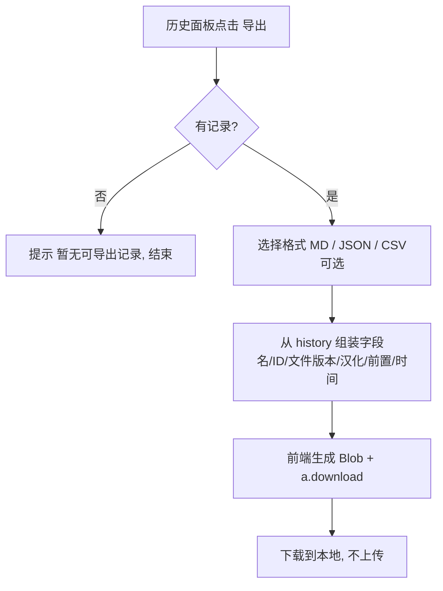
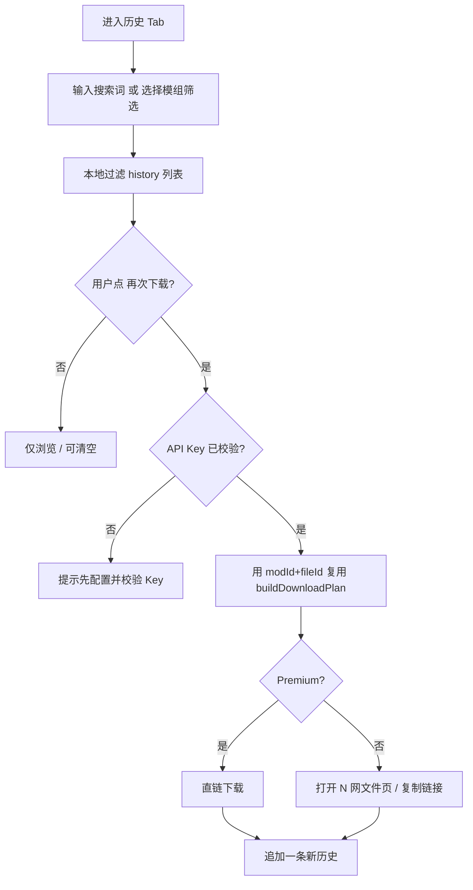
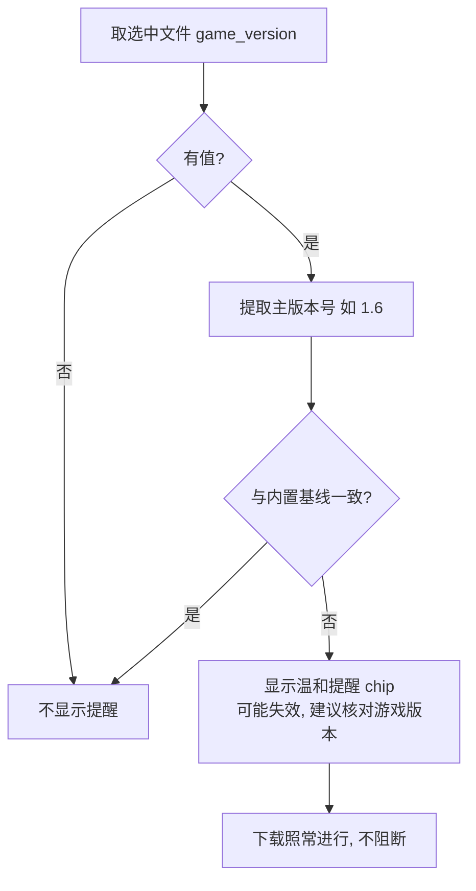

# 星露谷模组下载助手 — 增量 PRD（v2.0）

> 文档版本：v2.0（增量文档）　|　产品经理：许清楚（Xu）　|　基线：v1.0 PRD（R01–R22 已交付）
> 阅读约定：本文**只描述本次变更**，不重复 v1 全文。标注规则：**【新增】**= v1 没有、本次从零做；**【修改】**= 在 v1 已有能力上改造/增强。编号沿用 `R23` 起。

---

## 1. 变更概述

**一句话**：在已交付的 v1 之上，把界面切换为「清新浅色田园风」（并改为默认浅色），同时补齐导出清单、历史增强、版本兼容提醒、预览区强化与知识库数据扩充。

**本次范围**（6 项用户已勾选/确认，均"都做"）：

| 变更 | 主题 | 类型 | 对应需求 |
| --- | --- | --- | --- |
| 变更 1 | 界面风格 → 清新浅色田园风 + 默认浅色（可切深色） | 【修改】 | R23 |
| 变更 2 | 导出模组清单（MD / JSON，CSV 可选） | 【新增】 | R24 |
| 变更 3 | 下载历史增强：搜索 / 按模组筛选 / 再次下载（保留清空） | 【新增】 | R25 / R26 / R27 |
| 变更 4 | SMAPI 版本兼容提醒（提示性、不阻断） | 【新增】 | R28 |
| 变更 5 | 模组预览图与简介强化（图 + 名 + 作者 + 摘要 + 失败占位） | 【修改】 | R29 |
| 变更 6 | 前置 / 汉化知识库数据扩充 | 【修改】 | R30 / R31 |

**受影响的 v1 条目**（架构师做最小变更时留意，不展开重写）：R04（预览展示）、R09/R11（识别知识库）、R14/R18（主题与视觉）、R16（历史结构）、R19（版本提醒，v1 为 P2，本次提升为 P1）、R21（导出，v1 为 P2，本次提升为 P1）。

---

## 2. 变更需求池（R23 起）

> P0 = Must have　P1 = Should have　P2 = Nice to have

| 编号 | 需求 | 类型 | 优先级 | 验收要点 |
| --- | --- | --- | --- | --- |
| **R23** | 清新浅色田园风 + 默认浅色主题 | 【修改】 | **P0** | 默认加载为浅色田园风；配色符合第 3.1 节色值；圆角卡片/柔和阴影/充足留白保留；保留主题切换按钮，可切回 v1 深色；首次访问用户看到浅色，老用户存过的偏好仍被尊重。 |
| **R24** | 导出模组清单 | 【新增】 | P1 | 至少支持 Markdown 与 JSON（CSV 可选）；内容含模组名、ID、选定文件/版本、汉化、前置、时间；纯前端生成文件、不上传；空数据不可导出并给出提示。 |
| **R25** | 历史搜索 | 【新增】 | P1 | 按模组名 / 文件名 / ID 模糊匹配，实时过滤；清空搜索词后恢复；无结果显示空提示。 |
| **R26** | 按模组筛选 | 【新增】 | P1 | 从历史中出现过的模组生成筛选项；选中后仅显示该模组记录；可与搜索叠加；支持"全部"。 |
| **R27** | 历史"再次下载" | 【新增】 | P1 | 每条历史提供再次下载入口，用记录的 modId + fileId 重新触发 v1 下载计划；遵循 Premium/降级策略；API Key 未校验时给出引导；成功后追加一条新历史。 |
| **R28** | SMAPI 版本兼容提醒 | 【新增】 | P1 | 基于选中文件的 `game_version` 做温和提示；提示不影响/不阻断下载；无版本字段时不显示；文案明确"可能失效"而非"禁止"。 |
| **R29** | 预览图与简介强化 | 【修改】 | P1 | 缩略图更大更清晰；名称/作者/摘要分区明确；摘要仍为纯文本（不做 BBCode 富文本）；图片加载失败有田园风占位。 |
| **R30** | 前置知识库扩充 | 【修改】 | P1 | 按第 3.6 节清单扩充条目与 aliases；仅使用可信 ID，未确认一律 `modId: null` 名称型；ID 不确定项不得编造。 |
| **R31** | 汉化知识库扩充 | 【修改】 | P1 | 补充汉化关键词；`KNOWN_TRANSLATIONS` 填充已知可靠映射；不确定 ID 用名称型，不得编造。 |

---

## 3. 各变更详细说明与交互/视觉预期

### 3.1 R23【修改】清新浅色田园风（核心）

**方向**：米白 / 奶油底色 + 草绿 / 麦芽色点缀，明亮清爽、护眼久看不累；保留圆角卡片、柔和阴影、iOS 友好与充足留白；田园自然质感用"柔和绿渐变 + 轻量叶片/幼苗意象"表达，不过度花哨。

**浅色田园风配色方案建议（具体色值）**：

| 用途 | 变量 / Token | 建议色值 | 说明 |
| --- | --- | --- | --- |
| 页面背景 | `--app-bg` | `#F7FAF3` | 米白偏草绿奶油底；可叠柔和渐变 `linear-gradient(180deg,#F7FAF3,#EFF5E6)` |
| 卡片表面 | `--app-surface` | `#FFFFFF` | 纯白卡片，与底色形成轻层级 |
| 卡片内区 / raised | `--app-surface-raised` | `#FDFBF4` | 暖奶油色，用于卡片面/输入区 |
| 主色（草绿） | `brand-500` / 按钮底 `brand-600` | `#5FAE57` / `#3F8F42` | 主按钮、链接、焦点环；`brand-400 #86C96B` 作嫩叶点缀 |
| 强调色（麦芽金） | `accent-500` / `accent-400` | `#D9A441` / `#E8C46A` | Premium / 汉化徽标、轻量高亮 |
| 主文字 | `--app-text` | `#2F3A2E` | 深墨绿灰，比纯黑柔和护眼 |
| 次文字 | `--app-muted` | `#6B7A66` | 灰绿，用于摘要/时间/辅助信息 |
| 边框 | `--app-border` | `rgba(95,174,87,0.16)` | 草绿低透明描边 |
| 标签-主文件 | chip | 底 `#E7F4E4` / 字 `#3F8F42` | 草绿系 |
| 标签-汉化可用 | chip | 底 `#FBF1D6` / 字 `#9A6B12` | 麦芽色系 |
| 标签-需前置 | chip | 底 `#E4F1EC` / 字 `#2F7A5A` | 淡青绿（由紫调改为田园青绿） |
| 标签-版本提醒 | chip | 底 `#FFF4E2` / 字 `#A8631A` | 暖橙、温和，不用刺眼红 |
| 标签-错误 | chip | 底 `#FDECEC` / 字 `#A94848` | 柔红 |
| 焦点环 | `:focus-visible` | `#5FAE57` | 替换现有 `#22c55e` |

**改造要点**：
- `index.css`：把 `:root`（现为 `#f1f5f9` 冷灰蓝）替换为上表浅色田园变量；`--app-surface` 与 `--app-surface-raised` 分别落 `#FFFFFF` / `#FDFBF4`。
- `tailwind.config.js`：`brand`、`accent` 色阶微调为上表值；`boxShadow.card` 调浅为 `0 8px 24px -12px rgba(63,143,66,0.18)`（柔和绿影，避免深色重阴影）。
- 默认主题改浅色：`useLocalStorage(theme, 'dark')` → `'light'`，以及 `createInitialState` 的回退 `theme === 'light' ? ...` 改为默认 `light`（无存储时）。
- **兼容策略**：老用户 localStorage 里存过 `dark` 仍应生效（不要强制覆盖）；主题切换按钮保留，切回的深色沿用 v1 深色变量，本次不改深色配色。
- 标签文字色：现有 chip 用 `-400` 文字色在浅底上对比度不足，浅色主题下统一改为上表"深字 + 浅底"组合。
- 田园装饰：可在页面顶部/空状态放轻量叶片/幼苗 SVG 作为点缀（单色、低透明），避免大面积插画。

**交互预期**：首次打开明亮清爽；点主题按钮即时切换、有轻微过渡；深色模式体验与 v1 一致。

### 3.2 R24【新增】导出模组清单

- **触发位置**：历史面板顶部工具栏增加"导出"按钮（点击弹出格式选择：Markdown / JSON；CSV 作可选第三项）。
- **数据源**：以 `state.history` 为主；为覆盖"汉化、前置"，需给 `HistoryEntry` 增补可选字段（如 `chinese?: string[]`、`prerequisites?: string[]`、`gameVersion?: string`），在写入历史时从 `ParsedMod` 带出；当前 `state.mods` 中尚未下载的处理中模组可作为补充来源（见待确认 Q3）。
- **导出内容（必备字段）**：模组名、ID、选定文件 / 版本、汉化、前置、下载时间。
- **格式**：
  - Markdown：表格（列同上），便于直接贴到文档/分享。
  - JSON：结构化数组，字段稳定，便于备份/二次处理。
  - CSV（可选）：逗号分隔，Excel 兼容。
- **实现约束**：纯前端用 `Blob` + `<a download>` 生成，文件名带日期（如 `stardew-mods-2026-xx-xx.md`）；不经过任何服务器；历史为空时禁用按钮并提示"暂无可导出的记录"。

### 3.3 R25 / R26 / R27【新增】下载历史增强

**（1）搜索（R25）**：历史面板顶部增加搜索框，占位"搜索模组名 / 文件名 / ID"；对 `modName`、`fileName`、`modId` 做大小写不敏感的模糊匹配，输入即过滤；与筛选可叠加；无结果显示"没有匹配的记录"。

**（2）按模组筛选（R26）**：提供模组下拉（选项由 `history` 去重生成"模组名（ID）"），含"全部模組"；选中后仅显示该模组记录；与搜索叠加；清空筛选恢复全部。

**（3）再次下载（R27）**：每条历史卡片增加"再次下载"次级按钮。
- 触发后用该条目的 `modId + fileId` 复用 v1 下载计划（`buildDownloadPlan`）：Premium 走直链、非 Premium 走"打开 N 网 / 复制链接"降级；
- API Key 未校验时弹出与 v1 一致的引导提示，不静默失败；
- 成功后按 v1 逻辑追加一条新历史（不覆盖原记录）；
- **默认只重下该记录的文件**，不自动附带汉化/前置（避免重复下载），如后续需要可在确认层提供勾选（见待确认 Q5）。

**（4）清空功能**：保留 v1 的二次确认清空，位置不变；搜索/筛选状态下"清空"仍针对全部历史（需在文案或待确认里明确，见 Q6）。

### 3.4 R28【新增】SMAPI 版本兼容提醒

- **数据来源**：选中文件的 `game_version`（`ModFile.game_version?: string[] | string | null`，可能形如 `["1.6.8"]` 或 `"1.6"`），取主版本（如 `1.6`）。
- **触发逻辑**：取当前 `selectedFiles[modId]` 对应文件的 `game_version` → 提取主版本号 → 与内置"当前推荐游戏版本基线"（建议可配置，默认 `1.6`）比较：
  - 标注版本与基线不一致（偏低如 `1.5`，或偏高如 `1.7`）→ 在卡片标签行显示温和提醒 chip；
  - 无 `game_version` → 不显示；
  - 一致 → 不显示。
- **文案**：如"此模组标注 1.5，与当前游戏版本可能不一致，存在失效风险"；语气为"提示/建议核对"，**绝不阻断下载**。
- **范围**：本次不要求用户填写自己的游戏版本；如需精确比对，列为待确认 Q2（推荐先内置基线）。
- **配套**：`ParsedMod` 可新增派生字段（如 `versionNote?: string`）供 UI 直接消费，避免组件内重复解析。

### 3.5 R29【修改】模组预览图与简介强化

- **预览区结构**：卡片内形成清晰的"图 + 名称 + 作者 + 摘要"区块：
  - 缩略图由 64×64 提升为约 88–96px（或横向 16:9 预览条），`object-cover` 圆角；
  - 名称独立一行；作者单独一行（带小图标，复用 `formatAuthors`）；
  - 摘要从 `line-clamp-2` 的弱展示升级为独立浅底圆角区块（`--app-surface` 底 + 内边距），仍是纯文本。
- **失败占位**：`onError` 时显示田园风占位（叶片/幼苗 SVG + "暂无预览图"文字），替换现有像素游戏机图标；占位用 `brand` 低透明色。
- **明确不做**：BBCode 完整富文本渲染（v1 的 R22 保持 P2，本次仍不做），避免 XSS 与样式复杂度。

### 3.6 R30 / R31【修改】知识库数据扩充

**通用原则（强约束）**：**ID 必须真实可信；不确定就用 `modId: null` 的"名称型"条目 + aliases，绝不编造 N 网 ID。** 名称型条目命中后只展示文本标签、不生成 N 网链接（沿用 v1 `KnownMod` 现有语义）。

**R30 前置知识库（`prerequisites.ts`）扩充方向**：
- 已知可信 ID 条目（用户明确给出 / v1 已有，可直接使用）：

| 模组 | ID | 说明 |
| --- | --- | --- |
| SMAPI | 2400 | baseline，v1 已有 |
| Content Patcher | 1915 | v1 已有 |
| Generic Mod Config Menu (GMCM) | 5098 | v1 已有 |
| SpaceCore | 1349 | v1 已有 |
| Farm Type Manager | 1924 | v1 已有 |
| Json Assets | 2616 | v1 已有 |
| Stardew Valley Expanded (SVE) | 3758 | 本次新增（用户提供） |

- **新增名称型条目（`modId: null`）候选**：Custom Locations、Mail Framework Mod、Better Piece of Cake、SpaceCore 系列其他组件、SVE 关联前置（如 "Stardew Valley Expanded - 相关补丁"）等——凡 ID 未经确认者一律 `null` + 丰富 aliases（英文简称 + 中文俗称）。
- 为所有条目补充 aliases（如 `sve`、`expanded`、`ftm`、`cp`、`gmcm`、`json assets`、`mail framework` 等），并按需补 `note`。

**R31 汉化知识库（`chineseKeywords.ts`）扩充方向**：
- `CHINESE_KEYWORDS`：在现有表基础上补充常见汉化标记词（如 `简中`、`汉化补丁`、`翻译`、`chinese simplified`、`localized` 等），注意短词仍由 `modParser` 做边界判定避免误命中。
- `KNOWN_TRANSLATIONS`（现为空）填充已知可靠映射：`TranslateAll` → `36170`（用户提供）；"星露谷中文 / 中文补丁"等不确定 ID 者用名称型思路，不写死错误 ID。
- 该表结构为 `Record<number, string[]>`（modId → 汉化文件关键词），实现时保持结构不变、仅追加可靠条目。

---

## 4. 关键流程

**（1）导出流程（R24）**

**（2）历史搜索 / 筛选 / 再次下载流程（R25–R27）**

**（3）版本提醒触发逻辑（R28）**

---

## 5. 验收清单（本次新增）

- [ ] **默认浅色**：新安装/清空存储后首次打开为浅色田园风；配色符合第 3.1 节（背景 `#F7FAF3`、卡片 `#FFFFFF`/`#FDFBF4`、主色 `#5FAE57`、强调 `#D9A441`、文字 `#2F3A2E`）。
- [ ] **主题切换**：按钮可切深色/浅色；老用户的 `dark` 偏好不被覆盖；切换有即时反馈。
- [ ] **视觉细节**：卡片圆角+柔和绿影、留白充足；chip 为浅底深字、对比度达标；iOS 安全区/44px 触控区未破坏。
- [ ] **导出 MD**：字段齐全（名/ID/文件版本/汉化/前置/时间），内容正确，文件名带日期。
- [ ] **导出 JSON**：结构稳定、可被 JSON 解析；空历史不可导出并有提示；全程无网络上传。
- [ ] **历史搜索**：按名/文件/ID 模糊匹配正确，实时过滤，无结果有提示。
- [ ] **历史筛选**：模组筛选与搜索可叠加，含"全部"，切换正确。
- [ ] **再次下载**：按记录 fileId 重新触发；Premium 直下 / 非 Premium 降级；未校验 Key 有引导；成功后新增一条历史。
- [ ] **清空保留**：二次确认清空仍可用，行为未被增强功能破坏。
- [ ] **版本提醒**：`game_version` 与基线不一致时显示温和提示、不阻断；无字段不显示；文案为"可能失效"。
- [ ] **预览区**：缩略图放大、作者/摘要分区清晰；图片失败显示田园占位；摘要仍纯文本，无富文本/XSS 风险。
- [ ] **知识库**：可信 ID 条目正确；不确定项均为 `modId: null` 名称型；无编造 ID；aliases 命中逻辑正常。
- [ ] **回归**：v1 全部 P0 流程（校验/识别/文件选择/汉化/前置/降级/PWA）不因本次变更回归。

---

## 6. 待确认问题（含推荐）

| # | 问题 | 推荐 |
| --- | --- | --- |
| **Q1** | 导出格式优先级？ | 本次必做 **Markdown + JSON**（主理人倾向），CSV 作为可选第三项；三者共用一份组装数据，成本增量小。 |
| **Q2** | 版本提醒的"当前游戏版本"从哪来？ | 本次**内置可配置基线（默认 1.6）**，不增加用户输入；如需精确，后续版本再加"我的游戏版本"设置项。 |
| **Q3** | 导出是否包含"处理过但尚未下载"的模组？ | 推荐以**下载历史**为准（数据完整、语义清晰）；当前 `mods` 中的处理中模组可另设"导出当前清单"，本次可不强制。 |
| **Q4** | 深色模式是否同步改版？ | 推荐**保留 v1 深色不变**，仅把默认改为浅色；降低回归风险，用户仍可切回熟悉深色。 |
| **Q5** | 再次下载是否自动带上汉化/前置？ | 推荐**默认只重下该文件**，不自动附带，避免重复下载；若需要，在确认层给勾选而非静默附带。 |
| **Q6** | 搜索/筛选状态下"清空历史"作用范围？ | 推荐**始终清空全部历史**，并在二次确认文案写明"将清空全部记录"，避免用户误以为只清当前筛选结果。 |
| **Q7** | `HistoryEntry` 扩展字段是否需要回溯旧记录？ | 推荐**不回溯**：仅新记录写入汉化/前置/版本字段；旧记录导出时这几列留空，避免复杂迁移。 |

---

> 交付说明：本增量 PRD 供架构师做最小变更设计使用——请以"新增 R24–R28、修改 R23/R29/R30/R31"为边界，并特别关注 `HistoryEntry` 字段扩展与默认主题切换两处跨模块改动。
