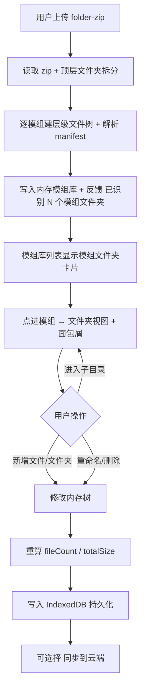
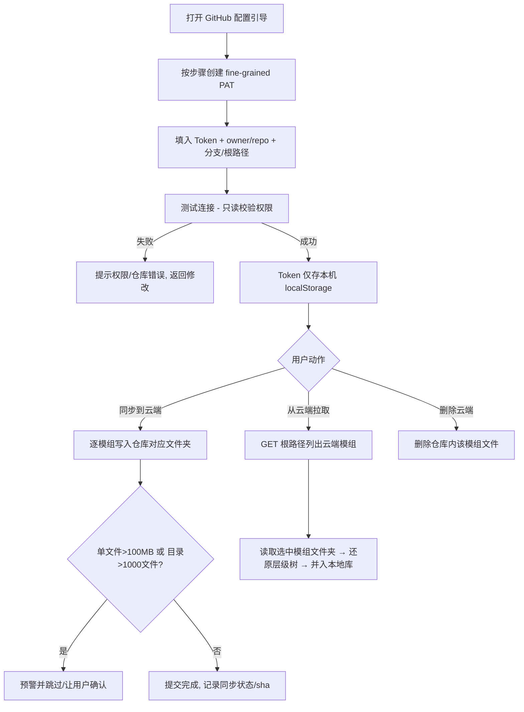
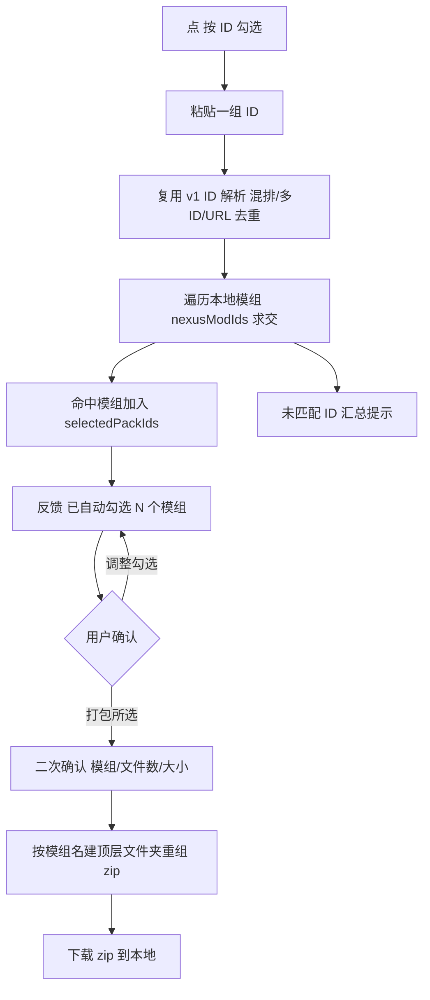
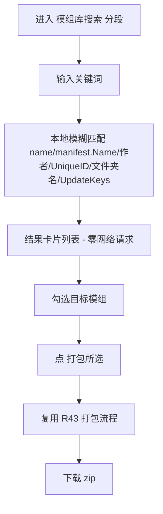

# 星露谷模组下载助手 — 增量 PRD（v4.0）

> 文档版本：v4.0（增量文档）　|　产品经理：许清楚（Xu）　|　基线：v3.0 PRD（R32–R45 已交付）
> 阅读约定：本文**只描述本次变更**，不重复 v1 / v2 / v3 全文。标注规则：
> **【修复】**= 修掉现有缺陷；**【改造】**= 在已有能力上换实现/换语义；**【新增】**= 现有版本没有、本次从零做；**【取消】**= 本次明确不实现。编号沿用 `R46` 起。
>
> ⚠️ **给架构师的改动面预警**：本次**不是最小改动**。它包含三处结构性重构——① 文件树模型（扁平 `FileNode[]` → 层级树）、② 本地持久化（内存 → IndexedDB）、③ 云端同步（新增 GitHub 私有仓库通道），并伴随多个模块的删除与新增。请按第 1.3 节的「重构 / 新增模块 / 删除 / 保持不动」清单界定边界，勿误判为打补丁。

---

## 1. 变更概述

**一句话**：修掉反复弹出的更新提示与上传理解偏差，把报错的「N 网搜索」换成「模组库本地搜索」，并把模组库从内存态升级为**可层级浏览、可增删改名、本地 IndexedDB 持久化 + GitHub 私有仓库云端同步**的模组管理器，同时补齐按 ID 勾选、清单导出与极简更新文案。

### 1.1 本次范围（用户三段长消息去重后 11 项，全部覆盖）

| 变更 | 主题 | 类型 | 对应需求 | 用户原话要点 |
| --- | --- | --- | --- | --- |
| 变更 1 | 更新提示反复弹 → 静默自动更新 | 【修复】 | R46 | "为什么一直出现那个更新提示"；点了也不消失；浅色主题下却是深色条很突兀 |
| 变更 2 | 上传理解纠正：主推 folder-zip | 【修复】 | R47 | "是将所有解压过的模组文件夹重新一起压缩的，不是压缩的所有模组压缩包" |
| 变更 3 | 删除 N 网搜索 → 模组库本地搜索 | 【改造】 | R48 | "它是干嘛用的，它是报错的"；"我想要的是我上传的模组能搜索出来让我选择并重新打包" |
| 变更 4 | 云端存储：本地 IndexedDB + GitHub 私有仓库双轨 | 【新增】 | R49 | "存在云端，永不失效，随时管理，能新增删除更新"；"本地+GitHub 都要" |
| 变更 5 | 文件夹树浏览（类 iOS 文件 App）+ 增删改名 | 【新增】 | R50 | "以模组文件夹展示…能点击进去浏览，能新增、删除，改文件或文件夹名"（反复强调） |
| 变更 6 | 按一组 ID 自动勾选对应模组 | 【新增】 | R51 | "给出一组ID的时候自动勾选对应的模组，让我能打包压缩下载" |
| 变更 7 | 更新检测文案极简两态 | 【改造】 | R52 | "已是最新版就提示已是最新版，有新版本就提示有新版本即可" |
| 变更 8 | 导出模组库清单 | 【新增】 | R53 | "需要增加导出模组库清单功能"（重复强调） |
| 变更 9 | N 网账号下载历史 | 【取消】 | R54 | "这个没有就算了" → 本次不实现 |
| 变更 10 | 推送 GitHub + 存资料库（iOS 可打开） | 【新增】 | R55 | "帮我推送到github进行托管，并保存在资料库（iOS 本地直接打开）" |
| 变更 11 | 更好的功能推荐 | 【新增】 | R56 | "有更好的功能也可以推荐给我" → 见第 7 节 |

### 1.2 受影响的现有条目（不展开重写，供对照）

- **删除**：`UpdatePrompt.tsx`（R46）、`ModSearch.tsx` / `SearchResultCard.tsx` / N 网 `search` 端点与 `SearchState` / `SearchResult` / `PendingDownload`（R48）。
- **重构**：`types/workspace.ts` 的 `FileNode` 文件树模型（R50）、`zipService.ts` 的解压建树与打包（R47/R50）、`LocalModCard.tsx` 与 `WorkspacePanel.tsx`（R48/R50）、`main.tsx` + `vite.config.ts` 的 SW 注册（R46）。
- **扩展**：`AppState` / `workspaceReducer`（R49/R50/R51）、`exportService.ts`（R53）、`UpdatePrompt` 相关状态清理（R46）。
- **保持不动**：下载 Tab、历史 Tab 全流程，`buildDownloadPlan` / `runPlanAndRecord` 的 v1 语义，Premium 降级策略，API Key 校验与非 Premium 铁律。

### 1.3 改动面清单（重构 vs 新增模块 vs 删除 vs 保持不动）

| 类别 | 具体对象 | 对应需求 |
| --- | --- | --- |
| **结构性重构** | 文件树模型（扁平带字节数组 → 层级 `FSTreeNode` 树）；`zipService` 的建树/打包双向改造；模组库 UI 从"卡片内平铺文件"改为"文件夹→子目录"两级/多级导航 | R47 / R50 |
| **结构性重构** | SW 注册链路去重（3 处 → 1 处），移除提示组件 | R46 |
| **新增模块** | `dbService`（IndexedDB 持久化）、`githubService`（REST 同步/配置/列举/删除）、`FileTreeExplorer`（层级浏览+增删改名）、`LibrarySearch`（本地/云端搜索）、`IdAutoSelect`（ID 勾选）、`GitHubSetupGuide`（token/仓库引导）、库清单导出 | R48–R53 |
| **删除模块** | `UpdatePrompt`、`ModSearch`、`SearchResultCard`、N 网 search 端点与相关类型、`PendingDownload`（search 语义） | R46 / R48 |
| **保持不动** | 下载 Tab、历史 Tab、`buildDownloadPlan`、`runPlanAndRecord`、Key 校验、Premium/降级、版本提醒只读 `files.json` 的约束 | 全局约束 |

---

## 2. 变更需求池（R46 起）

> P0 = Must have（用户明确要求）　P1 = Should have　P2 = Nice to have

| 编号 | 需求 | 类型 | 优先级 | 验收要点 |
| --- | --- | --- | --- | --- |
| **R46** | 静默自动更新，彻底移除更新提示条 | 【修复】 | **P0** | 任何情况下不再出现"发现新版本，点击更新"深色条；SW 仅一处注册；保留 `autoUpdate`，新版本自动生效；浅色主题无突兀深色浮层。 |
| **R47** | folder-zip 上传理解纠正与主推 | 【修复】 | **P0** | 主推"把 Mods 文件夹里所有模组文件夹一起压缩的 zip"；按顶层文件夹拆成多个模组；解析后反馈"已识别 N 个模组文件夹"；单包入口降级为次要并说明区别。 |
| **R48** | 删除 N 网搜索，替换为模组库本地搜索 | 【改造】 | **P0** | 无任何 N 网 `search.json` 调用；输入关键词从已上传模组字段模糊匹配；结果可勾选、可直接打包；旧 422 报错区域消失。 |
| **R49** | 双轨存储：IndexedDB 本地持久化 + GitHub 私有仓库云端 | 【新增】 | **P0** | 本地库刷新/关闭后仍在；用户可配置 PAT + owner/repo；可上传/列举/删除/更新/下载回本地；token 仅存本机 localStorage；数据只在用户自己的私有仓库。 |
| **R50** | 文件夹树浏览（类 iOS 文件 App）+ 增删改名 | 【新增】 | **P0** | 模组库列表只显示模组文件夹卡片；点进逐级浏览子目录；每个条目支持新增文件/新增文件夹/重命名/删除；面包屑返回上级；改动作用于内存树并可持久化/同步。 |
| **R51** | 按一组 ID 自动勾选 | 【新增】 | **P0** | 复用 v1 ID 解析（混排/多 ID）；按 `nexusModIds` 匹配自动勾选；列出匹配不到的 ID；确认后打包下载 zip。 |
| **R52** | 更新检测文案极简两态 | 【改造】 | P1 | `latest` → "已是最新版"，`outdated` → "有新版本"（可附版本号）；删除冗长说明；检测逻辑不变（只提示、不自动下载、兼容非会员、只读 `files.json`）。 |
| **R53** | 导出模组库清单 | 【新增】 | P1 | 导出本地 + 云端已同步模组；MD / JSON / CSV 三格式；字段含模组名/文件夹名/作者/版本/Nexus ID/更新状态/文件数/大小/来源/加入时间；纯前端生成。 |
| **R54** | N 网账号下载历史 | 【取消】 | — | **本次不实现**：官方 API 无下载历史端点，用户回复"没有就算了"。历史 Tab 保持 v2 已交付形态，不新增此项。 |
| **R55** | 推送 GitHub + 存资料库（iOS 可打开） | 【新增】 | **P0** | 代码推送到 GitHub 仓库（账号 LightSB，主理人用已连接通道完成）；成品存资料库；交付物需可在 iOS Safari 直接打开使用。记为交付要求，非应用内功能。 |
| **R56** | 更好的功能推荐 | 【新增】 | P2 | 给出 5–8 条高价值增强建议，每条说明价值，供主理人挑选排期；详见第 7 节。 |

---

## 3. 各变更详细说明与交互/视觉预期

### 3.1 R46【修复】静默自动更新，彻底移除更新提示条（用户反复抱怨）

**根因（主理人已定位）**：Service Worker 被注册 3 次且策略互相冲突——
1. `main.tsx` 中 `registerSW({ immediate: true })`；
2. `UpdatePrompt.tsx` 中 `useRegisterSW()`；
3. 构建配置 `vite.config.ts` 的 `registerType: 'autoUpdate'`。

三者叠加导致 `needRefresh` 反复为 `true`，点击"更新"也不消失；且提示条用 `bg-slate-800/95` 深色样式，在默认浅色田园风里非常突兀。

**修复方案（架构师按此收敛为单一注册源）**：
- **删除** `src/components/ui/UpdatePrompt.tsx`，并从 `App.tsx` 移除其 import 与 `<UpdatePrompt />` 渲染。
- **去重注册**：`useRegisterSW` 与 `registerSW` 只能保留一处。推荐保留 `main.tsx` 的 `registerSW({ immediate: true })` 作为**唯一注册入口**，`vite.config.ts` 维持 `injectRegister: null` 不自动注入；或改为插件自动注入（二选一，架构师定，但**必须全局唯一**）。
- **保留** `registerType: 'autoUpdate'`：新版本在后台静默完成 skipWaiting + 激活，用户无感；不再有任何"发现新版本"UI。
- **不新增**任何替代提示条/Toast/badge——用户要的是"以后不再弹这个条"。

**交互/视觉预期**：从任何页面进入、升级版本后，界面上都不再出现底部深色浮层；浅色主题保持纯净。

### 3.2 R47【修复】folder-zip 上传理解纠正与主推

**用户反复强调的语义**：上传的 zip 是"把已解压的各个模组文件夹**整体重新一起压缩**"得到的——即 zip 顶层是**多个模组文件夹**，每个文件夹内是该模组的散文件（manifest.json、Content Pack 等）。这正是现有 `folder-zip` 模式，工具必须正确按顶层文件夹拆成多个模组，**不能被误当作"一堆模组 zip 压缩包"**。

**改动要点**：
- **入口文案改造**（`UploadZone.tsx`）：主按钮文案改为明确表述——"上传你把 Mods 文件夹里**所有模组文件夹一起压缩**的 zip"，副文案"工具会按每个顶层文件夹识别为一个模组"。原有的"上传单个模组 zip（可多选）"降级为次要入口（次要按钮/折叠的"更多方式"），并说明适用场景（单个模组单独分发时）。
- **识别反馈**：解析完成后 Toast/摘要明确显示"已从 zip 中识别 N 个模组文件夹：A、B、C…"；若 zip 顶层是文件而非文件夹，仍按现有兜底逻辑处理并提示，但**不主动引导**用户用这种方式。
- **识别正确性**：沿用并加固 `zipService.parseModsZip` 的 folder-zip 分支（过滤 `__MACOSX` / `.DS_Store` / `._*` 系统项、以顶层文件夹为模组根、剥离前缀建树），保证与用户实际压缩方式一致；增加一条单测/验收用例覆盖"顶层多文件夹"结构。
- **不涉及**：不改变解压与打包的字节内容，不修改用户文件。

### 3.3 R48【改造】删除 N 网搜索，替换为模组库本地搜索

**用户真实需求**：不是搜 N 网，而是**搜索自己上传的模组**——"我上传的模组能在网页上搜索出来让我选择并可以重新打包想要的那些模组为压缩包"。根因是 `mods/search.json` 端点在 N 网公开 API v1 中不存在，必然 422。

**改动要点**：
- **删除**：`ModSearch.tsx`、`SearchResultCard.tsx`、`config` 中的 `search` 路径与 `gameId`（如无其他用途）、`nexusApi.searchMods`、`types/workspace.ts` 的 `SearchState` / `SearchResult` / `PendingDownload`（search 语义整体移除）。`WorkspacePanel.tsx` 三分段中的第 ② 段由"N 网搜索"改为"**模组库搜索**"；顶部"更新检测与 N 网搜索需要 API Key"的提示文案随之改为"更新检测需要已校验的 API Key；搜索与打包本地模组无需 Key"。
- **新增本地搜索**（`LibrarySearch`）：输入关键词，**零网络请求**，从已上传模组（含云端已同步的模组元数据）中模糊匹配字段：`name`（模组名）、`manifest.Name`、`author`、`uniqueId`、`rootFolder`（文件夹名）、`updateKeys` / `nexusModIds`（UpdateKeys）。匹配大小写不敏感、实时过滤、清空恢复。
- **结果交互**：每条结果显示模组名/作者/文件夹名/更新状态/文件数，带勾选框（复用 `selectedPackIds`）；勾选后可点"打包所选"直接跳到第 ③ 段打包。搜索结果**就是本地模组本身**，有完整文件树，与 v3 的"搜索结果无文件树、不参与打包"边界相反——此处明确可打包。
- **视觉**：沿用浅色田园风卡片与 chip 规范；空结果显示"没有匹配的模组，换个关键词试试"；无关键词时显示最近加入的模组列表（或全部）。

### 3.4 R49【新增】双轨存储：本地 IndexedDB 持久化 + GitHub 私有仓库云端（核心）

**用户诉求**："上传的模组能存在云端，永不失效，并让我随时管理，能在云端新增删除或更新。"主理人拍板双轨——本地库为主工作区，GitHub 私有仓库为云端。

#### 3.4.1 轨道 A：本地 IndexedDB 持久化
- 用 IndexedDB（如库名 `stardew-mod-helper`，store `mods` / `meta`）持久化整个模组库：每个模组的元数据 + 层级文件树（含文件字节，以 `Blob` / `ArrayBuffer` 结构化克隆存储）。
- 同一设备刷新/关闭后重开，模组库完整恢复（文件树、勾选、更新缓存、加入时间）。
- 替代 v3 的 Q1 决策（v3 只存内存、刷新即丢）；模组文件**仍不进 localStorage**（体积原因）。
- 写入时机：上传解析完成、文件树增删改名、更新检测结果写入、同步状态变更时分别落库；提供"清空本地库"入口（二次确认）。

#### 3.4.2 轨道 B：GitHub 私有仓库云端（用户自助配置 PAT）
**技术约束（主理人已验证，必须写入实现）**：
- 纯前端浏览器直连 GitHub REST API（`https://api.github.com`），认证用用户自己的 **fine-grained Personal Access Token**：权限只需 **Contents: read/write**，且**仅授权指定的一个私有仓库**（最小权限原则）。
- Token **仅存本机 `localStorage`**，绝不外传、不进日志、不进 Toast 详情、不写入模组元数据、不随任何请求发往非 GitHub 域名；提供"清除 token"按钮。
- **API 限制需在 UI 明确提示**：GitHub Contents API 单文件 ≤ **100MB**；目录列表单次 ≤ **1000 文件**。星露谷模组多为小文件，但超过阈值时给出"文件过大/过多，可能同步失败"的预警，并允许跳过该文件/该模组。

**配置引导（`GitHubSetupGuide`，用户要"简明步骤说明"）**：
1. 打开 GitHub → Settings → Developer settings → Personal access tokens → **Fine-grained tokens** → Generate new token；
2. Repository access 选 **Only select repositories** → 只勾选目标私有仓库；
3. Permissions → **Contents: Read and write**；设置过期时间；生成并复制 token；
4. 回到工具，填入 **Token**、**owner/repo**（如 `LightSB/my-stardew-mods`）、可选分支（默认 `main`）与仓库内根路径（默认 `mods/`）；
5. 点"测试连接"→ 工具发一个只读请求验证 token/仓库权限，成功显示"已连接"。

**云端操作（`githubService`）**：
- **上传模组**：把该模组文件树写入仓库对应文件夹（`{basePath}/{folderName}/...`），逐文件走 Contents API（新建 PUT / 更新带 `sha`）；空目录用占位文件保持结构。
- **列出云端模组**：GET 根路径目录，解析顶层文件夹为云端模组清单。
- **删除**：删除仓库内该模组文件夹下的文件。
- **更新**：比对本地与云端（按文件大小/时间戳/`sha`），仅上传变更文件。
- **下载回本地**：把云端某模组文件夹读回，还原为层级树并入本地库。

**本地与云端的关系（主理人推荐）**：本地 IndexedDB 库为**主工作区**；提供显式动作"**同步到云端**"（本地→GitHub）与"**从云端拉取**"（GitHub→本地），不做自动双向实时合并（避免冲突与误覆盖）。冲突时以用户显式选择为准（见第 9 节 Q3）。

**隐私铁律延续**：模组文件默认只在本地；**只有用户主动点"同步到云端"时**，才把文件发送到**用户自己配置的私有仓库**；工具不持有云端账号、不中转、不缓存 token 于服务器。

### 3.5 R50【新增】文件夹树浏览（类 iOS 文件 App）+ 增删改名（UI 改造重点）

**用户反复强调**：模组库只显示"模组文件夹"卡片，点进去显示顶层文件夹/文件列表，逐级点进子目录；每个条目可新增文件、新增文件夹、重命名、删除；面包屑返回上级。

**交互与视觉预期**：
- **第一级（模组库列表）**：一张卡片 = 一个模组文件夹（显示文件夹名/模组名、来源徽标、更新状态 chip、文件数/大小）。卡片主点击区"进入浏览"，勾选框独立（打包用，不与进入冲突）。**不再平铺所有文件**。
- **第二级及更深（文件浏览器 `FileTreeExplorer`）**：点进模组后进入一个"文件夹视图"——
  - 顶部**面包屑**：`模组根 / 子目录A / 子目录B`，点任一级返回；左侧"返回上级"。
  - 列表逐项显示当前目录下的**文件夹（优先）与文件**，文件夹用 folder 图标、文件按扩展名给图标；每项显示大小（文件）/子项数（文件夹）。
  - 点击文件夹逐级进入；点击文件可预览（文本文件显示内容摘要，二进制显示"二进制文件，仅可下载/删除"，见 Q6）。
  - **操作栏**（顶部或长按菜单，iOS 友好 ≥44px 触控区）：`+ 文件`（从本机选择文件加入当前目录）、`+ 文件夹`（输入名称新建）、对每个条目提供`重命名`、`删除`（删除文件夹含子内容需二次确认）。
  - 视觉沿用浅色田园风：白色/奶油卡片、草绿主按钮、柔和绿影、清晰层级缩进；空文件夹显示"此文件夹为空"。
- **作用范围**：所有增删改名先作用于**内存中的层级树**，实时重算 `fileCount` / `totalSize`；随后由 R49 落库到 IndexedDB，并可"同步到云端"。重命名文件夹时其下所有路径前缀同步更新（树结构天然处理）。
- **与打包衔接**：编辑后的树即打包源（R43 复用），保证"编辑所见即打包所得"。

> 架构师提示：这是本次 UI 与数据模型的双重重构核心。现有 `LocalModCard.tsx` 中"包含 N 个文件"的平铺 `<ul>` 要整体替换为导航式浏览器；`FileNode` 扁平数组要改为层级树（第 5.1 节）。

### 3.6 R51【新增】按一组 ID 自动勾选

**用户诉求**："当我给出一组ID的时候自动勾选对应的模组，让我能打包压缩下载到本地。"

**交互预期**：
- 在模组库提供入口"**按 ID 勾选**"（按钮/展开输入区），占位提示"粘贴模组 ID，支持多个混排（逗号/空格/换行/URL）"，复用 v1 的 ID 解析（`extractIds` 语义）得到 `inputIds`。
- 对每个本地模组，取其 `nexusModIds`（由 `manifest.UpdateKeys` 的 `Nexus:<id>` 提取、去 `@子键`、去重），与 `inputIds` 求交；命中则加入 `selectedPackIds`。
- **匹配不到**的 ID 汇总提示："以下 ID 未在模组库中找到对应模组：1915、2400"，不阻断其余勾选。
- 结果反馈："已自动勾选 N 个模组"；用户可手动微调勾选，点"打包所选"→ 走 v3 R43 打包流程下载 zip。
- 全程纯本地匹配，不调用任何 N 网端点。

### 3.7 R52【改造】更新检测文案极简两态

**改动**：把 `LocalModCard.tsx` 的状态 chip 文案简化——
- `latest` → **"已是最新版"**（不再附冗长说明/检测时间副文案）；
- `outdated` → **"有新版本"**，可附 `v{latest.version}`（如"有新版本 v1.2.3"）。
- 删除卡片内 `checkError` 的冗长灰底说明条在 `latest` / `outdated` 下的展示（`unknown` 可保留一行简短原因，或一并极简化，见 Q7）。

**不变**：检测逻辑（UpdateKeys → Nexus modId → 只读 `files.json`、只提示不自动下载、兼容非会员、缓存/节流）完全保持 v3 R37/R38/R39/R45 行为，不动 `updateService.ts` 的比对语义。

### 3.8 R53【新增】导出模组库清单

- **触发位置**：模组库顶部工具栏"导出清单"按钮（与"按 ID 勾选"并列），点击选格式 MD / JSON / CSV。
- **数据源**：本地 IndexedDB 库 + 云端已同步模组（去重合并，标注来源）。
- **字段（必备）**：模组名、文件夹名、作者、版本、Nexus ID（多个用逗号连接）、更新状态、文件数、大小、来源（`folder-zip` / `single-zip` / `cloud`）、加入时间。
- **实现**：沿用 `exportService.ts` 的"一份组装数据 → 三格式渲染 → Blob + `a.download`"风格，新增 `buildLibraryExportData(...)`；CSV 加 UTF-8 BOM，MD/JSON 规范同 v2；文件名如 `stardew-mod-library-YYYY-MM-DD.{md|json|csv}`。空库不可导出并提示。

### 3.9 R54【取消】N 网账号下载历史（本次不实现）

官方 API 无下载历史端点，用户回复"这个没有就算了"。**本次明确不实现**，历史 Tab 保持 v2 已交付形态（搜索/筛选/再次下载/导出/清空），不新增 N 网账号历史能力，也不为此引入任何新端点或登录流程。

### 3.10 R55【新增·交付】推送 GitHub + 存资料库（iOS 可打开）

- **代码托管**：主理人用已连接通道把代码推送到 GitHub 仓库（账号 `LightSB`）。
- **成品保存**：把交付物保存到资料库，供 iOS 打开。
- **iOS 说明**：工具是依赖在线 API 的 PWA，"iOS 本地直接打开"的落地形态由主理人在交付阶段处理（在线链接"添加到主屏幕" + 资料库存链接/产物）。PRD 只要求：**交付物需可在 iOS Safari 直接打开使用**。
- 该项为工程交付动作，非应用内功能需求。

### 3.11 R56【新增】更好的功能推荐

见第 7 节（给出 8 条高价值建议，每条说明价值，供挑选）。

---

## 4. 关键流程（Mermaid）

### 4.1 流程①：上传 → 解析 → 文件夹树浏览 → 编辑 → 持久化

### 4.2 流程②：配置 GitHub → 同步到云端 → 拉取

### 4.3 流程③：输入 ID → 自动勾选 → 打包下载

### 4.4 流程④：模组库搜索 → 勾选 → 打包

---

## 5. 数据结构预期（字段契约，非 TS 代码）

> 以下为架构师实现时的字段契约建议；命名可按项目风格微调，但语义与关系需保持一致。**本次文件树模型是从 v3 的扁平结构重构为层级树**，务必按此设计。

### 5.1 文件树节点（重构：`FileNode` → `FSTreeNode`）

v3 的 `FileNode[]` 是扁平数组，每个节点带完整相对 `path` + `data` 字节。v4 改为**真正的层级树**，以支持逐级浏览与增删改名：

| 字段 | 说明 |
| --- | --- |
| `nodeId` | 节点唯一 id（用于重命名/删除定位，避免用 path 做 key 因改名会变） |
| `name` | 名称（文件名或文件夹名，仅当前层级，不含路径） |
| `kind` | `'dir' \| 'file'` |
| `children` | `FSTreeNode[]`，仅 `dir` 有；`file` 为空/缺省 |
| `data` | 文件字节（`Uint8Array` / `Blob` / `ArrayBuffer`），仅 `file` 有；IndexedDB 中以可结构化克隆形式存储 |
| `size` | 文件字节数；`dir` 为 0（或其子树汇总，UI 展示用） |
| `mime` | 可选，用于文件预览类型判断 |

- `LocalMod.fileTree` 由 `FileNode[]` 改为 `FSTreeNode[]`（模组根下的层级树）。
- **建树**：`zipService` 解压时按 `/` 分段构造父子关系（替代 v3 的扁平 path + dir 标记）。
- **打树还原**：打包时递归遍历树拼接相对路径（替代 v3 直接读 `node.path`）。
- **增删改名语义**：新增文件=在目标 `dir.children` 插入 `file` 节点；新增文件夹=插入空 `dir`；重命名=改 `name`（子树路径随渲染时拼接自动更新）；删除=移除节点及其子树。操作后重算 `fileCount` / `totalSize` 并标脏。
- **迁移**：v3 内存态无持久化，无历史数据迁移负担；如 IndexedDB 中已有 v3 结构需版本升级时做一次扁平→层级转换（建议 v4 首次为空库，可不做）。

### 5.2 GitHub 配置对象（`GitHubConfig`，仅本机）

| 字段 | 说明 |
| --- | --- |
| `token` | fine-grained PAT，**仅存 localStorage**；不进 IndexedDB、不进日志、不外传 |
| `owner` | 仓库所有者（如 `LightSB`） |
| `repo` | 私有仓库名 |
| `branch` | 分支，默认 `main` |
| `basePath` | 仓库内模组根目录，默认 `mods/` |
| `connectedAt` | 测试连接成功时间（ISO） |
| `status` | `unconfigured` / `connected` / `error` |
| `error` | 连接/权限错误文案 |

- 提供"清除配置/token"动作；token 变更后需重新测试连接。

### 5.3 云端模组映射（`CloudModRef`）

| 字段 | 说明 |
| --- | --- |
| `folderName` | 仓库内文件夹名（对应本地 `rootFolder` / 安全化后的模组名） |
| `remotePath` | 完整路径 `{basePath}/{folderName}` |
| `localModId` | 关联本地模组 id（未拉取到本地时为空） |
| `lastSyncedAt` | 最近同步时间（ISO） |
| `syncStatus` | `synced` / `local-ahead` / `remote-ahead` / `conflict` / `error` |
| `fileShaMap` | 文件相对路径 → GitHub blob `sha`（用于增量更新与冲突判断） |
| `fileCount` / `totalSize` | 云端快照，供列表展示与差异比对 |

### 5.4 IndexedDB 存储结构

| Store | Key | 内容 |
| --- | --- | --- |
| `mods` | `id`（本地模组 UUID） | 模组元数据（name/author/version/manifest/updateKeys/nexusModIds/rootFolder/source/uniqueId/updateStatus/updateInfo/lastCheckedAt/addedAt）+ `fileTree`（层级树，含字节）+ `fileCount` / `totalSize` |
| `meta` | 固定 key | `selectedPackIds`、更新缓存配置、`schemaVersion`、GitHub **非敏感**配置（owner/repo/branch/basePath/status，**不含 token**） |
| （可选）`cloudMods` | `folderName` | `CloudModRef` 缓存，加速云端列表展示 |

- **token 例外**：只放 `localStorage`，不放 IndexedDB（见 5.2）。
- 数据库版本用于结构升级；`schemaVersion` 便于后续迁移。

### 5.5 ID 勾选匹配规则

| 步骤 | 规则 |
| --- | --- |
| 解析输入 | 复用 v1 `extractIds`：纯数字 / URL 末尾数字 / 逗号·空格·换行混排 → 去重得 `inputIds`（number[]） |
| 模组侧标识 | 每个模组 `nexusModIds` = 其 `manifest.UpdateKeys` 中 `Nexus:<id>` 提取、去 `@子键`、数字校验、去重 |
| 匹配 | `inputIds ∩ mod.nexusModIds ≠ ∅` → 该模组加入 `selectedPackIds` |
| 未匹配 | `inputIds` 中未被任何模组命中的 id → 汇总展示，不阻断 |
| 结果 | 反馈"已自动勾选 N 个模组"；用户可手动微调后打包 |
| 边界 | 纯本地计算，零 N 网请求；勾选仅作用于 `selectedPackIds`（单一数据源），不写回模组对象 |

---

## 6. 隐私、性能与平台约束

### 6.1 隐私（强约束，延续铁律）
- **模组文件不外传**：解压、浏览、编辑、打包、本地持久化全部在浏览器本地完成；**只有用户主动点"同步到云端"时**，文件才发往用户自己配置的 GitHub 私有仓库；工具不中转、不持有云端账号。
- **PAT 仅存本机 localStorage**：不外传、不进日志/Toast/元数据/埋点、不随非 GitHub 请求发送；提供清除入口。
- **API Key 不进日志/远端**：沿用 v1 约束，只随必要 Nexus 请求发往官方 API（更新检测的 `files.json`）。
- **无第三方埋点 / 分析 SDK**；新增依赖以纯前端库为主（IndexedDB 用原生 API 或轻量封装）。

### 6.2 性能与平台约束
- **GitHub 限制**：Contents API 单文件 ≤ 100MB、目录列表单次 ≤ 1000 文件；UI 在上传/同步前预警大文件/大目录，超限跳过或需用户确认。
- **IndexedDB 配额**：文件字节入 IndexedDB 占用设备存储；大库需提示存储占用，提供"清空本地库"；iOS Safari 配额紧张时给出降级提示。
- **iOS 限制**：文件选择/下载走 Safari 能力；多文件连续下载可能被拦截（沿用 v1 逐个触发 + 提示）；"iOS 本地直接打开"由主理人在交付阶段以在线链接 + 添加到主屏幕 + 资料库存链接/产物处理（见 R55）。
- **端侧能力边界**：无后端、无法绕过 GitHub 大小/速率限制、无法做 N 网账号下载历史（R54 取消）；云端同步依赖用户自助 PAT，工具不代管凭证。
- **回归底线**：下载 Tab / 历史 Tab 零回归；`buildDownloadPlan` / `runPlanAndRecord` 语义不变；版本提醒只读 `files.json`、不调 `download_link.json`。

---

## 7. 增强功能推荐（对应【邀请 11】）

> 用户要求 5–8 条高价值建议、每条说明价值。以下 8 条供主理人挑选排期（均为建议，**不进本次 P0**；如采纳可转 P1/P2 并另立编号）。

| # | 增强建议 | 价值 |
| --- | --- | --- |
| A1 | **云端仓库一键全量备份 / 恢复** | 一键把整个模组库推到 GitHub、一键从云端恢复，换机/重装不丢，强化"永不失效"承诺。 |
| A2 | **模组冲突检测（同 UniqueID / 同文件路径覆盖）** | 打包前提示重复 UniqueID 或文件覆盖风险，避免装进游戏后互相覆盖导致失效。 |
| A3 | **文件夹树内搜索文件** | 在文件浏览器里按文件名过滤当前及子目录，快速定位某个文件，弥补层级浏览的深埋痛点。 |
| A4 | **批量重命名** | 对选中多个文件/文件夹按规则批量改名，减少逐个操作，契合"改文件或文件夹名"诉求的进阶版。 |
| A5 | **打包前预览目录结构** | 生成 zip 前展示最终目录树，确认"所见即所得"，降低打包结构出错率。 |
| A6 | **重复文件检测** | 扫描库内内容相同的文件（哈希），提示清理冗余，节省本地/云端存储。 |
| A7 | **云端版本历史回滚（利用 GitHub commit history）** | 借助 GitHub 提交历史，把某模组回滚到旧版本，弥补"更新后不兼容"的痛点。 |
| A8 | **操作撤销 / 离线可用（PWA 缓存库元数据）** | 增删改名支持撤销降低误操作成本；PWA 缓存模组库元数据使离线也能浏览管理，提升可用性。 |

> 上述覆盖了用户举例的主要方向；如主理人希望扩展，备选还有：模组预览图渲染、SMAPI 版本基线提醒强化、导出为可直接分享的清单链接等。

---

## 8. 验收清单（本次新增）

**更新提示（R46）**
- [ ] 从任意页面进入、升级版本后，均不再出现"发现新版本，点击更新"深色提示条。
- [ ] SW 注册全局仅一处；`UpdatePrompt.tsx` 与 `App.tsx` 引用已删除；`registerType: 'autoUpdate'` 保留且静默生效。
- [ ] 浅色主题下无突兀深色浮层。

**上传理解（R47）**
- [ ] 主按钮文案明确"把 Mods 文件夹里所有模组文件夹一起压缩的 zip"。
- [ ] 上传顶层多文件夹 zip，正确拆成多个模组并反馈识别数量。
- [ ] 单包入口降级为次要并说明区别；系统项（`.DS_Store` 等）被过滤。

**N 网搜索替换（R48）**
- [ ] 无任何 `search.json` 调用，422 报错区域消失；相关组件/类型/端点已删除。
- [ ] 输入关键词可从 name/manifest.Name/作者/UniqueID/文件夹名/UpdateKeys 模糊匹配，实时过滤。
- [ ] 结果可勾选、可直接打包；零网络请求。

**双轨存储（R49）**
- [ ] 刷新/关闭重开后模组库完整恢复（IndexedDB 生效）。
- [ ] 配置引导可创建 token/私有仓库并测试连接成功；token 仅存 localStorage，可清除。
- [ ] 可上传/列举/删除/更新/下载回本地；大文件/大目录有预警。
- [ ] 除主动同步外无模组文件外传；token 不进日志/元数据/非 GitHub 请求。

**文件夹树浏览（R50）**
- [ ] 模组库只显示模组文件夹卡片，不平铺所有文件。
- [ ] 点进模组逐级浏览子目录，面包屑可返回上级。
- [ ] 每个条目支持新增文件、新增文件夹、重命名、删除；删除文件夹有二次确认。
- [ ] 改动作用于内存树并重算统计，随后可持久化/同步；打包结果与编辑后树一致。

**ID 勾选（R51）**
- [ ] 粘贴一组混排 ID 能正确解析并自动勾选对应模组；未匹配 ID 汇总提示。
- [ ] 可手动微调勾选后打包下载 zip；全程零 N 网请求。

**更新文案 / 导出（R52 / R53）**
- [ ] `latest` 显示"已是最新版"，`outdated` 显示"有新版本 vX"；检测逻辑未变、只读 `files.json`。
- [ ] 库清单可导出 MD/JSON/CSV，字段齐全，空库有提示；CSV 中文不乱码。

**取消 / 交付 / 回归（R54 / R55 / 全局）**
- [ ] N 网账号下载历史未实现，历史 Tab 保持 v2 形态。
- [ ] 代码已推送 GitHub（LightSB）；交付物存资料库且可在 iOS Safari 打开。
- [ ] 下载 Tab / 历史 Tab 全流程零回归；Premium 降级、Key 校验、非 Premium 铁律未被破坏。

---

## 9. 待确认问题（含推荐）

| # | 问题 | 推荐 |
| --- | --- | --- |
| **Q1** | 文件树字节在 IndexedDB 中的存储形式（`Uint8Array` vs `Blob` vs `ArrayBuffer`）？ | 推荐 `Blob`（结构化克隆友好、省内存），读取时按需 `arrayBuffer()`；打包时直接喂给 JSZip。 |
| **Q2** | 本地与云端的同步触发方式（自动 vs 手动）？ | 推荐**全手动**（显式"同步到云端"/"从云端拉取"），不做自动双向合并，避免冲突与误覆盖。 |
| **Q3** | 同一模组本地与云端都改过（冲突）如何处理？ | 推荐弹窗让用户二选一："以本地覆盖云端" / "以云端覆盖本地"，并显示各自修改时间；不做静默合并。 |
| **Q4** | 仓库内目录结构用原 `rootFolder` 还是安全化后的模组名？ | 推荐**原 `rootFolder` 优先**（与游戏内目录一致），缺失时用安全化模组名；与 v3 Q7 打包兜底一致。 |
| **Q5** | token 过期或被撤销时如何处理？ | 推荐测试连接/同步失败时明确提示"token 失效或权限不足"，引导重新生成，不清除已同步数据。 |
| **Q6** | 文件浏览器点开二进制文件的行为？ | 推荐文本文件（json/txt/cfg 等）显示内容摘要；二进制仅显示"二进制文件，可下载/删除"，不做在线编辑。 |
| **Q7** | `unknown` 状态是否也极简化？ | 推荐保留一行简短原因（"缺少 manifest / 无 UpdateKeys"），但不显示冗长灰底说明条，保持卡片轻量。 |
| **Q8** | "模组库搜索"是否包含尚未拉取到本地、仅在云端的模组？ | 推荐**包含云端已同步模组的元数据**（可勾选后触发"从云端拉取"或直接纳入打包计划），但需注意其文件树不在本地——建议先拉取再打包（列为后续优化，见第 7 节 A1）。 |
| **Q9** | 本地库容量上限与超大库策略？ | 推荐设软阈值提示（如总大小 > 500MB 提示占用），不做硬性限制；提供"清空本地库"与"仅元数据缓存"选项。 |

---

> 交付说明（给架构师）：本次以 **R46–R56** 为边界，其中 **R46/R47 为修复、R48/R52 为改造、R49/R50/R51/R53/R55/R56 为新增、R54 为取消**。请重点把控三处结构性重构——① 文件树模型（扁平 → 层级）、② IndexedDB 持久化、③ GitHub 同步模块；并严格保证下载 Tab / 历史 Tab 零回归、Premium 降级与非 Premium / 隐私铁律延续。
