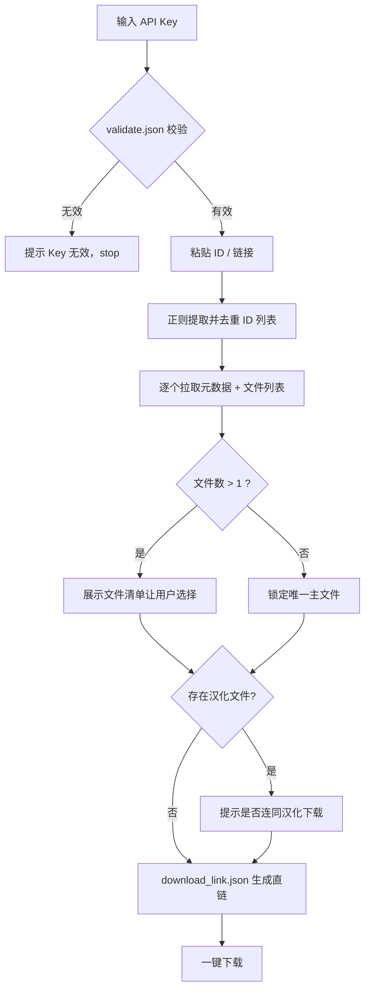
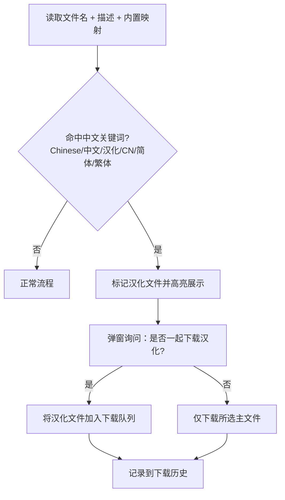

# 星露谷模组下载助手 — 简单 PRD

> 文档版本：v1.0　|　产品经理：许清楚（Xu）　|　模式：简单 PRD（不含竞品 / 市场分析）

---

## 1. 项目信息

| 项目 | 内容 |
| --- | --- |
| Language | 简体中文 |
| Programming Language | Vite + React + MUI + Tailwind CSS，构建为纯静态 **PWA**（无后端） |
| Project Name | `stardew_mod_helper` |
| 运行形态 | iOS Safari 打开后「添加到主屏幕」，以类原生 App 方式运行 |
| Game Domain | `stardewvalley`（Nexus Mods 星露谷固定域名） |

**原始需求复述**：开发一个能在 iOS 上运行的在线下载星露谷模组小工具。用户输入 N 网（Nexus Mods）API Key 后，可下载指定 ID 尾号（模组 URL 末尾纯数字）的模组；支持单个 / 多个尾号智能识别；有多个文件可供下载时让用户选择，单个主文件则直接下载；若存在中文汉化翻译则提示是否下载；同时说明所需前置模组。界面美观简洁，并鼓励产品经理提出更好的增强功能。

**关键术语**：
- **N 网** = Nexus Mods（www.nexusmods.com）
- **ID 尾号** = 模组页面 URL 末尾的纯数字 ID，如 `https://www.nexusmods.com/stardewvalley/mods/1915` 中的 `1915`。用户可能输入一个或多个，且可能混排 URL、逗号、空格、换行，工具需智能提取。

---

## 2. 产品定义

### 2.1 一句话价值主张

> 粘贴几个数字，就能在 iPhone 上一次看清星露谷模组的**文件、汉化、前置**，并尽可能一键装好。

### 2.2 产品目标（3 个正交目标）

| # | 目标 | 说明 |
| --- | --- | --- |
| G1 | **极简输入** | 用户粘贴数字 ID 或模组链接即可获得全部信息，零格式要求、零学习成本。 |
| G2 | **智能决策** | 自动识别中文汉化与前置依赖，帮助中文玩家「一次装齐、少踩坑」。 |
| G3 | **优雅下载** | Premium 用户一键直下；非 Premium 用户无缝降级到手动下载而不中断流程；全过程纯前端、数据留在本地。 |

### 2.3 用户故事（7 条）

1. **输入 Key 与校验**：作为一名首次使用的玩家，我想输入 N 网 API Key 并立即看到校验结果与会员状态，以便确认后续下载不会因认证问题失败。
2. **单个 ID 识别**：作为只想装一个模组的玩家，我想直接粘贴一个数字 ID 或整条模组链接，工具自动提取 ID 并展示信息，省去手动整理格式。
3. **多个 ID 识别**：作为想一次装一批模组的玩家，我想把多个 ID 混着 URL、逗号、空格、换行一起粘贴，工具能批量识别、去重并逐个展示。
4. **文件选择与单文件直下**：作为下载者，当模组有多个文件时希望让我挑选版本，而当只有一个主文件时直接开始下载，减少多余点击。
5. **汉化提示**：作为中文玩家，当模组存在中文汉化文件时希望被明确提示，并可选择连同汉化一起下载。
6. **前置说明**：作为新手玩家，我想在看模组时就知道它需要哪些前置（如 SMAPI 2400、Content Patcher 1915），避免装完却进不了游戏。
7. **下载降级**：作为非 Premium 用户，当无法生成 CDN 直链时，希望能改为「打开 N 网文件页面 / 复制下载链接」手动下载，流程不至于卡死。

---

## 3. 技术规范

### 3.1 技术约束（主理人已验证，必须遵守）

1. **纯前端可行（既定方向）**：Nexus API v1 已开启 CORS（`Access-Control-Allow-Origin: *`，允许 `apikey` 请求头），因此做成纯静态 PWA，无需后端；iOS Safari「添加到主屏幕」即可像 App 运行。
2. **API 基础**：Base URL `https://api.nexusmods.com/v1/`；认证用 HTTP 头 `apikey: <用户的key>`；建议同时携带 `Application-Name` 与 `Application-Version` 头；game domain 固定为 `stardewvalley`。
3. **关键端点**：
   - `GET /users/validate.json` — 校验 Key 有效性、是否 Premium
   - `GET /games/stardewvalley/mods/{modId}.json` — 模组元数据（名称、简介、作者、缩略图、BBCode 描述等）
   - `GET /games/stardewvalley/mods/{modId}/files.json` — 文件列表（file_id、file_name、version、category_name、is_primary、size_kb、uploaded_at、description 等）
   - `GET /games/stardewvalley/mods/{modId}/files/{fileId}/download_link.json` — 生成下载直链
4. **⚠️ 核心限制（必须设计降级）**：`download_link.json` 生成 CDN 直链**需要 Nexus Premium**；非 Premium 用户调用会失败。因此：元数据和文件列表（无需 Premium）照常获取；对非 Premium 用户，下载动作降级为「打开 N 网对应文件页面 / 复制下载链接」手动慢速下载；对 Premium 用户给出直链一键下载。**该降级策略的最终形态列为待产品决策（见第 7 节 Q1），并给出推荐方案。**
5. **常见前置知识（用于前置识别参考）**：SMAPI (2400) 几乎必需；Content Patcher (1915)、Generic Mod Config Menu (5098)、SpaceCore (1349)、Custom Music、Farm Type Manager (1924) 等为常见前置。识别来源：模组 BBCode 描述中的 Requirements / 前置段落解析 + 内置知识库。
6. **汉化识别思路**：文件列表中文件名含 `Chinese` / `中文` / `汉化` / `CN` / `简体` / `繁体` 等关键词，或描述中提及汉化 / 翻译，即判定存在中文翻译；可辅以内置已知汉化模组映射。

### 3.2 需求池（P0 / P1 / P2）

> P0 = Must have（用户明确要求）　P1 = Should have　P2 = Nice to have

| 编号 | 需求 | 优先级 | 说明 / 验收要点 |
| --- | --- | --- | --- |
| R01 | API Key 输入与校验 | **P0** | 调用 `validate.json`，明确展示「有效 / 无效 / 是否 Premium」 |
| R02 | 单个 ID 智能提取 | **P0** | 支持纯数字与整条 URL，正则提取末尾数字 |
| R03 | 多个 ID 智能提取与去重 | **P0** | 兼容逗号 / 空格 / 换行混排，去重后逐个处理 |
| R04 | 模组元数据展示 | **P0** | 名称、作者、简介、缩略图、BBCode 描述 |
| R05 | 文件列表展示 | **P0** | 文件名、版本、分类、大小、上传时间、主文件标记 |
| R06 | 多文件选择下载 | **P0** | 多文件时展示可选清单，用户选定后再下载 |
| R07 | 单主文件直接下载 | **P0** | 仅一个主文件时跳过选择，直接触发下载 |
| R08 | 下载直链生成 | **P0** | Premium 调用 `download_link.json` 得到直链并下载 |
| R09 | 汉化识别与提示 | **P0** | 文件名关键词 + 描述 + 内置映射；命中时展示汉化提示 |
| R10 | 汉化下载选择 | **P0** | 询问是否连同汉化文件一起下载 |
| R11 | 前置模组识别与说明 | **P0** | BBCode 解析 + 内置知识库（SMAPI 2400 等），随模组展示 |
| R12 | 非 Premium 下载降级 | **P0** | 打开 N 网文件页面 `.../mods/{modId}?tab=files&file_id={fileId}` / 复制下载链接 |
| R13 | 纯静态 PWA + iOS 适配 | **P0** | 无需后端；Safari 添加到主屏幕可运行 |
| R14 | 美观简洁的中文界面 | **P0** | 卡片式、深色主题、iOS 友好（详见 3.5） |
| R15 | API Key 本地安全存储 | P1 | 保存在设备本地（可一键清除），不上传任何服务器 |
| R16 | 下载历史 / 已安装清单 | P1 | 记录已下载的模组与文件、版本，避免重复 |
| R17 | 一键批量下载 / 队列 | P1 | 多 ID 场景汇总文件，统一触发下载 |
| R18 | 深色 / 浅色主题切换 | P1 | 默认深色，可切换 |
| R19 | SMAPI 版本兼容提醒 | P2 | 结合已知版本要求做风险提示 |
| R20 | 模组冲突提示 | P2 | 基于内置冲突规则给出预警 |
| R21 | 导出模组清单 | P2 | 导出 Markdown / CSV / JSON 便于备份分享 |
| R22 | BBCode 完整渲染 | P2 | 从纯文本摘要升级为富文本预览 |

### 3.3 主动推荐增强功能（用户明确邀请）

| # | 增强建议 | 价值 |
| --- | --- | --- |
| A1 | **API Key 本地安全存储** | 免去每次重新输入；密钥只存设备本地，契合隐私预期，提升复访率。 |
| A2 | **下载历史 / 已安装清单** | 记录已装模组与版本，避免重复下载，方便管理与回滚。 |
| A3 | **一键批量下载 / 下载队列** | 多 ID 场景下把主文件与汉化汇总后统一触发，大幅减少重复操作。 |
| A4 | **SMAPI 版本兼容提醒** | 提前预警版本不匹配导致的闪退 / 模组失效，降低新手挫败感。 |
| A5 | **模组冲突提示** | 基于已知冲突规则给出提示，减少用户排查时间。 |
| A6 | **深色主题 + 全中文界面** | 护眼、契合 iOS 视觉习惯与目标用户语言，提升质感。 |
| A7 | **导出模组清单（MD / CSV / JSON）** | 便于备份、迁移和分享给朋友，形成轻量「模组管理」价值。 |
| A8 | **预览图 / BBCode 简介渲染** | 下载前看清模组内容与效果，降低误装率。 |

> 优先级映射：A1→R15(P1)、A2→R16(P1)、A3→R17(P1)、A4→R19(P2)、A5→R20(P2)、A6→R14/R18(P0/P1)、A7→R21(P2)、A8→R04/R22(P0/P2)。

### 3.4 关键流程说明

**（1）正常下载流程（Premium）**



**（2）非 Premium 降级流程**

```mermaid
flowchart TD
    A[Premium = false] --> B[照常获取元数据与文件列表]
    B --> C[用户选择文件 / 主文件直选]
    C --> D[跳过 download_link.json<br/>避免无效调用]
    D --> E{用户偏好}
    E -- 打开网页 --> F[跳转 N 网文件页<br/>mods/{modId}?tab=files&file_id={fileId}]
    E -- 复制链接 --> G[复制下载链接到剪贴板]
    F & G --> H[UI 提示：N 网 Premium 可一键直下]
```

**（3）汉化跟随下载流程**



### 3.5 UI 设计稿描述

- **整体风格**：美观简洁、 iOS 友好；深色主题为默认，圆角卡片、柔和阴影、适度毛玻璃质感，充足留白与清晰层级。
- **顶部状态条**：API Key 状态徽标（未配置 / 已验证 / Premium），点击可展开设置入口。深色底 + 状态色点。
- **输入区**：大号多行输入框，占位提示「粘贴模组 ID 或链接，多个用逗号 / 空格 / 换行分隔」；下方实时显示「已识别 N 个 ID」。
- **模组卡片列表**：每个模组一张卡片，含缩略图、名称、作者、简介摘要、版本；标签行显示「主文件」「汉化可用」「需前置」等彩色标签，前置模组以可展开小条目列出。
- **文件选择区**：卡片内可展开文件清单（文件名 / 版本 / 分类 / 大小 / 时间 / 主文件标记），汉化文件高亮并附「一起下载」勾选。
- **下载操作区**：主按钮「一键下载」（Premium）或「打开 N 网下载 / 复制链接」（非 Premium），次级操作「复制下载链接」「查看详情」。
- **底部导航**：Tab 形式 —「下载」（主流程）与「历史」（已安装清单），符合 iOS 单手操作习惯。
- **反馈与空状态**：加载骨架屏、校验失败 / 网络错误的友好提示、无结果空状态插画。

---

## 4. 待确认问题（需用户 / 主理人拍板）

| # | 问题 | 我的推荐 |
| --- | --- | --- |
| **Q1** | **Premium 降级策略（核心）**：非 Premium 用户点击下载时，默认行为是什么？ | 推荐「自动降级」：跳过 `download_link.json`，直接提供「打开 N 网文件页 + 复制下载链接」双按钮，并在界面温和提示「Premium 可一键直下」。既不中断流程，又避免无效 API 调用。 |
| Q2 | API Key 的存储方式？ | 推荐存于设备本地（localStorage），提供「清除密钥」按钮；不写入任何远端。 |
| Q3 | BBCode 描述的呈现程度？ | v1 用纯文本摘要 + 关键词解析前置；完整富文本渲染列为 P2。 |
| Q4 | 内置前置 / 汉化知识库的初始数据范围与维护方式？ | v1 收录高频前置（SMAPI、CP、GMCM、SpaceCore、FTM 等）与常见汉化映射，随版本迭代更新。 |
| Q5 | 多文件批量下载在 iOS Safari 可能被拦截，如何处理？ | 采用逐个触发 + 提示「允许多个下载」；必要时引导用户复制链接。 |
| Q6 | 是否预留星露谷以外其他游戏的支持？ | v1 锁定 `stardewvalley`，架构上将 game domain 抽为配置，便于后续扩展。 |
